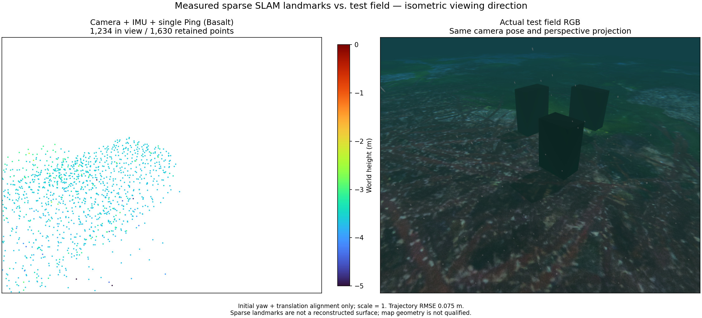
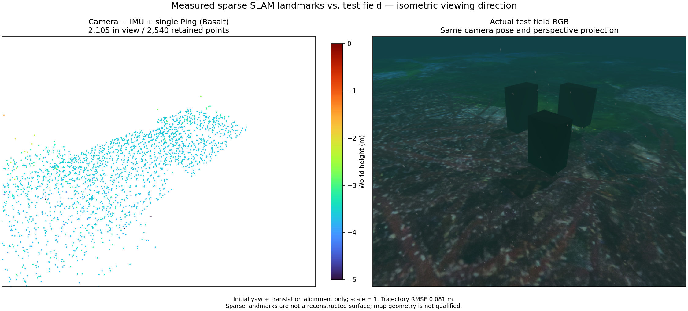

# Method comparison protocol / 방법 비교 규약

## Camera + IMU + single Ping: measured coverage

Basalt revision `0f3b2b52c807f70ff4e2973ce253c73329eea7bc`, with POSIM-SLAM VIO 0.1.7's
native Ping integration, produces 1,630 retained landmarks in this BlueROV run;
1,234 fall inside the comparison camera view. All retained points are supplied
to the plot. Both panels use the same perspective camera and isometric viewing
direction. Height colours span −5 to 0 m. The reference is captured after map
export in the same static test scene. Underwater attenuation, suspended particles
and seabed caustics are visible. Only initial yaw and translation align the
estimate for evaluation; scale remains one.

The 30-second trajectory RMSE is 0.075 m. This does not qualify map geometry:
the cloud concentrates on part of the seabed and does not reconstruct the three
box targets visible in RGB. This is a coverage failure example, not a completed
scene reconstruction. The vehicle camera footprint and mission path require
further assessment before comparing additional sensor combinations.

## 카메라 + IMU + 단일 Ping: 실제 관측 범위

Basalt 리비전 `0f3b2b52c807f70ff4e2973ce253c73329eea7bc`와 POSIM-SLAM VIO 0.1.7의
네이티브 Ping 융합을 사용한 BlueROV 주행입니다. 유지된 점 1,630개를
모두 그리기에 전달했으며, 그중 1,234개가 비교 카메라 시야 안에 있습니다.
두 패널은 같은 원근 카메라와 등각 시점을 사용합니다. 높이 범례는
−5~0 m입니다. RGB 참조는 같은 정적 시험장에서 지도 내보내기 후 촬영했습니다.
수중 거리 감쇠, 부유 입자와 해저 집광무늬가 보입니다. 평가에는 최초 방위각과
위치 정렬만 적용했고 축척은 1로 유지했습니다.

30초 경로 RMSE는 0.075 m입니다. 지도 형상은 검증을 통과하지 못했습니다.
점군이 해저 일부에 집중돼 있고 RGB의 세 상자형 표적은 재구성되지 않았습니다.
완성된 장면 복원이 아닌 관측 범위 실패 사례입니다. 다른 센서 조합을 비교하기
전에 차량 카메라의 관측 범위와 시험 경로를 추가 점검해야 합니다.

## Longer survey / 긴 조사 경로

An independent 7 m outbound survey of the same unchanged scene, using the same
library and effects, retains 2,540 points; 2,105 are in the comparison view.
Over 59.9 seconds the trajectory RMSE is 0.081 m. The same −5 to 0 m colour
range and camera parameters are used. Frustum/front-face checks on recorded
poses find potential exposure of all three targets, whereas the 3 m survey
never includes the third target. These checks do not establish visibility
through occlusion or feature trackability. The expanded cloud still fails to
recover the boxes. Longer coverage alone is insufficient; sparse feature maps
must not be presented as complete obstacle geometry.

같은 장면·라이브러리·환경 효과로 별도 수행한 7 m 전진 조사에서는
2,540점을 유지했고, 비교 시야 안에는 2,105점이 있습니다. 59.9초 경로
RMSE는 0.081 m입니다. 카메라 설정과 −5~0 m 색상 범위를 동일하게
유지했습니다. 기록된 자세의 시야·앞면 계산에서는 세 표적 모두 관측 가능
구간이 생겼습니다. 3 m 조사에서는 세 번째 표적이 시야 밖이었습니다.
이 계산만으로 가림 여부나 특징점 추적 가능성을 입증하지는 않습니다.
넓어진 점군도 상자 형상을 복원하지 못했습니다. 관측 거리 확대만으로는
충분하지 않으며, 희소 특징점 지도를 완전한 장애물 형상으로 제시할 수 없습니다.

## Protocol / 규약

Each completed sensor combination requires a paired figure: its generated SLAM
point cloud beside an RGB rendering of the actual test field. Both use a matching
elevated isometric viewpoint, metric extent and axes. Record camera pose and
projection; perspective RGB imagery must not be labelled orthographic. Keep the
same input scene and trajectory across methods, or disclose separate runs.

Use Turbo height colours with a shared blue-to-red scale in metres. State the
displayed and total point counts and retain gaps and outliers. An overview may
show the full cloud; the application's default remains 1,000 points, with
1,000 / 2,000 / 5,000 / full display choices.

The caption identifies sensors, exact library revisions, scene, time interval,
map segment, environment effects and any rigid evaluation-frame alignment.
Preserve the original cloud and input hashes. Report measured trajectory error
and geometry coverage when available. Ground truth is for evaluation and the
reference rendering; it is not an estimator input. Do not rescale the estimate
to fit the reference or substitute an illustration for measured output.

Publish the overview here and in WWW-POSIM's SLAM/fusion guide. Synthetic unit
tests and bounded solver examples do not qualify a completed live combination.
The sonar/IMU/Ping reference solver still needs live integration before its
comparison can be presented as an operational method.

완료된 센서 조합마다 생성된 SLAM 점군과 실제 시험장의 RGB 렌더링을
나란히 제시합니다. 두 영상은 높은 위치에서 내려다보는 등각 시점과 미터
단위 범위·축을 맞춥니다. 카메라 자세와 투영 방식을 기록하며, 원근 RGB
영상을 직교 투영으로 표기하지 않습니다. 방법 간에는 같은 장면과 경로를
사용하고, 별도 주행이면 이를 명시합니다.

높이는 파랑에서 빨강으로 이어지는 Turbo 색상과 공통 미터 단위 범례로
표시합니다. 표시 점 수와 전체 점 수를 밝히고 누락 영역과 이상점을
유지합니다. 비교 개요는 전체 점군을 사용할 수 있습니다. 앱 기본값은
1,000점이며 1,000 / 2,000 / 5,000 / 전체 선택을 유지합니다.

캡션에는 센서, 정확한 라이브러리 리비전, 장면, 시간 구간, 지도 구간,
환경 효과와 평가 좌표계의 강체 정렬 여부를 적습니다. 원본 점군과 입력
해시를 보존하고, 측정된 경로 오차와 형상 관측 범위가 있으면 함께
보고합니다. 정답값은 평가와 참조 렌더링에만 사용합니다. 추정 결과의
축척을 정답에 맞추거나 실제 출력 대신 삽화를 사용하지 않습니다.

비교 개요는 이 저장소와 WWW-POSIM의 SLAM·센서 융합 안내 양쪽에
게시합니다. 합성 단위 시험이나 짧은 구간의 최적화 예제만으로 실제 조합의
완료를 인정하지 않습니다. 소나·IMU·Ping 참조 최적화는 실제 운용 방법으로
비교하기 전에 라이브 스트림 연결이 필요합니다.
