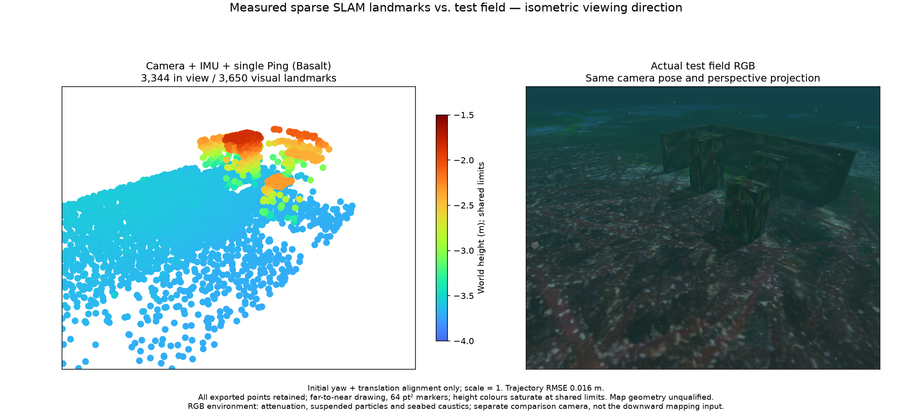
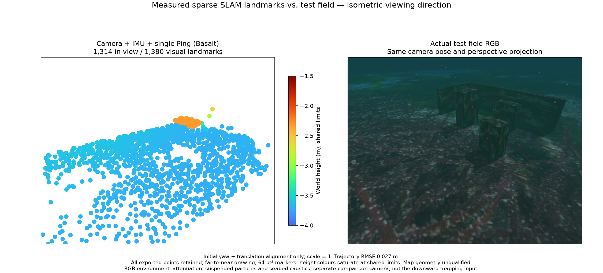
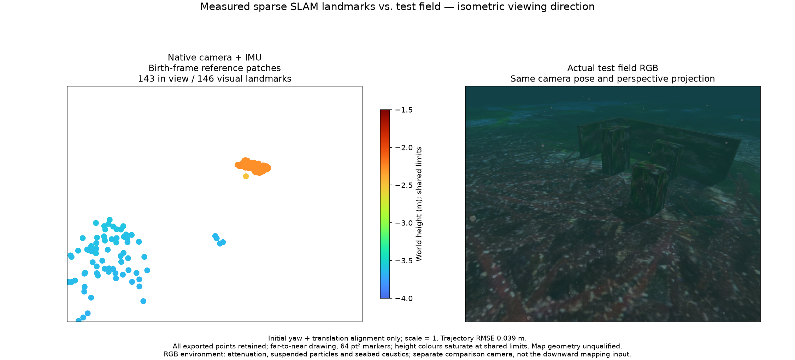
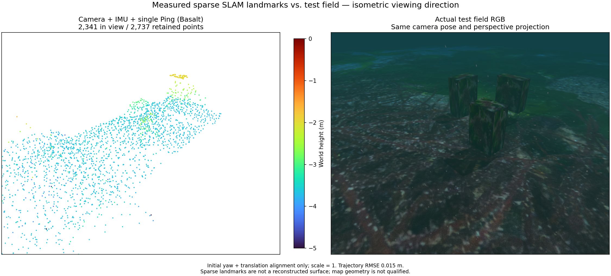
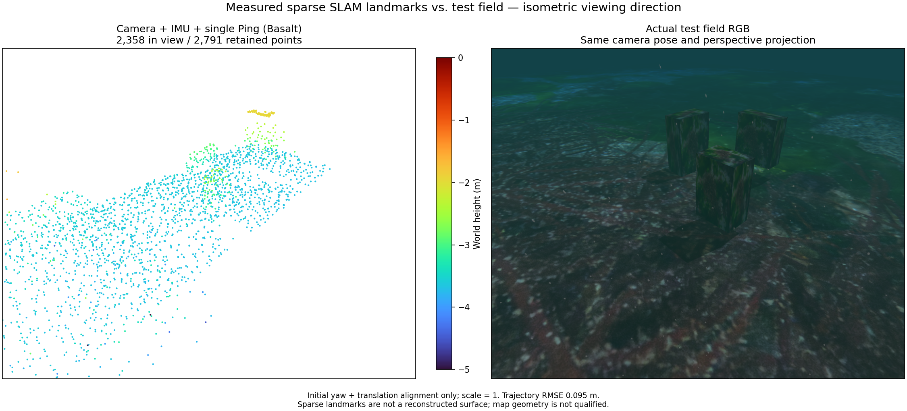

# Method comparison protocol / 방법 비교 규약

### Moving initialization and IMU-loss recovery

This 1× ROS replay uses POSIM-SLAM 0.1.0, Basalt
`0f3b2b52c807f70ff4e2973ce253c73329eea7bc`, patch tracking and the
RANSAC/known-gravity moving seed. Camera/raw-IMU/single-Ping recovery exports
1,380 points with 7.67 mm surface RMSE and 2.71 cm trajectory RMSE. The initial
3,650-point map has six errors beyond 10 cm, including a 47.03 cm maximum.
Recovery retains one point beyond 10 cm, maximum 11.97 cm. Every point is retained. This does not certify obstacle recognition, area
coverage or installed-app operation.

The figures share an isometric perspective camera, metre extent and −4 to
−1.5 m Turbo limits, with 64 pt² markers and visible/total counts. RGB includes
attenuation, particles and seabed caustics. Evaluation aligns initial
yaw/translation with scale one. Segments remain separate, so recovery cannot
show objects observed only before the outage.

[Input ownership and fresh-field evidence](validation/ordered-camera-inputs-20261028/README.md)
separates this recorded integration proof from native field acceptance. The
two-depth field tracks 112.5 s with 2.36 cm position RMSE, but its map remains
unavailable because no point meets the joint world-position uncertainty budget.

A separate camera/IMU-only numerical control retains the startup images.
With three recent IMU states it exports 24 points; sixteen states export 146.
The latter covers one target and nearby seabed while missing two targets and
both walls. This combination remains unqualified. The default stays at three
states. [Factor-window method and limits](https://github.com/IOES-Lab/POSIM-SLAM/blob/main/docs/diagnostics/visual-factor-window.md).
[Initialization method and limits](https://github.com/IOES-Lab/POSIM-SLAM/blob/main/docs/diagnostics/visual-inertial-seed.md).

### 이동 초기화와 IMU 유실 복구

이 1배속 ROS 기록 예시는 POSIM-SLAM 0.1.0, Basalt
`0f3b2b52c807f70ff4e2973ce253c73329eea7bc`, 패치 추적과 RANSAC·중력 크기
보정 초기값을 사용합니다. 카메라·원본 IMU·단일 Ping은 복구 후 1,380점을
내보내며 표면 RMSE 7.67mm, 경로 RMSE 2.71cm입니다. 초기 3,650점에는
10cm 초과점 6개와 최대 47.03cm 오차가 있습니다. 복구 지도에도 10cm 초과점
1개와 최대 11.97cm 오차를 그대로 보존합니다. 장애물
인식·면적 관측 범위·설치형 앱의 합격을 뜻하지 않습니다.

그림은 같은 등각 방향의 원근 카메라·미터 범위와 −4~−1.5m Turbo 높이
범위, 64 pt² 점을 사용하며 화면 안 점과 전체 점 수를 표시합니다. RGB는
감쇠·입자·해저 집광무늬를 포함합니다. 평가는 초기 방위각·위치만 정렬하고
축척은 1로 유지합니다. 각 구간은 별도이므로 복구 지도에는 유실 전에만
관측한 물체가 나타나지 않습니다.

[입력 순서와 새 현장 검증](validation/ordered-camera-inputs-20261028/README.md)은
이 기록 통합 시험과 네이티브 현장 합격을 구분합니다. 두 수심 현장은 112.5초를
추적하고 위치 RMSE 2.36cm를 기록하지만, 공동 세계 좌표 불확실성 한도를 통과한
점이 없어 지도를 제공하지 못합니다.

카메라·IMU만 사용하는 별도 수치 대조 시험은 초기 영상을 유지합니다.
IMU 이력 3개는 24점, 16개는 146점을 내보냅니다. 후자도 물체 하나와 해저
일부만 있어 두 물체와 두 벽이 빠집니다. 이 조합은 미검증이며 기본 이력은
3개로 유지합니다. [관측 이력 처리와 한계](https://github.com/IOES-Lab/POSIM-SLAM/blob/main/docs/diagnostics/visual-factor-window.md)를 참고하세요.
[초기화 방법과 한계](https://github.com/IOES-Lab/POSIM-SLAM/blob/main/docs/diagnostics/visual-inertial-seed.md)를 참고하세요.

## Camera + IMU + single Ping: measured coverage

Basalt revision `0f3b2b52c807f70ff4e2973ce253c73329eea7bc`, with POSIM-SLAM VIO 0.1.7's
native Ping integration, produces 1,630 retained landmarks in this BlueROV run;
1,234 fall inside the comparison camera view. All retained points are supplied
to the plot. Both panels use the same perspective camera and isometric viewing
direction. Height colours span −5 to 0 m. The reference is captured after map
export in the same static test scene. Underwater attenuation, suspended particles
and seabed caustics are visible. Only initial yaw and translation align the
estimate for evaluation; scale remains one.

The 30-second trajectory RMSE is 0.075 m. This does not qualify map geometry:
the cloud concentrates on part of the seabed and does not reconstruct the three
box targets visible in RGB. This is a coverage failure example, not a completed
scene reconstruction. The vehicle camera footprint and mission path require
further assessment before comparing additional sensor combinations.

## 카메라 + IMU + 단일 Ping: 실제 관측 범위

Basalt 리비전 `0f3b2b52c807f70ff4e2973ce253c73329eea7bc`와 POSIM-SLAM VIO 0.1.7의
네이티브 Ping 융합을 사용한 BlueROV 주행입니다. 유지된 점 1,630개를
모두 그리기에 전달했으며, 그중 1,234개가 비교 카메라 시야 안에 있습니다.
두 패널은 같은 원근 카메라와 등각 시점을 사용합니다. 높이 범례는
−5~0 m입니다. RGB 참조는 같은 정적 시험장에서 지도 내보내기 후 촬영했습니다.
수중 거리 감쇠, 부유 입자와 해저 집광무늬가 보입니다. 평가에는 최초 방위각과
위치 정렬만 적용했고 축척은 1로 유지했습니다.

30초 경로 RMSE는 0.075 m입니다. 지도 형상은 검증을 통과하지 못했습니다.
점군이 해저 일부에 집중돼 있고 RGB의 세 상자형 표적은 재구성되지 않았습니다.
완성된 장면 복원이 아닌 관측 범위 실패 사례입니다. 다른 센서 조합을 비교하기
전에 차량 카메라의 관측 범위와 시험 경로를 추가 점검해야 합니다.

## Longer survey / 긴 조사 경로

An independent 7 m outbound survey of the same unchanged scene, using the same
library and effects, retains 2,540 points; 2,105 are in the comparison view.
Over 59.9 seconds the trajectory RMSE is 0.081 m. The same −5 to 0 m colour
range and camera parameters are used. Frustum/front-face checks on recorded
poses find potential exposure of all three targets, whereas the 3 m survey
never includes the third target. These checks do not establish visibility
through occlusion or feature trackability. The expanded cloud still fails to
recover the boxes. Longer coverage alone is insufficient; sparse feature maps
must not be presented as complete obstacle geometry.

같은 장면·라이브러리·환경 효과로 별도 수행한 7 m 전진 조사에서는
2,540점을 유지했고, 비교 시야 안에는 2,105점이 있습니다. 59.9초 경로
RMSE는 0.081 m입니다. 카메라 설정과 −5~0 m 색상 범위를 동일하게
유지했습니다. 기록된 자세의 시야·앞면 계산에서는 세 표적 모두 관측 가능
구간이 생겼습니다. 3 m 조사에서는 세 번째 표적이 시야 밖이었습니다.
이 계산만으로 가림 여부나 특징점 추적 가능성을 입증하지는 않습니다.
넓어진 점군도 상자 형상을 복원하지 못했습니다. 관측 거리 확대만으로는
충분하지 않으며, 희소 특징점 지도를 완전한 장애물 형상으로 제시할 수 없습니다.

## Surface appearance control / 표면 재질 대조 시험

[Plain-target diagnostic run / 무늬 없는 표적 진단 주행](images/camera-imu-ping-plain-trace-isometric.png)

Two independent 7 m runs use the same diagnostic worker, camera/IMU/Ping inputs,
target geometry, nominal path and environmental effects. The control changes
only target appearance to matte surfaces using the existing Orca5 seabed texture.
The textured run retains 2,737 points (2,341 in view) and has 0.015 m trajectory
RMSE over 59.9 seconds. Colour/view settings match the preceding figures.

| Target | Plain: unique archived candidate IDs | Matte textured: unique archived candidate IDs |
|---|---:|---:|
| 0 | 4 | 66 |
| 1 | 22 | 72 |
| 2 | 2 | 116 |

These are actual native track IDs, attributed after estimation by intersecting
pixel rays with known boxes using independent recorded poses. They are candidate
labels, not verified physical correspondences. Plain-target observations are
900 of 183,280 feature observations; the textured control has 10,359 of 188,879.
Some plain-target points do reach the archive, so wholesale loss during export
does not explain the sparse objects. Appearance strongly affects available
geometry. Material brightness/roughness and texture change together, and the
runs are not identical sensor replay. Sparse target points improve; complete
surfaces and untextured obstacle coverage remain unqualified.

같은 진단 워커와 카메라·IMU·Ping, 표적 형상, 명목 경로, 환경 효과로
7 m 주행을 각각 수행했습니다. 대조 조건은 기존 Orca5 해저 텍스처를
사용한 무광 표면으로 표적 외관만 바꿉니다. 텍스처 주행은 2,737점 중
2,341점이 비교 시야 안에 있고, 59.9초 경로 RMSE는 0.015 m입니다.
시점과 색상 범위는 앞선 그림과 같습니다.

표의 숫자는 실제 네이티브 추적 ID 중 지도에 보존된 표적 후보입니다.
추정 후 별도 정답 자세로 픽셀 광선을 상자와 대조했으며, 검증된 물리적
대응 관계는 아닙니다. 무늬 없는 조건의 표적 후보 관측은 전체 183,280회
중 900회, 텍스처 조건은 188,879회 중 10,359회입니다. 일부 표적 점은
지도까지 보존되므로 내보내기 단계의 일괄 손실로 설명할 수 없습니다.
표면 외관은 얻을 수 있는 형상 정보에 큰 영향을 줍니다. 밝기·거칠기와
텍스처를 함께 바꿨고 동일 입력 재생도 아니므로 효과를 분리해 주장하지
않습니다. 희소 표적 점은 개선됐지만 완전한 표면과 무늬 없는 장애물의
관측 범위는 아직 검증되지 않았습니다.

The managed-provider example uses Basalt `0f3b2b52c807f70ff4e2973ce253c73329eea7bc`,
a downward camera with a 100 m far clip, raw IMU and single Ping. It retains
2,791 points (2,358 in view); trajectory RMSE over 59.9 seconds is 0.095 m.
The Orca5 textured targets, underwater lighting, suspended particles and waves
appear in the actual RGB reference. Both panels use the same isometric viewing
direction and perspective; evaluation aligns initial yaw and translation with
scale fixed at one. Recovery and export pass, but the sparse cloud does not
recover complete box surfaces. This native session is not installed-GUI acceptance.

관리형 공급자 예시는 Basalt `0f3b2b52c807f70ff4e2973ce253c73329eea7bc`,
원거리 클리핑 100 m인 하향 카메라, 원본 IMU와 단일 Ping을 사용합니다.
2,791점 중 2,358점이 시야 안에 있고, 59.9초 경로 RMSE는 0.095 m입니다.
실제 RGB에는 Orca5 질감 표적과 수중 조명·부유 입자·파도 효과가 적용됩니다.
두 영상은 같은 등각 방향과 원근 투영을 사용하며, 평가는 초기 방위각과
이동만 정렬하고 축척을 1로 유지합니다. 복구·내보내기는 통과했지만 점군은
완전한 상자 표면을 복원하지 못합니다. 이 네이티브 세션 결과는 설치형 GUI의
검증 완료를 의미하지 않습니다.

## Protocol / 규약

Each completed sensor combination requires a paired figure: its generated SLAM
point cloud beside an RGB rendering of the actual test field. Both use a matching
elevated isometric viewpoint, metric extent and axes. Record camera pose and
projection; perspective RGB imagery must not be labelled orthographic. Keep the
same input scene and trajectory across methods, or disclose separate runs.

Use Turbo height colours with a shared blue-to-red scale in metres. State the
displayed and total point counts and retain gaps and outliers. An overview may
show the full cloud; the application's default remains 1,000 points, with
1,000 / 2,000 / 5,000 / full display choices.

The caption identifies sensors, exact library revisions, scene, time interval,
map segment, environment effects and any rigid evaluation-frame alignment.
Preserve the original cloud and input hashes. Report measured trajectory error
and geometry coverage when available. Ground truth is for evaluation and the
reference rendering; it is not an estimator input. Do not rescale the estimate
to fit the reference or substitute an illustration for measured output.

Publish the overview here and in WWW-POSIM's SLAM/fusion guide. Synthetic unit
tests and bounded solver examples do not qualify a completed live combination.
The sonar/IMU/Ping reference solver still needs live integration before its
comparison can be presented as an operational method.

완료된 센서 조합마다 생성된 SLAM 점군과 실제 시험장의 RGB 렌더링을
나란히 제시합니다. 두 영상은 높은 위치에서 내려다보는 등각 시점과 미터
단위 범위·축을 맞춥니다. 카메라 자세와 투영 방식을 기록하며, 원근 RGB
영상을 직교 투영으로 표기하지 않습니다. 방법 간에는 같은 장면과 경로를
사용하고, 별도 주행이면 이를 명시합니다.

높이는 파랑에서 빨강으로 이어지는 Turbo 색상과 공통 미터 단위 범례로
표시합니다. 표시 점 수와 전체 점 수를 밝히고 누락 영역과 이상점을
유지합니다. 비교 개요는 전체 점군을 사용할 수 있습니다. 앱 기본값은
1,000점이며 1,000 / 2,000 / 5,000 / 전체 선택을 유지합니다.

캡션에는 센서, 정확한 라이브러리 리비전, 장면, 시간 구간, 지도 구간,
환경 효과와 평가 좌표계의 강체 정렬 여부를 적습니다. 원본 점군과 입력
해시를 보존하고, 측정된 경로 오차와 형상 관측 범위가 있으면 함께
보고합니다. 정답값은 평가와 참조 렌더링에만 사용합니다. 추정 결과의
축척을 정답에 맞추거나 실제 출력 대신 삽화를 사용하지 않습니다.

비교 개요는 이 저장소와 WWW-POSIM의 SLAM·센서 융합 안내 양쪽에
게시합니다. 합성 단위 시험이나 짧은 구간의 최적화 예제만으로 실제 조합의
완료를 인정하지 않습니다. 소나·IMU·Ping 참조 최적화는 실제 운용 방법으로
비교하기 전에 라이브 스트림 연결이 필요합니다.

[Survey depth diagnostic: exposure and failed position gate](diagnostics/depth-observability.md)

[관측 깊이 진단: 표면 관측 범위와 위치 기준 실패](diagnostics/depth-observability.md)

[Vertical excursion and shallow survey repeat](diagnostics/vertical-excursion.md)

[수직 움직임을 포함한 얕은 관측 경로 재현 시험](diagnostics/vertical-excursion.md)

[Two-lane survey and surface proximity](diagnostics/two-lane-survey.md)

[두 관측 경로와 표면 근접도](diagnostics/two-lane-survey.md)

[Measured sonar fusion and matched replay control / 실측 소나 결합과 대조 재생](diagnostics/measured-sonar.md)

[Camera-free sonar/IMU/DVL and input ablations / 카메라 없는 소나·IMU·DVL과 입력 대조 시험](diagnostics/sonar-dvl-recorded.md)

[Camera-free pressure recovery / 카메라 없는 수압 복구](diagnostics/sonar-pressure-recovery.md)
