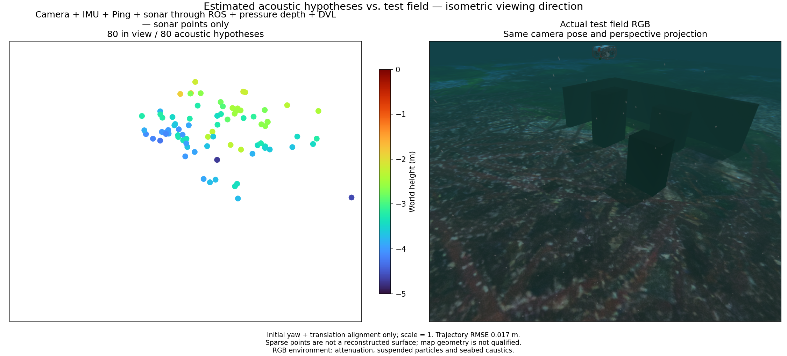

# All-sensor replay / 전체 센서 재생

Camera, raw IMU, single Ping, imaging sonar, pressure and DVL are selected. At 1x delivery the bounded scheduler fails before the planned interruption. At 0.75x wall-clock delivery, with unchanged measurement timestamps, limits and estimator thresholds, fusion and pressure-loss recovery pass. This is offline replay acceptance, not real-time performance qualification. The exact cause of the 1x backlog still needs profiling; the slower pass supports a throughput hypothesis but does not prove it.

The initial 50.6 s trajectory has position RMSE 0.01676 m (maximum 0.03026 m); recovery 8 s has RMSE 0.00573 m (maximum 0.01088 m). Initial/recovered DVL optimization counts are 51/9. The initial export has 1918 visual points and 69 acoustic hypotheses; recovery has 356 visual and 4 acoustic points. Per-segment initial yaw/translation alignment uses scale one and simulator truth only for evaluation.

Only 40 of 69 acoustic hypotheses are within 10 cm of physical collision surfaces. Median nearest-surface distance is 0.07367 m, p90 0.35614 m, maximum 1.08069 m. These nearest-surface distances do not prove correct physical correspondence. The scene remains poorly reconstructed despite centimetre-scale trajectory accuracy. DVL fusion alone does not resolve elevation ambiguity or establish persistent acoustic scatterers. Further navigation-only tweaks must not be presented as a mapping fix.

The figure shows initial acoustic points and actual post-mission RGB of the same static field, with matching isometric perspective, fixed Turbo height limits and four-times point diameter. RGB contains attenuation, particles and seabed caustics. No simulator surface or object identity is an estimator input.

## 한국어

카메라·원본 IMU·단일 Ping·영상 소나·수압·DVL을 선택했습니다. 1배 재생은 예정된 중단 시험 전에 제한된 대기열이 초과됐습니다. 측정 시각·한도·추정기 임계값을 유지한 0.75배 재생에서는 융합과 수압 중단·복구를 통과했습니다. 오프라인 재생 검증이며 실시간 성능은 미검증입니다. 느린 재생의 성공은 처리량 문제 가능성을 뒷받침하지만, 정확한 원인은 추가 프로파일링이 필요합니다.

초기 50.6초 위치 RMSE는 0.01676 m, 최대는 0.03026 m입니다. 복구 8초 RMSE는 0.00573 m, 최대는 0.01088 m입니다. DVL 최적화 반영 횟수는 초기 51회, 복구 9회입니다. 초기 지도는 시각점 1918개·소나 가설점 69개, 복구 지도는 시각점 356개·소나 가설점 4개입니다. 각 구간의 초기 방위각·위치만 정렬하고 축척은 1로 고정했으며 시뮬레이터 정답은 평가에만 사용합니다.

소나 69점 중 40점만 실제 충돌 표면 10 cm 이내입니다. 최근접 표면 거리는 중앙값 0.07367 m, 90백분위 0.35614 m, 최대 1.08069 m입니다. 표면에 가깝다는 사실만으로 올바른 물리 반사점 대응을 증명하지 않습니다. 위치 오차가 센티미터 수준이어도 현장 형상 복원은 부족합니다. DVL 융합만으로 고도 모호성이나 지속적인 반사점 대응이 해결되지 않았습니다. 항법 조정만으로 지도 문제가 해결됐다고 판단하지 않습니다.

그림은 초기 소나 점군과 임무 후 촬영한 같은 정적 현장의 실제 RGB를 같은 등각 방향·원근 투영으로 비교합니다. 고정 Turbo 높이 범위와 지름 4배 점을 사용합니다. RGB에는 수중 감쇠·입자·해저 집광무늬가 포함됩니다. 시뮬레이터 표면이나 물체 식별자는 추정기에 전달하지 않습니다.

## Rank-certified QR follow-up / 계수 보장 QR 후속 검증

The repeated 1x stall was localized to SVD in damped Ping/visual nuisance elimination. A positive damping rank bound now permits equivalent Householder QR; uncertified and undamped systems retain SVD. Thirty native regressions pass. The updated worker completes 1x recorded ROS fusion and pressure recovery with maximum observed image processing 273.7 ms and queue peak 14/16. Initial 50.2 s RMSE is 0.01734 m; recovered 7.8 s RMSE is 0.00571 m. This is a single host replay, not a hard real-time guarantee; initialization/export intervals differ slightly. The 80-point acoustic map remains unqualified.

반복된 1배 재생 지연은 감쇠가 적용된 Ping·시각 공동 보조변수 소거의 SVD에서 발생했습니다. 양의 감쇠로 계수를 보장할 수 있을 때 동등한 Householder QR을 사용하고, 보장되지 않거나 감쇠가 없는 경우 SVD를 유지합니다. 네이티브 회귀검사 30개가 통과했습니다. 수정 워커는 1배 기록 재생의 융합·수압 복구를 완료했고, 관측된 최대 영상 처리 시간은 273.7 ms, 대기열 최대는 14/16이었습니다. 초기 50.2초 RMSE는 0.01734 m, 복구 7.8초는 0.00571 m입니다. 한 호스트의 단일 재생 결과이며 엄격한 실시간 성능 보장은 아닙니다. 초기화·내보내기 구간은 약간 다릅니다. 소나 80점의 지도 품질은 아직 미검증입니다.
