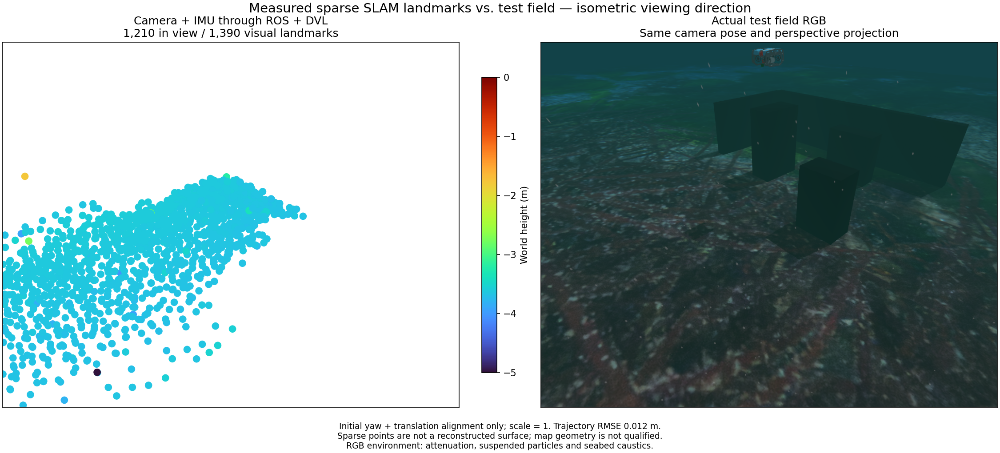

# Camera/IMU/DVL session startup / 카메라·IMU·DVL 세션 시작

A matched application development provider connects physical DVL measurements to native camera/IMU optimization. Startup checks source/binary/SDK identity, the tested Ping/sonar combination, camera rate and explicit gyro uncertainty. The application reports native DVL in its sensor label. A recorded ROS proof permits development startup; installed SDK and GUI acceptance remain separate.

A 1x replay with a 5 Hz camera cap passes 3 s DVL-silence recovery: the old map is cleared, stale exports fail, and the new frame exports 301 visual landmarks after 8 DVL optimization states. The initial frame exports 921 landmarks with 22 DVL states. Initial 21.2 s position RMSE is 0.01115 m; recovered 7.6 s is 0.003919 m, using initial yaw/translation and scale one. This does not establish obstacle coverage, bottom-lock-loss recovery or full terrain mapping. The RGB reference contains attenuation, particles and caustics; it shares the point projection, Turbo height limits -5 to 0 m and marker area 64 pt².

## 한국어

일치하는 개발용 시작 설정으로 실제 DVL 측정을 카메라·IMU 네이티브 최적화에 연결합니다. 시작 시 소스·바이너리·SDK, 시험한 Ping·소나 조합, 카메라 처리율과 명시적 자이로 불확실성을 확인합니다. 앱의 센서 이름에도 네이티브 DVL 사용 여부를 표시합니다. 기록된 ROS 시험은 개발용 시작을 검증하며 설치형 SDK·GUI 검증은 별도로 남아 있습니다.

카메라 상한 5 Hz의 1배 재생에서 DVL 3초 중단·복구가 통과했습니다. 기존 지도를 비우고 오래된 내보내기를 거부했으며, 새 구간에서 DVL 최적화 8회 후 시각 랜드마크 301점을 내보냈습니다. 초기 구간은 DVL 22회·랜드마크 921점입니다. 초기 21.2초 위치 RMSE는 0.01115 m, 복구 7.6초는 0.003919 m이며 초기 방위각·위치만 정렬하고 축척은 1입니다. 장애물 복원·바닥 추적 상실 복구·전체 지형 지도 성능은 입증하지 않았습니다. RGB에는 수중 감쇠·입자·집광무늬가 포함되며 점군과 같은 투영, Turbo 높이 범위 -5~0 m와 점 면적 64 pt²를 사용합니다.

## Timed bottom-lock loss / 시각이 있는 바닥 추적 상실

[Download the retained local-frame landmarks](../data/camera-dvl-bottom-lock.ply).

Three injected invalid DVL statuses over 3 s preserve original timestamps and carry no velocity/covariance. Camera/IMU estimation continues in the same frame; no DVL factor is fused during loss. Point display and export wait for a valid recently optimized DVL update. Return produces 56 supported post-return poses and a 1,390-point fresh export. Full-segment 37 s position RMSE is 0.012449 m, max 0.020243 m, using initial yaw/translation alignment and scale one. There are no resets; cleanup stops the one worker. This is recorded fault injection, not independent physical lock-loss evidence. Silence remains a separate fault with new-segment recovery.

The panel reports lock, current fusion and fused-state count in EN/KO. The browser receiver also enforces selected auxiliary readiness and requires a fresh cloud after restoration. The image uses actual RGB with attenuation, particles and caustics, matched projection, Turbo -5 to 0 m and marker area 64 pt². Sparse landmark geometry and installed-app acceptance remain unqualified. The PLY uses the native local frame; the figure applies the initial evaluation alignment.

3초 동안 원래 시각을 유지한 DVL 무효 상태 세 건을 주입했습니다. 속도·공분산은 넣지 않았습니다. 카메라·IMU 추정은 같은 프레임에서 이어지며 추적 상실 중 DVL 제약은 추가하지 않습니다. 유효한 DVL이 최근 최적화에 반영될 때까지 점 표시와 내보내기를 보류합니다. 복구 후 유효한 자세 56개와 새 랜드마크 1,390점을 내보냈습니다. 전체 37초 위치 RMSE는 0.012449 m, 최대 오차는 0.020243 m이며 초기 방위각·위치만 정렬하고 축척은 1입니다. 구간 초기화는 없었고 작업자 하나가 정상 정리됐습니다. 기록에 장애를 주입한 검사로, 물리적인 바닥 추적 상실을 재현한 것은 아닙니다. 통신 두절은 새 구간을 만드는 별도 복구 경로입니다.

패널은 바닥 추적·최신 융합·융합 상태 수를 한국어와 영어로 표시합니다. 브라우저 수신부도 선택 센서의 준비 상태를 확인하고 복구 후 새 점군을 기다립니다. RGB에는 감쇠·입자·집광무늬가 포함되며 점군과 같은 투영, Turbo -5~0 m와 점 면적 64 pt²를 사용합니다. 희소 지도 형상과 설치형 앱 검증은 남아 있습니다. 다운로드 PLY는 네이티브 국소 좌표이며 비교 그림에는 초기 평가 정렬을 적용했습니다.
