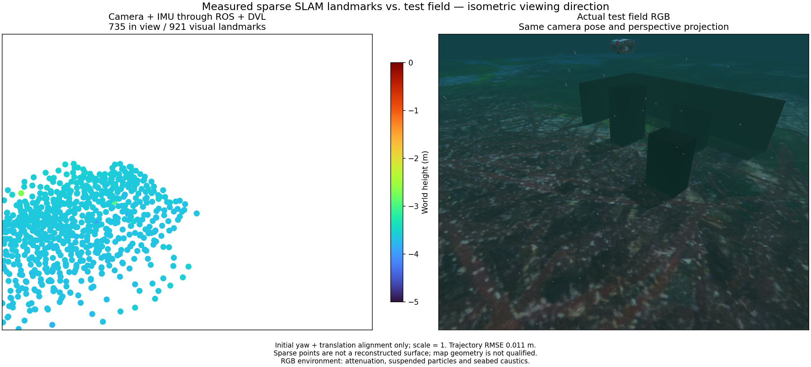

# Camera/IMU/DVL session startup / 카메라·IMU·DVL 세션 시작

A matched application development provider connects physical DVL measurements to native camera/IMU optimization. Startup checks source/binary/SDK identity, the tested Ping/sonar combination, camera rate and explicit gyro uncertainty. The application reports native DVL in its sensor label. A recorded ROS proof permits development startup; installed SDK and GUI acceptance remain separate.

A 1x replay with a 5 Hz camera cap passes 3 s DVL-silence recovery: the old map is cleared, stale exports fail, and the new frame exports 301 visual landmarks after 8 DVL optimization states. The initial frame exports 921 landmarks with 22 DVL states. Initial 21.2 s position RMSE is 0.01115 m; recovered 7.6 s is 0.003919 m, using initial yaw/translation and scale one. This does not establish obstacle coverage, bottom-lock-loss recovery or full terrain mapping. The RGB reference contains attenuation, particles and caustics; it shares the point projection, Turbo height limits -5 to 0 m and marker area 64 pt².

## 한국어

일치하는 개발용 시작 설정으로 실제 DVL 측정을 카메라·IMU 네이티브 최적화에 연결합니다. 시작 시 소스·바이너리·SDK, 시험한 Ping·소나 조합, 카메라 처리율과 명시적 자이로 불확실성을 확인합니다. 앱의 센서 이름에도 네이티브 DVL 사용 여부를 표시합니다. 기록된 ROS 시험은 개발용 시작을 검증하며 설치형 SDK·GUI 검증은 별도로 남아 있습니다.

카메라 상한 5 Hz의 1배 재생에서 DVL 3초 중단·복구가 통과했습니다. 기존 지도를 비우고 오래된 내보내기를 거부했으며, 새 구간에서 DVL 최적화 8회 후 시각 랜드마크 301점을 내보냈습니다. 초기 구간은 DVL 22회·랜드마크 921점입니다. 초기 21.2초 위치 RMSE는 0.01115 m, 복구 7.6초는 0.003919 m이며 초기 방위각·위치만 정렬하고 축척은 1입니다. 장애물 복원·바닥 추적 상실 복구·전체 지형 지도 성능은 입증하지 않았습니다. RGB에는 수중 감쇠·입자·집광무늬가 포함되며 점군과 같은 투영, Turbo 높이 범위 -5~0 m와 점 면적 64 pt²를 사용합니다.
