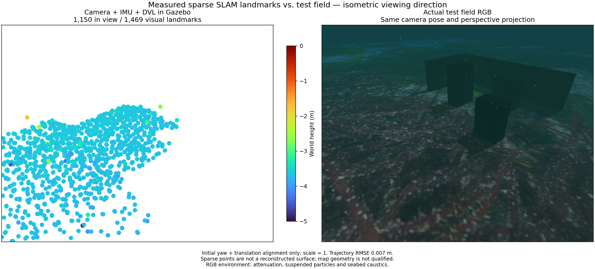

# Native camera/IMU/DVL SDK execution / 네이티브 카메라·IMU·DVL SDK 실행

[Download all local-frame visual landmarks, including outliers](../data/camera-dvl-native-sdk.ply).

An isolated macOS development SDK runs the actual BlueROV terrain demo with ArduPilot and a session-owned camera/raw-IMU/DVL worker. A worker termination produces a new frame; the actual localhost panel API selects VIO, retrieves 1,000-point topic and 2,000/5,000/full archive views, and downloads the PLY. The staged binary completes 59.8 s over 13.2782 m with position RMSE 0.007117 m and max 0.017588 m, using initial yaw/translation alignment and scale one. It exports 1,469 landmarks and all owned processes stop cleanly. A preceding separate native run gives 0.027881 m RMSE.

SDK-relative staging changes the binary checksum, so it is retested through ROS DVL loss/return and a second actual simulator run before registration. The bundle contains exact pinned native dependencies, adapter sources, Eigen headers and notices. The independent application validates source/SDK fingerprints, sensor combination, native recovery/export and shutdown. A recorded ROS proof alone cannot enable the installed-layout descriptor. This is a source-bearing development SDK result; payload-driven defaults and the signed installed GUI remain unqualified.

Map quality remains unqualified: 1,349/1,469 points lie within 10 cm of the post-estimation physical-surface oracle; median/p90 distance is 0.01081/0.07823 m, but maximum distance is **34.7200 m**. The earlier run also has a 12.7240 m outlier. Most supported points are seabed landmarks, with weak target/wall coverage. The PLY preserves all outliers. Low trajectory error is not a geometric map certificate. Investigate visual inverse-depth conditioning and multi-view/archive admission alongside the separate sonar observation problem. No truth-based map trimming is applied.

The same-pose RGB reference contains underwater attenuation, particles and caustics. Point panels use isometric perspective, Turbo -5 to 0 m and marker area 64 pt². Labels report actual fusion: physically attached transport-only Ping is excluded from the method name.

## 한국어

격리된 macOS 개발 SDK에서 ArduPilot과 세션 소유 카메라·원본 IMU·DVL 작업자로 실제 BlueROV 지형 데모를 실행했습니다. 작업자를 종료하면 새 프레임이 생기며 실제 로컬 패널 API로 VIO 선택, 1,000점 토픽·2,000점·5,000점·전체 보존 지도와 PLY 다운로드를 확인했습니다. 배치된 바이너리의 59.8초·13.2782 m 주행에서 위치 RMSE는 0.007117 m, 최대 오차는 0.017588 m입니다. 초기 방위각·위치만 정렬하고 축척은 1로 유지했습니다. 랜드마크 1,469점을 내보냈고 소유 프로세스가 모두 종료됐습니다. 앞선 별도 네이티브 주행의 RMSE는 0.027881 m였습니다.

SDK 상대 경로로 배치하면 바이너리 해시가 달라지므로 ROS DVL 중단·복구와 실제 시뮬레이터 실행을 다시 통과한 뒤 등록합니다. 번들에는 고정 버전 의존성·어댑터 소스·Eigen 헤더·고지가 포함됩니다. 앱은 소스·SDK 해시, 센서 조합, 네이티브 복구·내보내기·종료를 확인합니다. 기록 재생만으로 설치 레이아웃 공급자를 활성화할 수 없습니다. 개발 SDK 검증이며 센서 선택에 따른 기본 조합과 서명된 설치형 GUI 검증은 남아 있습니다.

지도 형상은 아직 부적합합니다. 추정 후 실제 충돌 표면과 비교하면 1,469점 중 1,349점이 10 cm 이내이고 중앙값·90백분위 거리는 0.01081/0.07823 m이지만 최대 거리는 **34.7200 m**입니다. 앞선 실행에도 12.7240 m 이상점이 있습니다. 대부분 해저 랜드마크이며 물체·벽 복원은 약합니다. PLY는 이상점도 그대로 보존합니다. 낮은 궤적 오차만으로 지도를 인정하지 않습니다. 시각 역깊이의 추정 조건과 여러 시점·보존 지도 반영 기준을 소나 관측 문제와 함께 검토해야 합니다. 정답 형상을 이용해 점을 제거하지 않았습니다.

같은 카메라 위치·투영의 RGB에는 수중 감쇠·입자·집광무늬가 포함됩니다. 점군은 등각 방향 원근 투영, Turbo -5~0 m와 점 면적 64 pt²를 사용합니다. 이름에는 실제 융합한 센서만 표시하며 관측값만 전달하는 Ping은 제외합니다.
