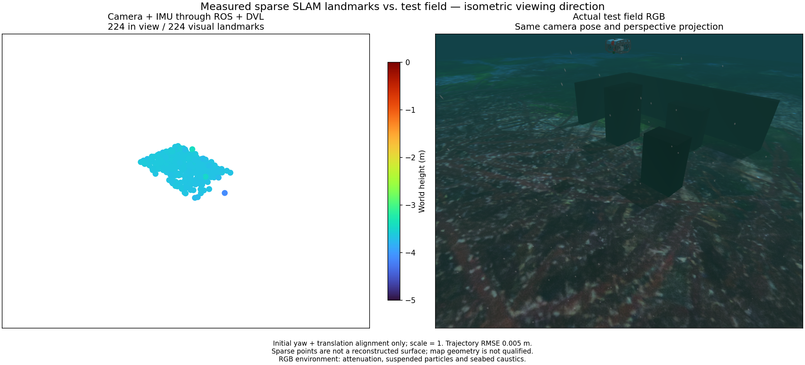

# Camera, IMU and DVL / 카메라·IMU·DVL

The ROS owner sends DVL velocity and covariance at the original measurement time, with bracketed raw gyro for the calibrated lever arm. Camera and sonar paths share DVL identity, bottom-lock and packet validation. The native acknowledgment distinguishes received observations from optimization inclusion.

This 12-second recorded moving-start trial produces 224 exported visual points. Seven DVL observations enter optimization. The full 7-second published trajectory has 0.01015 m position RMSE and 0.01996 m maximum error after initial yaw/translation alignment, scale one. The figure uses only states available at export, hence its different RMSE. RGB is an actual post-mission reference of the same static scene, with attenuation, particles and seabed caustics; the panels share an isometric perspective, fixed Turbo limits and four-times point diameter.

The reconstructed points occupy only a small seabed patch. This does not qualify terrain reconstruction, initialization uncertainty, hardware timing or an installed package.

## 한국어

ROS 실행 경로는 원래 측정 시각의 DVL 속도·공분산과 그 시각을 전후로 보간한 원본 자이로를 전달합니다. 센서 장착 위치에 따른 속도 차이를 반영하며, 카메라와 소나 경로는 DVL 식별·바닥 잠금·패킷 검증을 공유합니다. 추정기의 응답에서 관측 수신과 실제 최적화 반영을 구분합니다.

이동 중 시작하는 12초 기록 재생에서 시각 지도 224점을 내보냈고 DVL 관측 7개가 최적화에 반영됐습니다. 초기 방위각·위치만 정렬하고 축척을 1로 고정했을 때, 전체 출력 7초 구간의 위치 RMSE는 0.01015 m, 최대 오차는 0.01996 m입니다. 그림은 내보내기 시점까지의 상태만 평가하므로 RMSE가 다릅니다. RGB는 같은 정적 현장을 임무 후 촬영한 실제 참조이며 수중 감쇠·입자·해저 집광무늬를 포함합니다. 두 패널은 같은 등각 방향·원근 투영, 고정 Turbo 범위와 지름 4배 점을 사용합니다.

점군은 해저의 작은 영역만 표현합니다. 지형 복원, 초기화 불확실성, 실제 장치 시간 제약과 설치 패키지 검증은 남아 있습니다.

## DVL recovery / DVL 복구

A separate 42-second replay suppresses DVL for three seconds. Stale maps are cleared and export is rejected; DVL return starts a new local segment. Initial 22-second RMSE is 0.01291 m; recovered 7.6-second RMSE is 0.00392 m. Native DVL optimization counts are 23 and 8; recovery exports 301 visual points. Each segment is aligned independently. Global map continuity and prolonged explicit bottom-lock loss remain unqualified.

별도 42초 재생에서는 DVL을 3초 중단했습니다. 오래된 지도를 비우고 내보내기를 거부하며, 입력 복귀 시 새 로컬 구간을 시작합니다. 초기 22초의 위치 RMSE는 0.01291 m, 복구 7.6초는 0.00392 m입니다. DVL 최적화 반영 횟수는 각각 23회와 8회이며, 복구 지도는 시각점 301개를 내보냅니다. 구간마다 독립적으로 정렬하므로 전역 지도 연속성과 명시적인 바닥 잠금 상실의 장기 처리는 아직 미검증입니다.
