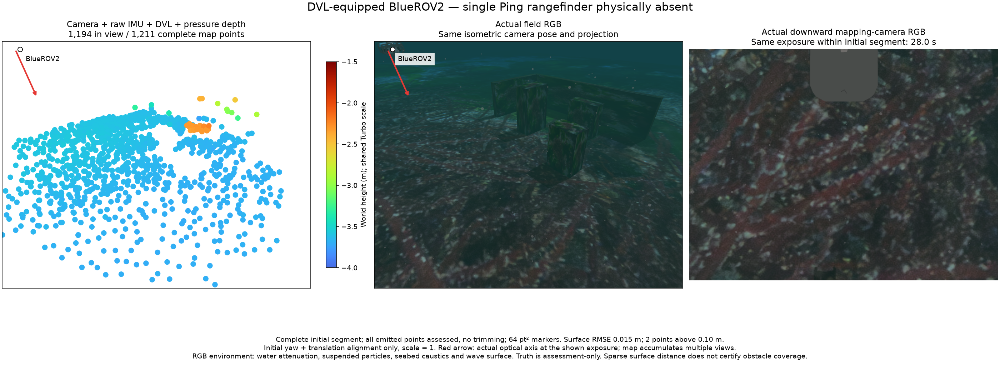
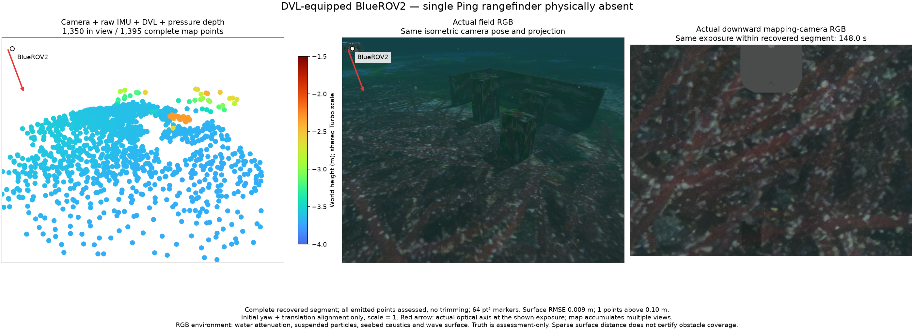
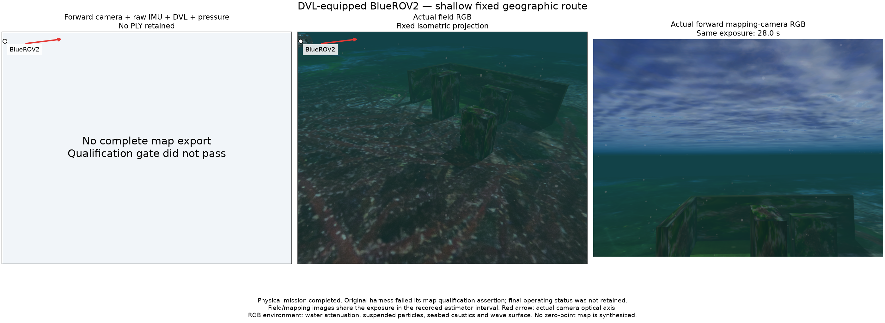
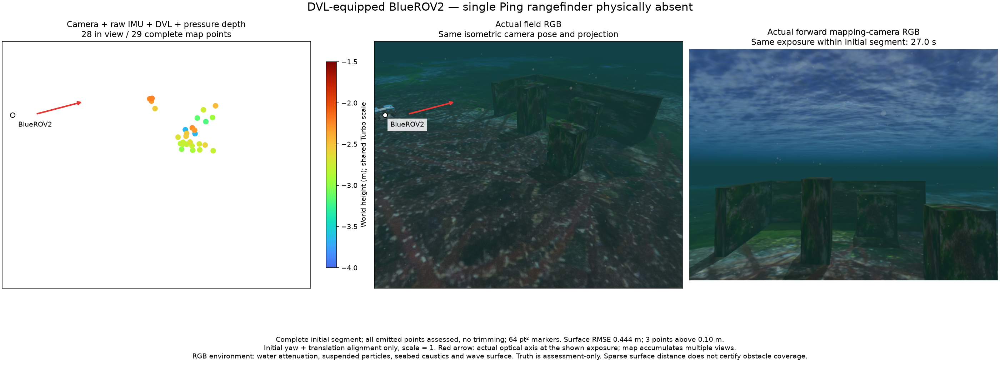
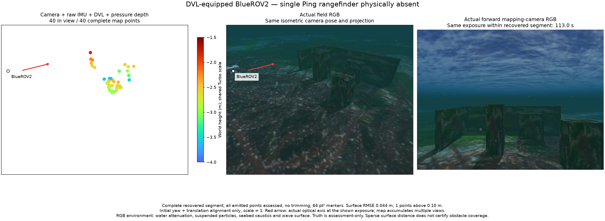

# Camera direction with DVL and no single Ping

The downward camera produces complete sparse maps on the fixed field. The forward camera does not yet produce a useful map. Keep the downward-camera preference and the unchanged map-admission, noise, queue and freshness settings. These development runs do not qualify initialization uncertainty, navigation or an installed package.

Actual BlueROV2/Gazebo/ArduPilot sessions select `camera_down,dvl` or `camera,dvl` through the demo API. Each generated model contains one selected camera, DVL, IMU and pressure; no single Ping link, joint, sensor, topic, autopilot range input or worker argument remains. Sonar PRs are untouched.

## Fixed field and measurements

The shallow camera pair reuses the same 20 requested geographic waypoints, nominal 7 × 4 m extent and 0.6/1.2 m depths. Each request uses its fresh session nonce and normal terrain/body-clearance checks. The inspection run changes depth to 1.6/2.4 m, extent to 3 × 1.5 m and holds heading. It is a different operating regime, not a depth-only ablation. Physical visual/collision geometry, texture, rendering effects, native binary and estimator settings are retained.

Raw images are downward 800 × 600 and forward 640 × 480. Both use the unchanged 120,000-pixel / 200-detection-cell processing budget. The cameras differ in mounting and raw resolution; these separate native runs are not a synchronized identical-pixel experiment.

| Run / segment | Full vertices | Nearest-surface RMSE | Maximum | Above 10 cm | Position RMSE |
| --- | ---: | ---: | ---: | ---: | ---: |
| Downward, shallow / initial | 1,211 | 1.47 cm | 24.74 cm | 2 | 6.69 cm |
| Downward, shallow / recovered | 1,395 | 0.92 cm | 11.12 cm | 1 | 5.04 cm |
| Forward, inspection / initial | 29 | 44.40 cm | 236.72 cm | 3 | 7.53 cm |
| Forward, inspection / recovered | 40 | 4.44 cm | 18.31 cm | 1 | 5.51 cm |

All 2,675 exported vertices remain and are assessed. Alignment uses initial yaw and translation only, with scale fixed at one. Nearest authored surface distance is not feature identity, obstacle completeness or a universal marine acceptance limit. The inspection maps fail utility: only 29/40 vertices remain and neither wall has an archive point within 5 cm of the geometrically visible samples. The visibility calculation is an upper bound with box occlusion; it excludes terrain/self-hull occlusion and photometry.

The forward shallow mission completes physically, but the original harness fails its qualification assertion before writing a final operating status. No complete PLY is retained and no zero-point PLY is synthesized. Its separately retained 603-state trajectory has 0.626 m position RMSE and 6.10° rotation RMSE. The late observer captures no operating status; post-shutdown `dvl_stale` is not evidence of an operating reset. There is no retained HTTP export rejection status for that failed run. See its [evidence limits](forward-shallow/evidence-limits.json).

Both complete-map runs exercise deliberate DVL communication silence and recovery, yielding exactly the expected `dvl_stale` segment transition. DVL and pressure are actually fused in both segments. All three backend parents exit 0 without escalation; all twelve owned process groups are empty. Factor/lifecycle success does not imply useful forward mapping.

## Matched actual views

Each overview uses actual field RGB and the actual selected mapping camera at one exposure inside its estimator segment. The field and cloud share the isometric projection. The red arrow shows the selected optical axis. All emitted map vertices participate in rendering; out-of-view counts are explicit. Markers are 64 pt² with the same −4 to −1.5 m Turbo height scale. RGB includes attenuation, suspended particles, seabed caustics and a wave surface. The isometric camera is separate from the estimator camera; truth is assessment-only.

Downward initial: 28 s exposure, 4.6–124 s segment; 1,194/1,211 vertices in view.

Downward recovered: 148 s exposure, 132.2–246 s segment; 1,350/1,395 in view.

Forward shallow failure: 28 s field/forward exposure inside the retained estimator interval; no exported map panel is fabricated.

Forward inspection: initial 27 s and recovered 113 s exposures, with 28/29 and 40/40 vertices in view. Moving surface/illumination and limited useful static-feature support remain candidate causes; these runs do not isolate them.

## Coordinate control and next decision

Six deterministic native controls hold images and physical motion fixed while expressing raw IMU, seeds, camera/DVL extrinsics and pressure lever arms in identity, 90° pitch and 180° roll IMU bases. Both 3- and 16-state windows are tested for 121 frames. Tracks, reconstructed active points, pose and joint point uncertainty agree after the known world-yaw gauge change: maximum position difference 2.8e−15 m, active-point difference 1.1e−14 m and point-sigma difference 1.1e−9 m. Each case compares 1,404 or 1,603 triangulated observations. This does not reproduce a simple IMU-basis transform bug in that fixture.

The fixture has constant physical orientation and a translated planar texture. No archive point passes the unchanged 0.1 m three-sigma world-position gate, so archive equivalence and real-scene accuracy are not tested. Keep those limits. The portable [reproducer](basis-control/reproduce.py) accepts an existing matching binary and a new output directory, after installing POSIM-SLAM with its research/diagnostics dependencies. The measured probe/analysis sources are retained separately as source receipts; their original working paths are not runtime requirements.

Next record one bounded original-time forward-camera/IMU/DVL/pressure case and inspect track lifetime, static-object support, initial gravity/bias uncertainty and dynamic-surface consistency. Do not expand the long-run suite or weaken map admission to pass this scene. Preserve the functioning downward profile. Revisit actual initialization uncertainty before package acceptance. Acoustic work and its deferred PR integration remain separate.

The operating checks follow the sensor-frame, covariance, depth and loss-testing concerns in the [ROS Maritime learning material](https://ros-maritime.oceansoft.org/education_and_tutorials/). No example controller or third-party source is imported by these records.

## Verify retained evidence

Run `python3 summarize.py` in either repository's copy. It checks hashes, full vertex payloads, all-point assessment arithmetic, raw-to-world transforms, exposure/frame bounds, physical no-Ping summaries, optimized auxiliaries, deliberate segment reset, cleanup and the retained basis-control pose/point/sigma equivalence. It does not rerun Gazebo or independently reconstruct surface truth.

[Source identity](source-identity.json) records application `9b9854ac`, component `1a2c8d8`, engine/SDK `8c47601`, actual native binary hash, development shader and official asyncio correction. The downward API prototype precedes the later VRX-specific override rejection; per-run API hashes retain that distinction. No private application implementation is copied into the component. Terrain/model provenance and the existing Orca5 MIT / renderer notices remain in the parent documentation.
