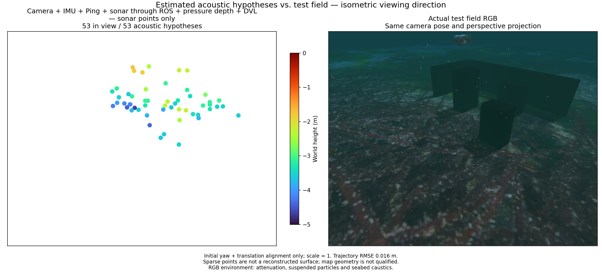

# Metric-fan tracking ablation / 미터 부채꼴 추적 비교

This experiment changes LK patch coordinates from beam/range pixels to an isotropic metric fan chart. Bilinear resampling retains the baseline dB mapping; tracks return to original measured range/azimuth. The chart does not supply elevation or a zero-elevation map. A bounded fan-interior seed mask excludes artificial raster edges. The original forward/backward pixel threshold and native factor settings remain unchanged. Thus the trial changes both patch support and seeding, not only a mathematically lossless coordinate transform.

Thirteen tests pass, including known analytic planar-field translation, float32 coordinate round-trip, changed calibration and replayed clocks. The existing native OpenCV C ABI completes the 1x all-sensor pressure-recovery replay. Initial 50.4 s position RMSE is 0.01587 m; recovered 7.8 s is 0.00591 m. This does not establish sonar reconstruction.

The initial acoustic export has 53 points, of which 30 are within 10 cm of a collision surface. Median/p90/max surface distances are 0.08080/0.53031/0.98218 m. The preceding polar baseline has 80 points, 43 within 10 cm, and 0.07658/0.39710/1.06142 m distances. The recorded inputs and estimator settings are shared, but asynchronous startup/export intervals differ slightly. This trial does not demonstrate a useful map improvement. The production experiment is removed; its exact sources and replay evidence are preserved in the application engineering record. Do not enable it as a product option.

Physical scatterer identity and unresolved elevation remain central: a fixed-metre image patch cannot make elevation-integrated speckle into a persistent point. Future work should test surface/echo observation semantics rather than adding more LK acceptance exceptions. The RGB reference is actual post-mission static scenery with attenuation, particles and caustics. Both panels share isometric perspective, Turbo height limits and four-times point diameter.

## 한국어

LK 패치 좌표를 방위각·거리 픽셀에서 등방성 미터 간격의 부채꼴 평면으로 바꿔 시험했습니다. 이중 선형 보간 후에도 기존 dB 매핑을 유지하고, 추적 결과는 원래 거리·방위각으로 되돌립니다. 이 평면은 고도 관측이나 고도 0의 지도가 아닙니다. 영상 경계가 인공 특징점이 되지 않도록 부채꼴 내부에서만 점을 생성했습니다. 기존 왕복 추적 오차 기준과 네이티브 제약 설정은 유지했습니다. 패치 지지 영역과 점 생성이 함께 바뀌므로 손실 없는 좌표 변환만의 비교는 아닙니다.

알려진 평면 영상 이동·float32 좌표 왕복·보정 변경·시각 역행을 포함한 테스트 13개가 통과했습니다. 기존 네이티브 OpenCV 경로에서 전체 센서 1배 재생과 수압 중단·복구도 통과했습니다. 초기 50.4초 위치 RMSE는 0.01587 m, 복구 7.8초는 0.00591 m입니다.

초기 소나 53점 중 30점이 충돌 표면 10 cm 이내이며, 표면 거리의 중앙값·90백분위·최대는 0.08080/0.53031/0.98218 m입니다. 기존 극좌표 기준은 80점 중 43점, 0.07658/0.39710/1.06142 m였습니다. 기록과 추정기 설정은 같지만 비동기 초기화·내보내기 구간은 약간 다릅니다. 유용한 지도 개선이 입증되지 않아 제품 코드에서 실험 경로를 제거하고 정확한 소스와 결과를 보존했습니다.

고정된 미터 크기의 패치만으로 고도 방향이 합쳐진 반사 신호를 지속적인 물리점으로 만들 수는 없습니다. 앞으로의 핵심은 LK 예외 조건 추가보다 표면·에코의 관측 모델 검증입니다. 실제 임무 후 RGB에는 수중 감쇠·입자·해저 집광무늬가 포함되며 두 패널은 같은 등각 방향·원근 투영, Turbo 높이 범위와 지름 4배 점을 사용합니다.
