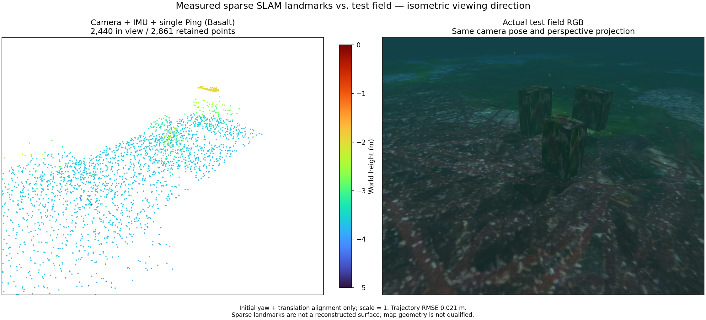
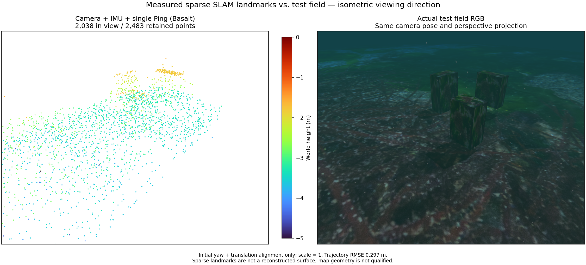

# Survey depth and target observation

Camera + raw IMU + single Ping uses Basalt revision
`0f3b2b52c807f70ff4e2973ce253c73329eea7bc`. These are separate
7 m / 60 s recordings with the same textured boxes, camera far clip of 100 m,
and underwater attenuation, particles and caustics. Independent truth is used
only for evaluation. The comparison uses matching isometric viewing directions
and perspective projection; alignment fixes scale to 1 and uses initial yaw
and translation only.

At 1.5 m depth, none of the 49 sampled top-face locations on the first two
boxes enters the camera frustum. At 0.5 m, 28 and 22 enter it; the third box
increases from 33 to 49. This is a geometric upper bound without occlusion,
lighting or texture tests. Pixel-to-box attribution finds 84/67/155 archived
track IDs at 1.5 m and 105/106/141 at 0.5 m; these labels are diagnostic,
not ground-truth feature correspondences.

The shallower survey fails the position gate: RMSE 0.297 m, maximum 0.585 m
against limits of 0.1 m and 0.25 m. Better exposure alone does not qualify a map.
Both sessions stop cleanly; the 1.5 m default remains. Shape recovery needs a
survey with useful coverage and stable estimation together.

## 한국어

카메라·원시 IMU·단일 Ping을 위 Basalt 리비전으로 처리한 별도 주행입니다.
같은 표적과 7 m·60초 경로, 카메라 원거리 100 m 설정을 사용하며 수중 감쇠,
입자와 해저 집광무늬가 켜져 있습니다. 정답값은 평가에만 사용합니다.
RGB와 점군은 같은 등각 관찰 방향의 원근 투영으로 비교합니다. 축척은 1로
고정하고 초기 요각과 평행이동만 정렬합니다.

깊이 1.5 m에서는 첫 두 상자의 윗면 표본 49개 중 카메라 시야에 들어온
점이 없습니다. 0.5 m에서는 각각 28·22개이며 세 번째 상자는 33개에서
49개로 늘었습니다. 가림·조명·텍스처를 고려하지 않은 기하학적 상한입니다.
표적에 대응하는 저장 특징점 ID는 84·67·155개에서 105·106·141개로 바뀌지만,
이 대응은 진단용이며 정답 특징점 대응을 뜻하지 않습니다.

얕은 경로는 위치 RMSE 0.297 m, 최대 오차 0.585 m로 기준 0.1 m·0.25 m를
초과합니다. 관측 범위가 넓어지는 것만으로 지도 품질을 인정하지 않습니다.
두 세션은 정상 종료했으며 기본 깊이 1.5 m를 유지합니다. 다음 경로는
충분한 표면 관측과 안정적인 추정을 함께 확보해야 합니다.
