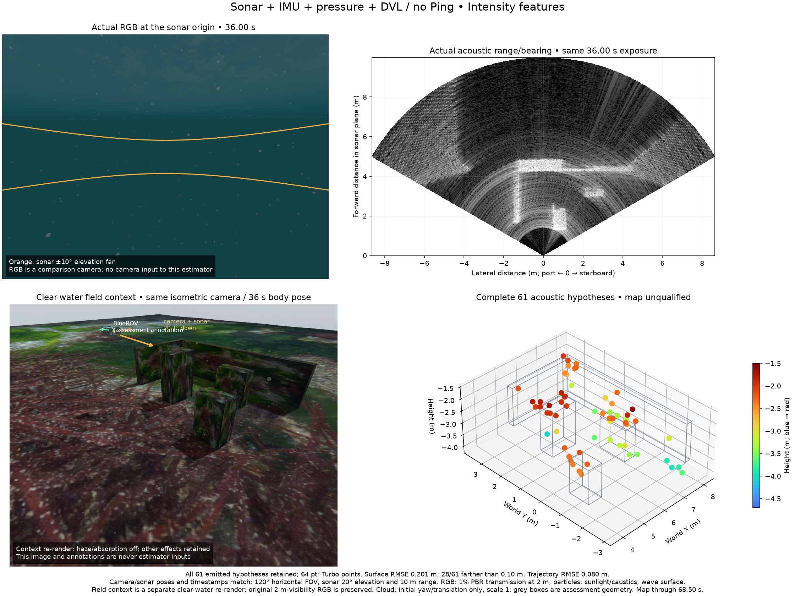

# Moving DVL / forward-sonar overlap diagnosis

This record preserves one native BlueROV acquisition with camera, forward
imaging sonar, raw IMU, pressure and DVL. Ping is physically absent. RGB has
1% scene transmission at 2 m, with particles, sunlight/caustics and wave
surface. Camera and sonar share their origin, 20.1° downward pitch and 120°
horizontal field. Sonar has 256 beams, 20° vertical field and 10 m range.
The estimator uses sonar/IMU/pressure/DVL; the camera is a comparison input.

`capture.tar.gz` is the only canonical archive for this acquisition. It contains
135 raw sonar frames, 338 original RGB frames, 6,748 raw IMU samples, 67 common
DVL reports, 68 original native DVL reports, 675 pressure samples and 68 actual
field-camera frames. All 268 common beam ranges/locks exactly match the native
report at the same timestamp. All range variances remain unknown. One extra
initial native report is preserved. Requested IMU rate is 1,000 Hz; the existing
10 ms physics step produces 100 Hz. Every checksum and timestamp is retained.

Independent truth and terrain are in explicitly named assessment files. They
never enter the native estimator or estimated-pose overlap diagnosis.
The real controller completes seven waypoints: path length 18.57 m, XYZ extent
7.05 × 4.09 × 1.12 m, yaw span 453.45°. Actual motion differs from the historical
record, so cross-record changes are not an algorithm comparison. Acquisition
and context rendering exit normally; all owned groups are empty.

## Unchanged native baseline and failed shared-plane model

The full native replay window is 2.50–68.50 s. Overlap diagnosis also keeps
the original 2.01 s frame with its available bootstrap pose; this does not
add a native factor or retime an observation.

The replay uses committed POSIM-SLAM `000fc4b`, native binary `cb5cbc7c`, fixed
declared noise and original times. It has 214 states, 66 DVL-velocity states and
66 pressure states, with no camera/Ping inputs or DVL-range factors. It retains
all 61 acoustic hypotheses. Trajectory RMSE is 8.05 cm; surface RMSE/p90/max is
20.06/31.59/79.51 cm, with 28/61 farther than 10 cm from the nearest assessed
surface. Physical identity and joint uncertainty remain unqualified.
Replay client-close sends SIGTERM (-15); that is separate from normal-zero
acquisition shutdown. No lifecycle or map acceptance is inferred.

A causal prior-three-frame shared plane retains 252 held-out DVL predictions.
Continuous-cone absolute residual median/p90/max is 1.93/37.54/143.02 cm.
Only 35/252 have whole-cone local support; every failed hypothesis is preserved.
The centre-ray control has p90 36.98 cm. Using perfect assessment poses only
in a separately labelled diagnostic leaves continuous-cone p90 36.74 cm.
Pose correction alone does not fix the shared-surface/correspondence assumption.
The declared 20 mm independent / 10 mm shared range noise is diagnostic, not
calibrated sensor noise. These planes do not update native states.

The existing committed spatial association retains all 264 pose-covered DVL
range hypotheses: 212 have no supported plane, 34 fail whole-cone hull support
and 18 pass the conditional local-support test. Association uses the current
range seed, so selected residuals are not independent held-out accuracy.
Unsupported points remain as labelled centre-ray seeds, not accepted landmarks.

## Range/azimuth and spatial overlap

The independent `range_azimuth_plane` API solves
`A cos(elevation) + B sin(elevation) = (d - n·origin) / measured_range`.
It preserves zero, one, two or infinitely many elevations in the vertical fan,
including tangent sensitivity. A unique plane-conditioned hit still needs
physical correspondence, occlusion/support checks and joint uncertainty.
No new dependency or third-party implementation is added; code is Apache-2.0.

The overlap tool tests all 6,812 observed ground-onset candidates from 133
pose-covered sonar frames against all 52 spatial plane hypotheses, including
the 18 whole-DVL-cone-supported ones. Contemporaneous means within 0.51 s;
separate delayed comparisons use at most 30 s in either direction. Five sampled
range/azimuth bin locations are a diagnostic, not a full uncertainty bound.

There is no contemporaneous DVL support sample inside the sonar fan. Earlier
sonar views contain support samples in 140 patch/frame pairs, but no observed
onset intersection lies inside the local DVL support hull. Later sonar views
also supply no supported onset. Thus this record supplies **zero supported
ground-onset / DVL-patch correspondences**. This is not proof that all possible
echo features or trajectories lack overlap. The synthetic positive control
supports 22 onsets; its out-of-fan negative control supports zero.

Assessment-only terrain projection gives median vehicle height 3.03 m above
the seabed. A flat/level approximation puts the near vertical-fan edge about
6.05 m away. This explains why the short footprint trajectory offers weak
support. Next test a collision-checked lower-altitude, overlapping multi-pass
mission before changing native factors. Keep sensor noise, support and map
gates fixed. Do not fit one plane across unrelated DVL footprints.



Top views have the same 36.00 s exposure and calibrated origin/direction.
Bottom left is a separately labelled clear-water context re-render at the same
body pose: haze/absorption off, other effects retained. Original foggy RGB and
field-camera frames stay in the archive. Bottom right retains all hypotheses,
64 pt² markers, Turbo height limits -4.7 to -1.5 m and assessment-only boxes.

## Checks and reproduction

Five new mathematical tests cover independently generated forward geometry,
rigid transforms, both plane signs, multiple/absent/continuous branches,
tangency and invalid geometry. Clean committed-source export plus the selected
additions and an independently installed wheel each pass 448 tests, with 16
optional native/decoder checks skipped. Skip reasons and hashes are retained;
this does not exercise native range fusion or an installed WWW-POSIM package.

From the library checkout, run `python docs/diagnostics/dvl-moving-overlap-20261029/verify.py --raw`.
To reproduce overlap, extract the archive into an input folder, then run:

```sh
python tools/diagnose_dvl_sonar_overlap.py --record INPUT_FOLDER \
  --states docs/diagnostics/dvl-moving-overlap-20261029/baseline/states.csv \
  --calibration INPUT_FOLDER/metadata/calibration.json \
  --spatial-report docs/diagnostics/dvl-moving-overlap-20261029/dvl-spatial-probe.json \
  --output overlap.json
```

한국어: 단일 Ping을 물리적으로 제외한 이동 기록입니다. DVL 원본 268개 빔의
거리·잠금 상태가 공통 입력과 정확히 일치합니다. 원본 IMU의 실제 주기는 100 Hz이며
카메라는 가시거리 2 m 조건의 비교 영상입니다. 네이티브 추정기의 점 61개를 모두
보존했고, 28개가 평가 표면에서 10 cm보다 멉니다. 지도는 합격으로 인정하지 않습니다.

여러 DVL 빔을 하나의 평면으로 묶으면 평가용 정확한 자세로도 p90 약 37 cm 오차가
남습니다. 공간적 평면 후보 52개 중 전체 빔 원뿔을 지지하는 것은 18개입니다.
소나 상승 경계 6,812개를 현재 및 전후 30초 관측과 비교해도 DVL 국소 지지 범위
안에 들어오는 대응은 없습니다. 이는 모든 소나 특징이나 경로의 불가능성을 뜻하지
않습니다. 합성 양성 대조는 22개, 음성 대조는 0개를 검출합니다.

평가 전용 지형 자료에서 차량의 해저 고도 중앙값은 3.03 m입니다. 평탄·수평 근사에서
소나가 해저를 처음 보는 거리는 약 6.05 m입니다. 다음 시험은 충돌 여유를 확인한
낮은 고도와 중첩 주행을 먼저 검증합니다. 잡음·공간 지지·지도 판정 기준은 유지합니다.
새 기하 함수는 고각의 모든 해를 보존하며, 점의 물리적 동일성이나 자세·평면을 함께 추정한 공분산을
입증하지 않습니다. 소스와 외부 경로 설치 wheel에서 각각 448개 검사가 통과하고
선택적 네이티브·디코더 검사 16개는 생략됐습니다. 앱 설치본의 합격 근거가 아닙니다.
