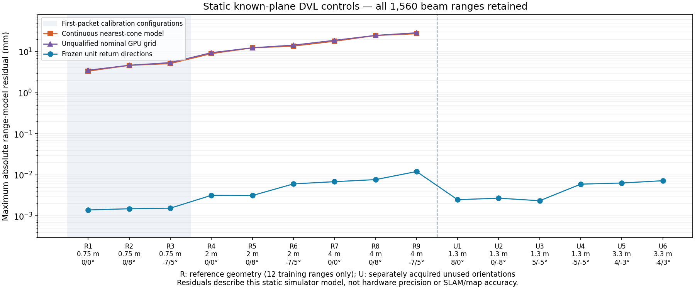

# 알려진 평면을 이용한 DVL 반사 방향 보정

[English](README.md)

실제 프로필의 DVL을 알려진 수평 평면에서 시험합니다. 항법·소나 특징·지도
대응에서 거리 관측 모델을 분리하는 대조군입니다. SLAM 궤적이나 복원 점군을
생성하는 시험은 아닙니다.



그림에는 모든 정적 배치가 포함됩니다. 처음 세 배치의 첫 패킷만 보정에
사용하며, 입력 거리는 총 12개입니다. 같은 배치의 나머지 300개 거리는 반복
측정이며 독립 보정 정보를 추가하지 않습니다. 더 큰 거리의 여섯 배치에서
미사용 거리 624개를 얻습니다. 방향을 고정한 뒤 별도 네이티브 실행으로 새로운
자세·거리 여섯 배치의 거리 624개를 얻습니다. 원본 패킷 390개와 빔 거리
1,560개를 모두 보존합니다.

## 방법과 관측 결과

이상적인 연속 원뿔과 평면의 최근접 교차 모델은 기준 배치에서 렌더링 거리와
최대 27.33 mm 차이가 납니다. 독립적으로 해석한 명목 GPU 격자도 최대
28.81 mm 차이로 일치하지 않습니다. 해당 예측과 샘플링 코드는 미검증
대조군으로 보존합니다. 이 계산으로 설치된 렌더러의 실제 표본 위치나 비평면
표면에서 반사점이 무엇인지 입증하지는 못합니다.

평면 법선 `n`과 수직 거리 `H`를 알 때 고정 단위 반사 방향 `u`의 예측은
`r = H / (n·u)`입니다. 독립 함수
`posim_slam.range_direction.calibrate_return_directions`는 `H/r`에 선형
최소제곱을 적용한 뒤 각 방향을 단위 길이로 정규화합니다. 센서가 내보낸 거리와
물리 설정은 바꾸지 않습니다. 고정한 방향 평균의 최대 잔차는 미사용 거리
대조군에서 12.04 µm, 별도로 취득한 미사용 자세 대조군에서 7.20 µm입니다.
이는 정적 관측 모델의 일치도입니다. 실제 장비의 정밀도·확률적 거리 잡음·SLAM
자세 불확실성·지도 정확도를 측정한 값은 아닙니다.

함수에는 빔 우선 순서로 배치한 `H/r`의 전체 공분산을 명시적으로 넣을 수
있습니다. 선형 해와 단위 정규화를 거쳐 평면 간·빔 간 상관관계를 전달합니다.
기준 기하를 알고 있다는 조건의 1차 보정이며, 모르는 불확실성은 미확정으로
남깁니다. 합성 공분산 대조군은 미분·좌표 변환·빔 간 상관 보존을 검사합니다.
이 대조군이 실제 측정의 불확실성을 제공하지는 않습니다.

## 센서와 취득 범위

- 네 빔: 기울기 30°, 개구각 2°, 회전각 45°/135°/−45°/−135°.
- 거리 0.1–20 m, 해상도 설정은 1 m에서 0.01 m, 갱신율 1 Hz.
- 선언한 가우스 속도 잡음은 0.002 m/s이며 거리 잡음이 아닙니다.
- 기준 높이 0.75·2·4 m, 롤/피치 0°/0°·0°/8°·−7°/5°.
- 별도 미사용 배치: 높이 1.3 m의 8°/0°·0°/−8°·5°/−5°·−5°/−5°,
  높이 3.3 m의 4°/−3°·−4°/3°.
- 알려진 정적 평면, 시험 장치의 단위 장착 변환, 원래 DVL 내부 설정과 잡음
  요소를 사용합니다. 차량 주행이나 카메라·소나 취득은 없습니다. 각 프로세스는
  강제 종료 없이 정상 종료합니다.

설치 패키지는 gz-sensors 10.1.1을 보고합니다. 실제 로드한 DVL·센서·렌더러의
정확한 바이너리 해시는 `fixtures.json`에 있습니다. 패키지 버전만으로 설치
빌드의 모든 소스 패치를 확정하지는 못합니다. 상위
[DVL 소스](https://github.com/gazebosim/gz-sensors/blob/gz-sensors10_10.1.1/src/DopplerVelocityLog.cc)와
[API 헤더](https://github.com/gazebosim/gz-sensors/blob/gz-sensors10_10.1.1/include/gz/sensors/DopplerVelocityLog.hh)에
샘플링 해상도와 속도 잡음이 정의됩니다. 이 기록의 해저 표적·빔 메시지는 거리
평균만 제공하며 거리 분산은 제공하지 않습니다. 해상도 설정이나 속도 공분산으로
누락된 거리 불확실성을 대체하지 않습니다.

첫 미사용 자세 시험은 XML 작성기가 `gz:type` 대신 `ns0:type`을 출력해
패킷이 0개입니다. 사용자 정의 센서 파서는 `gz:type`을 요구합니다.
`fixture-setup-failure.json`에 실패를 보존합니다. 이름 공간 접두어만 고쳤으며,
확장된 XML의 기하·설정과 고정한 방향은 같습니다. 이 시험 장치의 오류를 근거로
제품 파서나 센서 모델을 수정하지 않습니다.

## 재현과 남은 조건

POSIM-SLAM 체크아웃에서 NumPy와 라이브러리를 설치한 뒤 실행합니다.

```sh
python docs/diagnostics/dvl-plane-calibration-20261031/verify.py
python -m unittest discover -s tests -p test_range_direction.py
```

검사기는 파일 해시, 원본 거리 평균 전체, 보정 입력 12개, 연속·명목 격자의
모든 기준 예측, 고정한 방향의 모든 미사용 평면 예측을 확인합니다. 직렬화된
protobuf SHA는 취득 영수증입니다. 바이너리 전송 원문은 포함하지 않아 JSON만으로
해당 SHA를 재생성할 수 없습니다. JSON 전체 데이터는 결정적 gzip으로 압축하며,
`data-identities.json`에 압축 전 바이트 해시도 보존합니다. 선택 의존성 Matplotlib로 `render.py`를
실행하면 그림을 다시 만듭니다.

이 보정을 라이브 융합에 사용하지 않습니다. 움직이는 비평면 관측 영역에서는
최근접 반사가 바뀔 수 있습니다. SLAM 제약으로 사용하려면 실제 반사 영역의
지지와 거리·평면·자세의 결합 불확실성을 검증해야 합니다.
[같은 방향의 현장·전체 점군 기록](../sonar-close-view-20261031/README.ko.md)과
[조건부 그림자 기록](../sonar-shadow-support-20261031/README.ko.md)에 실패 지도와
좁은 관측 방향의 한계를 보존합니다. 다음 운용 시험은 표적과 그림자를 보면서
차량이 횡방향으로 이동해야 합니다.

보정 코드와 기록의 라이선스는 Apache-2.0입니다. 명목 격자 대조군은 OSRF의
Apache-2.0 gz-sensors 소스를 참고한 독립 구현입니다.
