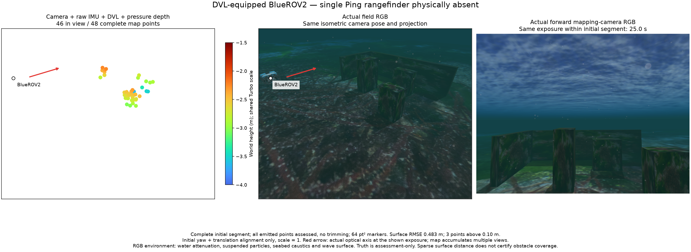
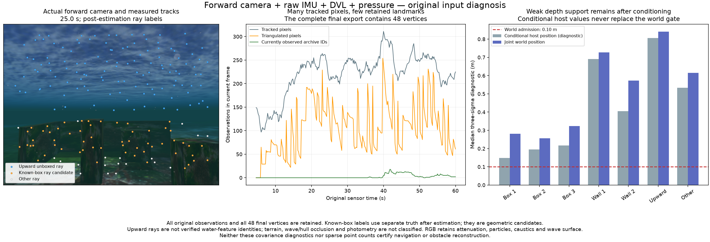

# Original forward-camera diagnosis

This physical BlueROV2 run completes its checked inspection route with raw IMU, DVL and pressure, and no single Ping. Its complete 48-point map remains unsuitable: nearest-surface RMSE is 0.483 m, maximum 2.360 m, and three points exceed 10 cm. All vertices and outliers remain. Position RMSE is 5.24 cm. These figures do not establish feature identity, obstacle reconstruction or navigation readiness.

The field and mapping RGB are captured at the same 25 s exposure within the exported estimator segment. The first two panels share the isometric projection; arrows show the actual optical axis. Points use 64 pt² markers and a common −4 to −1.5 m Turbo scale. RGB retains water attenuation, particles, seabed caustics and the wave surface. Truth is separate and used only after estimation. The camera mount, 3 × 1.5 m checked route, 1.6/2.4 m depths and fixed heading follow the [camera-direction control](../camera-view-20261029/README.md).

## What limits the map

The 278 native image events from 4.6 to 60 s retain 61,433 tracked observations. Known-box ray candidates include all three boxes and both walls. Another 27,758 observations have upward unboxed optical rays. This is not semantic water classification: ray labels ignore terrain/wave/hull occlusion and photometry, and a track ID can move between categories.

For wall candidates, median three-sigma conditional host-position diagnostics are 0.691/0.405 m; joint world-position diagnostics are 0.728/0.572 m. They exceed the unchanged 0.1 m world-position admission limit. Conditioning on the pose does not supply precise depth. This evidence supports inspecting static-feature persistence, motion baseline and dynamic appearance; it does not justify replacing joint world uncertainty with a conditional value or increasing the viewer count.

At the original 4.6 s handoff, the camera/IMU numerical seed has 0.115° tilt error and 0.144 m/s velocity error against the separate physical reference. A small initial tilt does not explain the full mapping failure. No alternate truth-derived seed is supplied.

## Original input archive and its boundary failure

One canonical archive remains at `.local/forward-original-inputs-20261029/record` in the integrating checkout. It stores exact full-resolution estimator gray8 pixels before native resizing, raw IMU/DVL/pressure and separate truth. It uses 46,761,455 bytes before its final receipt, below the 128 MiB guard. Received source RGB accounts for 277 MB, but its full payload is not duplicated. The archive has 301 images, 8,875 IMU samples, 89 original-time DVL statuses and 888 pressure measurements. This kit includes the hash inventory and one matching input frame, not the complete raw archive.

The original recorder receipt **fails**: the first camera exposure is 0.04 s, followed by regular 0.2 s ticks. The helper waits for an exposure exactly 60 s after the first one, although no 60.04 s exposure exists. It reaches its wall deadline and flags the first acquisition interval. Preserve the original failed receipt and all input timestamps.

The independent input audit verifies the actually consumed 1.4–60 s camera window: 294 unchanged gray8 frames at exactly 5 Hz, matching native calibration, continuous original IMU with at most a 20 ms gap and measured warmup/tail, and valid original DVL/pressure conversion. It uses the worker's actual 0.01 rad/s DVL gyro-model assumption. The irregular acquisition prefix is outside that bootstrap window. This qualifies input coverage for replay; it does not turn the complete recorder run into a passed capture, alter estimator limits or certify map accuracy. The original helper is not used for another field run.

The native mission/worker has no operating reset. All four owned groups become empty, the parent exits 0 and no forced stop occurs. This lifecycle success is separate from the failed recorder boundary check and poor map.

## Existing DVL initialization control

The independent library's existing `InertialDvlSession` receives the same original IMU/DVL prefix and model-declared zero IMU bias calibration. It first tracks at 13.01 s, using 13 DVL endpoints over 12.01 s. Its reported maximum three-sigma attitude is 0.597° and velocity is 0.00851 m/s. Separate scoring finds 0.0425° tilt error and 0.0126 m/s velocity error. This one velocity error is larger than the reported three-sigma magnitude, so these assumptions are not a calibrated navigation confidence certificate. Bias observability remains unqualified. No DVL initializer output or covariance is handed to native VIO in this control.

## Gravity consistency

The actual world declares `0 0 -9.8`, while the measured VIO and independent initializer use 9.80665 m/s². The SDFormat 1.12 schema in the selected SDK also declares 9.8 m/s² as the omitted-element default. A paired independent initializer control changes only gravity to the known world value: its 13.01 s velocity error changes from 0.0125928 to 0.0125910 m/s. This inconsistency is real but does not explain this map failure.

The integrating application's candidate reads the final world's gravity for common IMU/DVL, visual and sonar-inertial configurations, and binds development profiles to that value. It keeps Z-up Earth-gravity support and direct-CLI standard-gravity defaults explicit. The pressure plugin separately generates and converts pressure with its retained 9.80665 m/s² reference constant. New gravity-profile/native acceptance is separate from this earlier record; do not relabel this map as using corrected gravity.

[Source identity](source-identity.json) records application `6fef5319`, component `d5d7a81`, unchanged native binary and engine/SDK `8c47601`, plus the exact measured source hashes. No private application implementation is included. Existing Orca5 and renderer notices apply to the scene media. Run `python3 summarize.py` to verify the retained public subset; the verifier does not replay unavailable raw frames or independently reconstruct scene truth.
