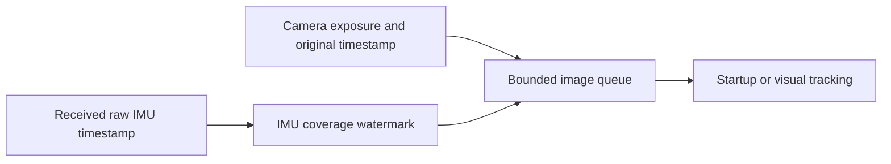

# Camera/IMU exposure timing / 영상·IMU 시각 동기화

`posim_slam.image_imu_queue.ImageImuQueue` retains each image payload and its
original timestamp until a received raw IMU sample covers that exposure.
Camera-first and IMU-first receipt orders release the same measurements. The
caller retains IMU values for integration and owns startup/feature tracking.

The defaults are 32 images, a 64 MiB payload estimate and a 2 s receipt-age
budget. Capacity or age failure is explicit. No sensor time is changed and no
IMU value is predicted. Reset releases the previous context and increments a
generation marker. Startup, map precision and native factor acknowledgements
retain their own readiness checks.

`ImageImuQueue`는 원본 영상·시각을 보관하고, 실제 수신한 IMU가 그 노출 시각을
덮으면 전달합니다. 영상과 IMU 중 어느 것이 먼저 도착해도 같은 측정을 전달합니다.
호출자는 적분에 필요한 IMU 값과 초기화·특징 추적을 관리합니다.

기본 한도는 영상 32장·추정 페이로드 64MiB·수신 후 2초입니다. 용량·시간 초과를
명시적으로 보고합니다. 센서 시각을 바꾸거나 IMU 값을 예측하지 않습니다. 초기화는
이전 대기 문맥을 비우고 세대 표식을 갱신합니다. 초기화·지도 정밀도·네이티브 요인의
처리 확인은 각각의 준비 검사를 유지합니다.

- [Independent implementation](../../src/posim_slam/image_imu_queue.py)
- [Arrival-order, clock-zero and bounded-reset controls](../../tests/test_image_imu_queue.py)
- [Matched native/ROS figures, source fingerprints and retained failures](../validation/camera-imu-profiles-20261028/README.md)
