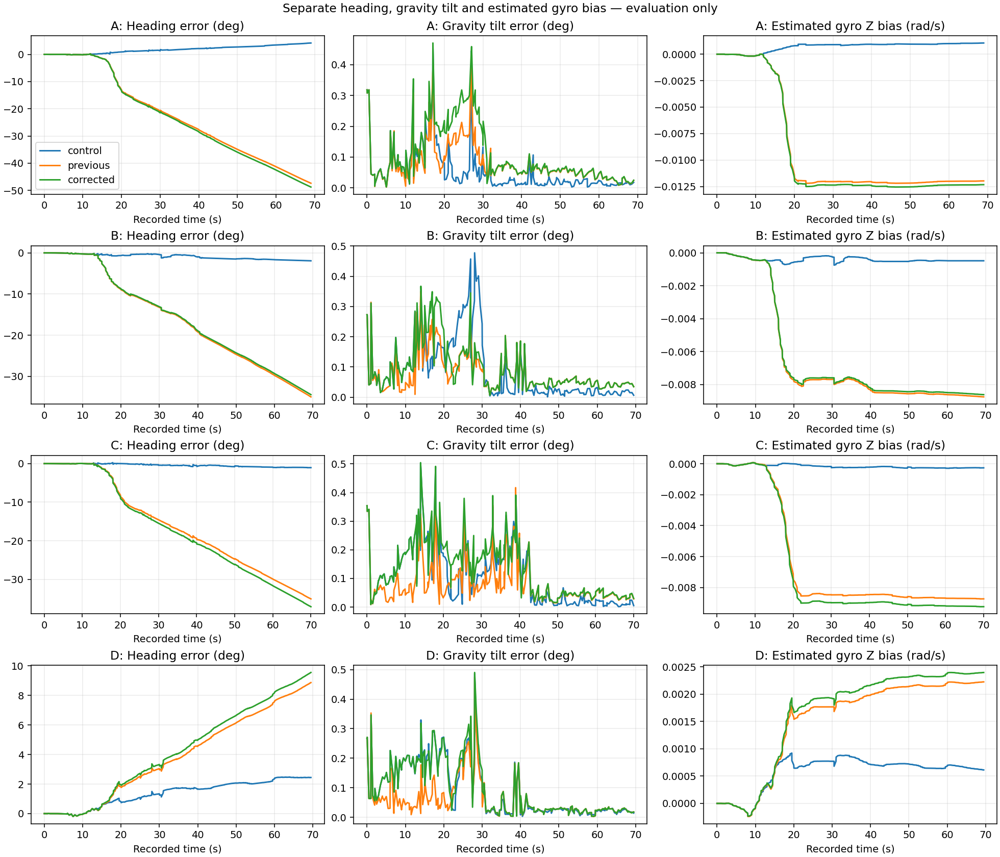
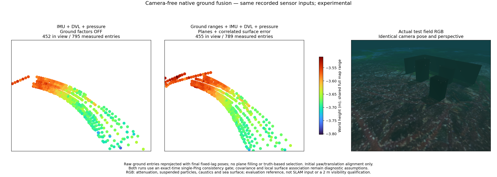
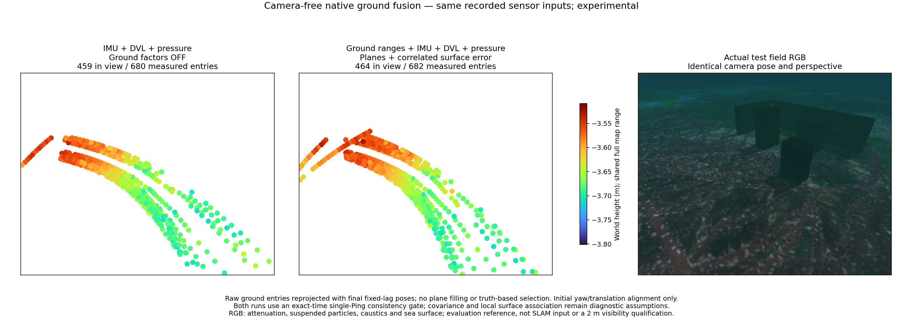
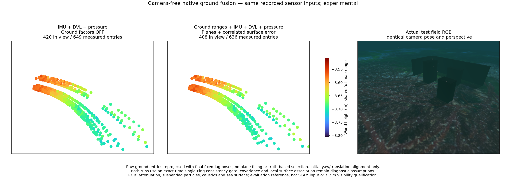

# Initial IMU bias prior / 초기 IMU 바이어스 사전정보

The native build maps `vio_init_bg_weight` to gyro bias coordinates 9–11 and
`vio_init_ba_weight` to accelerometer bias coordinates 12–14. The pinned Basalt
constructor assigns these names in reverse; the build-local adapter corrects
both square-root and Hessian branches. Source pins and upstream files remain
unchanged. This applies to visual and camera-free native estimators.

네이티브 빌드는 `vio_init_bg_weight`를 자이로 바이어스 좌표 9–11에,
`vio_init_ba_weight`를 가속도계 바이어스 좌표 12–14에 연결합니다. 고정한 Basalt
생성자의 반대 연결을 빌드 전용 어댑터가 수정하며 square-root·Hessian 경로에
모두 적용합니다. 원본 소스와 고정 버전은 유지합니다. 시각·카메라 미사용
네이티브 추정기에 공통으로 적용됩니다.

The default information weights stay 100 for gyro and 10 for acceleration.
The zero-centred initial standard deviations are therefore 0.1 rad/s and
approximately 0.316 m/s². These weak initialization assumptions are not a
measured sensor calibration or evidence of readiness. Noise densities, bias
random walks and sonar settings are unchanged.

기본 정보 가중치는 자이로 100, 가속도계 10으로 유지합니다. 0을 중심으로 하는
초기 표준편차는 각각 0.1 rad/s, 약 0.316 m/s²입니다. 약한 초기화 가정이며
실측 센서 보정이나 준비 완료의 근거는 아닙니다. 잡음 밀도·바이어스 랜덤워크·
소나 설정은 바꾸지 않았습니다.

[Adapter](../../native/basalt/prepare_joint_headers.py) ·
[actual constructor regression](../../native/basalt/initial_prior_probe.cc) ·
[source pins and notices](../../native/basalt/sources.json) ·
[full results](imu-initial-prior.json).

[어댑터](../../native/basalt/prepare_joint_headers.py) ·
[실제 생성자 회귀 검사](../../native/basalt/initial_prior_probe.cc) ·
[소스 버전과 고지](../../native/basalt/sources.json) ·
[전체 결과](imu-initial-prior.json).

## Verification / 검증

The constructor probe checks four configurations and 24 physical state
increments. It compares the actual initial matrix with `applyInc` gyro and
accelerometer changes. Fresh builds execute this probe before VIO qualification.
Twenty-five native sensor/worker tests pass. Two 12-second visual-inertial
synthetic runs pass existing limits: position RMSE 0.01895 m with supplied tracks
and 0.02031 m with rendered images. These are synthetic regression results.

생성자 검사는 네 설정과 물리 상태 증분 24개를 확인합니다. 실제 초기 행렬의
비용을 `applyInc`가 변경한 자이로·가속도계 바이어스와 비교합니다. 새 빌드는
VIO 검사 전에 이 검사를 실행합니다. 네이티브 센서·작업자 검사 25개가 통과했습니다.
12초 시각·관성 합성 재생 두 개도 기존 기준을 통과했습니다. 위치 RMSE는 제공된
트랙 입력 0.01895 m, 렌더링 영상 입력 0.02031 m이며 합성 회귀 검사 결과입니다.

## Remaining ground-fusion failure / 남은 해저 융합 실패

The recorded error is predominantly heading and horizontal motion. In C, the
spatial ground run has 21.27° heading RMSE and 0.166° gravity-tilt RMSE; the
matching no-ground control has 0.59° and 0.150°. The corrected initial prior
does not resolve this failure. Estimated gyro Z bias differs substantially,
but this alone does not prove whether surface association, acoustic bias or
weak geometry is responsible. Do not clamp the bias to its simulated truth.

기록 오차는 주로 방위각과 수평 이동에 나타납니다. C의 공간 해저 실행은 방위각
RMSE 21.27°, 중력 기울기 RMSE 0.166°이며 같은 빌드의 대조군은 0.59°, 0.150°입니다.
초기 사전정보 수정으로 이 실패가 해결되지는 않습니다. 추정 자이로 Z축 바이어스도
크게 달라지지만 이것만으로 표면 연결·음향 편향·약한 기하 중 원인을 확정할 수는
없습니다. 시뮬레이션의 정답 바이어스로 고정하지 않습니다.

Online position RMSE in metres, all with the corrected worker / 수정 작업자의 온라인 위치 RMSE(m):

| Record / 기록 | No ground / 대조군 | Ground / 해저 | Spatial ground / 공간 해저 |
| --- | ---: | ---: | ---: |
| A | 0.054 | 0.955 | 0.685 |
| B | 0.018 | 0.357 | 0.342 |
| C | 0.021 | 1.191 | 0.570 |
| D | 0.042 | 0.199 | 0.077 |

All ground runs remain unqualified. The spatial setting is the frozen A-derived
0.08 m / 2 m diagnostic setting; see its [conditional calibration limitations](sonar-ground-spatial.md).
Paired controls are byte-identical across the plain/spatial configurations.
No camera or reference pose enters estimation. All records share a terrain family.

모든 해저 실행은 미검증입니다. 공간 설정은 A에서 정한 0.08 m / 2 m를 유지합니다.
[조건부 설정 선택의 한계](sonar-ground-spatial.md)를 참고하세요. 일반·공간 설정의
대조군 상태열은 바이트 단위로 같습니다. 카메라·정답 자세는 추정에 입력하지 않으며
기록들은 같은 지형 계열입니다.

The following views compare no-ground control, spatial ground fusion and RGB.
They share the camera pose and perspective, 64 pt² markers and full-range Turbo
height scale. RGB has attenuation, particles, caustics and sea surface and is
captured after the mission. The measured ground samples do not establish
obstacle reconstruction, independent-world accuracy or explicit 2 m visibility.

아래는 대조군·공간 해저 융합·RGB 비교입니다. 카메라 위치·원근, 점 면적 64 pt²와
전체 높이 범위 Turbo 색상을 공유합니다. RGB에는 감쇠·입자·집광무늬·수면이 있고
임무 후 촬영합니다. 관측한 해저 점은 장애물 복원·독립 환경 정확도·명시적
가시거리 2 m 조건을 검증하지 않습니다.

