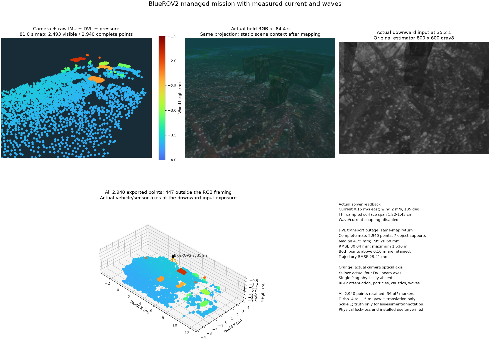

# 조류·파도 조건의 관리형 BlueROV2 미션

카메라·원시 IMU·DVL·수압을 사용하며 단일 Ping은 물리적으로 없습니다.
원본 초기 추적 16개와 보조 측정을 보존합니다. 실제 유체 모델에서 동쪽
0.15m/s 조류와 풍속 2m/s·135°의 FFT 파도를 확인했습니다. 표본 수면의
공간 높이 범위는 1.22~1.43cm이며 유의파고가 아닙니다. 조류와 파도의
상호 결합은 꺼져 있습니다. 수압은 평균 수면 기준의 정수압입니다.

8개 경유점과 부상을 60.12초에 완료합니다. 의도한 워커 종료 후 새 구간에서
복구하며, 이후 DVL 통신 중단은 같은 구간의 지도·자세를 유지합니다.
단절 중 다운로드는 HTTP 409로 거부하고 복귀 후 다시 허용합니다.
운용·다운로드 검증이며 실제 bottom-lock 상실을 검증한 결과는 아닙니다.

전체 지도는 중단 전 1,550점·복귀 후 1,758점·최종 2,940점입니다. 기존
물체 범위 검사는 각각 2개/실패·5개/통과·7개/통과입니다. 최종 전 점 오차는
중앙값 4.75mm·P95 20.68mm·RMSE 30.04mm·최대 1.536m입니다. 10cm 초과
2점과 그중 20cm 초과 1점도 모두 보존합니다. 궤적 RMSE는 29.41mm입니다.
지형·물체와의 거리를 평가한 단일 장면 결과이며 제품 정확도 수용은 남아 있습니다.

위 두 패널은 같은 원근 투영입니다. 84.4초 RGB는 81.0초 지도 이후의 정적
현장 문맥이며 동시 노출이 아닙니다. 하향 입력과 아래 차량·센서 축은
35.2초 원본 노출입니다. 주황색은 카메라 광축, 노란색은 실제 DVL 음선
방향입니다. 전체 지도 패널에는 화면 밖 447점도 있습니다. Turbo −4~−1.5m,
36pt²와 축척 1을 사용하며 환경 효과는 수중 감쇠·입자·해저 집광무늬·파도입니다.

[전체 수치](summary.json) · [중단 전 PLY](before.ply) ·
[복귀 후 PLY](after.ply) · [최종 전체 PLY](final.ply).

실행 118.96초·최대 소유 RSS 2,003,353,600바이트이고 강제 종료나 남은
소유 프로세스는 없습니다. 39개 조류·파도 응답이 9.96~85.32초에 확인됐으며
운용 종료 뒤의 오래된 응답 6개도 기록합니다. 잡음·사전분포·채택·최신성
한도를 유지합니다. 초기화 불확실성 보정·장시간 운용·설치형 GUI 수용은 남아 있습니다.

[그림의 제3자 고지](../../../THIRD_PARTY.md) · [English](README.md)
