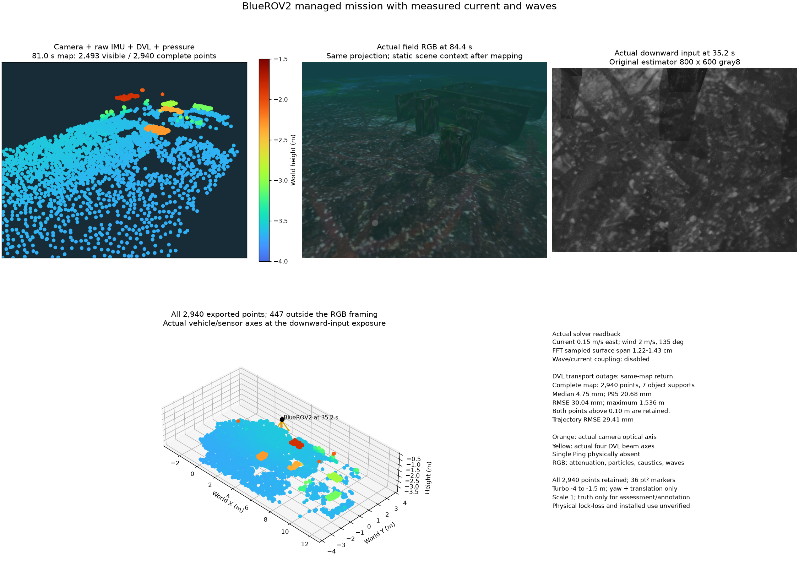

# Managed BlueROV2 mission with current and waves

The physical payload contains camera, raw IMU, DVL and pressure, without single
Ping. Sixteen original startup tracks and auxiliary measurements are retained.
Solver readbacks confirm a 0.15 m/s eastward current and FFT waves driven by
2 m/s wind at 135 degrees. The sampled spatial surface span is 1.22–1.43 cm,
not significant wave height. Wave/current coupling is disabled. Pressure models
hydrostatic pressure relative to the mean surface.

Eight waypoints including surfacing complete in 60.12 seconds. An intentional
worker termination recovers in a new segment. A subsequent DVL transport outage
retains the same map segment and poses, withholds downloads with HTTP 409, then
restores export. This verifies operating recovery, not physical bottom-lock loss.

Complete maps contain 1,550 points before the outage, 1,758 after recovery and
2,940 finally. The existing object-coverage gate respectively reports 2/fail,
5/pass and 7/pass. Final all-point surface errors are median 4.75 mm, P95
20.68 mm, RMSE 30.04 mm and maximum 1.536 m. Both points above 10 cm, including
one above 20 cm, remain in the exports. Trajectory RMSE is 29.41 mm. This single
terrain/object-distance fixture does not qualify product accuracy.

The two upper overview panels share the same perspective projection. RGB at
84.4 seconds is static scene context after the 81.0-second map, not a simultaneous
exposure. The downward input and lower vehicle/sensor axes use the original
35.2-second exposure. Orange is the camera optical axis; yellow is the actual
DVL beam direction. The complete-map panel includes all 447 points outside the
RGB frame. Markers are 36 pt², Turbo spans −4 to −1.5 m and scale is fixed to 1.
RGB effects include water attenuation, particles, seabed caustics and waves.

[Full results](summary.json) · [Before PLY](before.ply) ·
[Recovered PLY](after.ply) · [Complete final PLY](final.ply).

The run takes 118.96 seconds with peak owned RSS 2,003,353,600 bytes, no forced
shutdown and no remaining owned processes. Thirty-nine current/wave readbacks
are confirmed from 9.96 to 85.32 seconds; six trailing stale readbacks after
operation are also retained. Noise, priors, admission and freshness limits remain
unchanged. Initialization covariance calibration, long operation and installed
GUI qualification remain open.

[Third-party figure notices](../../../THIRD_PARTY.md) · [한국어](README.ko.md)
