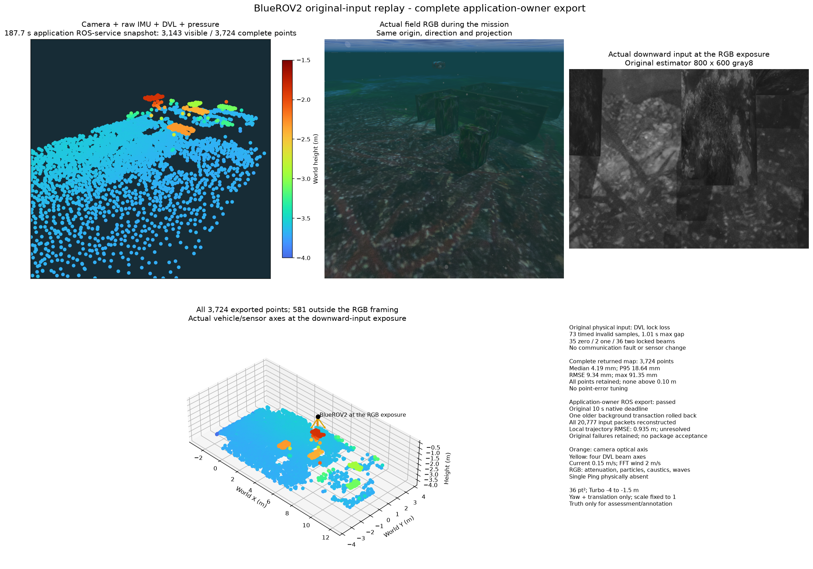

# 요청 우선 처리와 전체 지도 내보내기

전체 지도 갱신 요청은 입력 리비전을 고정합니다. 워커는 더 오래된
백그라운드 그래프 처리를 되돌린 뒤 요청을 먼저 계산합니다. 요청 계산은
중단하지 않습니다. 이전 완료 지도·원본 입력·실제 소스 오류와 기존 수치·
기한·자원 한도를 보존합니다.

정상 소스 빌드와 실제 스레드 제어 3개가 통과합니다. 저장 페이지 32개를
준비한 뒤 중단해도 원래 그래프가 바이트 단위로 같습니다. 재개한 전체
수치 결과도 3,859점·품질 항목 8,177개 모두 같습니다. 새 해법·사전분포·
감쇠나 지도 채택 조정은 없습니다.

원래 전송 바이트·시간표 재생은 기존 네이티브 10초 기한 안인 7.033초에
전체 3,585점을 내보냅니다. 이후 검증 래퍼의 JSON 키 자료형 비교는
실패했습니다. 해당 판정과 별도 네이티브 감사 결과를 구분해 보존합니다.

앱 ROS 소유자는 같은 실제 카메라·IMU·DVL·수압 기록을 1배속으로
재생하며 Ping은 없습니다. ROS 내보내기 서비스는 187.7초의 전체 3,724점과
지도 리비전 219를 반환합니다. 백그라운드 처리 1개를 되돌렸습니다.
네이티브 상태 2,133개를 모두 남기며 실제 DVL 잠금 상실 중 848개,
최소 2,570점과 같은 워커·좌표 프레임을 유지합니다. 오류·지도 오류는
없습니다. 브라우저 HTTP 경로나 유실 중 내보내기 요청은 검증하지 않았습니다.

전체 점의 표면 오차 중앙값/P95/RMSE/최대는
4.190/18.645/9.345/91.354mm이며 10cm 초과 점은 없습니다.
연속 로컬 위치 RMSE/최대는 0.935/2.356m로 남습니다. 작은 표면 오차로
항법을 수용하지 않습니다. 센티미터 미만 오차의 추가 튜닝은 하지 않습니다.

이전 재생은 원본 영상 바이트를 중복 저장해 기존 512MiB 출력 한도로
종료됐습니다. 새 진단 기록은 불변 원본을 참조하며 영상 1,798개를 포함한
패킷 20,777개를 모두 정확히 복원합니다. 추정기 입력과 모든 출력을
보존합니다. 새 실행은 192.78초·최대 RSS 1,111,097,344B이고 소유 프로세스가
남지 않습니다. 저장 방식 변경은 검증 기록기에만 적용됩니다.

RGB와 하향 입력은 원래 같은 38.0초 노출입니다. 점군과 RGB는 같은
시점·투영이며 아래 등각 패널은 화면 밖 점도 모두 포함합니다. 주황은
카메라 축, 노랑은 DVL 음선입니다. RGB에는 수중 감쇠·입자·집광무늬·파도가
있으며 조류 0.15m/s·FFT 파도의 풍속 2m/s입니다. Turbo −4~−1.5m·36pt²를
사용합니다. 참값은 평가·주석에만 사용하고 초기 yaw·이동 정렬과 축척 1을
유지합니다.

`conditional_paged_v1`은 선택형입니다. 이전 기본 용량·기한 실패,
위치 드리프트·장기 운용·초기화 불확실성·설치 패키지 검증은 남아 있습니다.
전역 SDK·공급자·라이브 서비스는 바꾸지 않았습니다.

[전체 결과·소스 연결](summary.json) · [앱 전체 PLY](application-3724.ply) ·
[네이티브 전송 재생 전체 PLY](native-wire-3585.ply) · [비교 메타데이터](comparison.json) ·
[English](README.md).
