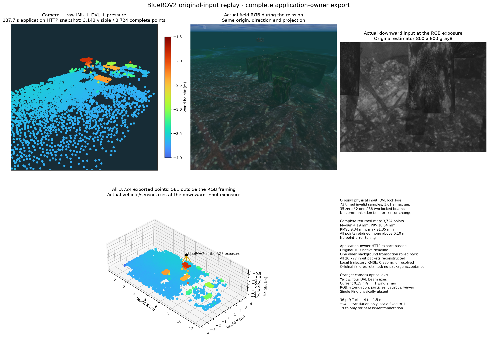

# Complete map export with request priority

An explicit map refresh pins its input revision. The worker can roll back an
older background graph transaction and serve that request first. It does not
interrupt a requested transaction. The previous published map, original input,
source faults and existing numerical/deadline/resource limits are preserved.

The normal source build and three threaded controls pass. Cancellation after
32 staged storage pages restores the original graph byte for byte; resuming
produces the same complete numeric output (3,859 points and 8,177 quality entries).
No new solver, prior, damping or admission adjustment is used.

Exact original-wire replay exports all 3,585 points in 7.033 seconds against the
existing native 10-second deadline. Its wrapper subsequently fails a JSON key-type
comparison; that verdict and the independent native audit remain separate.

The application ROS owner replays the same physical camera/IMU/DVL/pressure
record at 1x, with Ping absent. Complete HTTP export returns 3,724 points at
187.7 seconds, through mapping revision 219. One background transaction is
rolled back. All 2,133 native states remain; 848 occur during physical DVL lock
loss, with at least 2,570 landmarks and the same worker/frame. No faults or map
errors are observed. A during-loss HTTP export request was not made.

All-point surface median/P95/RMSE/maximum are 4.190/18.645/9.345/91.354 mm.
No point exceeds 10 cm. Continuous local position RMSE/maximum remain
0.935/2.356 m; a small surface error does not qualify navigation. No further
sub-centimetre tuning is intended.

An earlier replay stops at the unchanged 512 MiB output guard because it stores
canonical image bytes again. The revised diagnostic archive references those
immutable inputs and successfully reconstructs every one of 20,777 packets,
including 1,798 images. Estimator input and all output are retained. The revised
run takes 192.78 seconds and peaks at 1,111,097,344 bytes RSS; no owned process
remains. This storage change belongs to the validation recorder.

RGB and downward input are the same original 38.0-second exposure. Cloud and
RGB use the same view; the lower isometric panel retains every point, including
those outside that view. Orange marks the camera axis and yellow the DVL beams.
RGB includes attenuation, particles, caustics and waves; current is 0.15 m/s and
FFT-wave wind is 2 m/s. Turbo covers −4 to −1.5 m at 36 pt². Truth is assessment
and annotation only; alignment uses initial yaw/translation with scale 1.

`conditional_paged_v1` remains opt-in. Earlier default-capacity/deadline failures,
position drift, longer operation, calibrated initialization and installed-package
qualification remain open. No global SDK/provider or live service is changed.

[All results and source binding](summary.json) · [Complete application PLY](application-3724.ply) ·
[Complete native-wire PLY](native-wire-3585.ply) · [Comparison metadata](comparison.json) ·
[한국어](README.ko.md).
