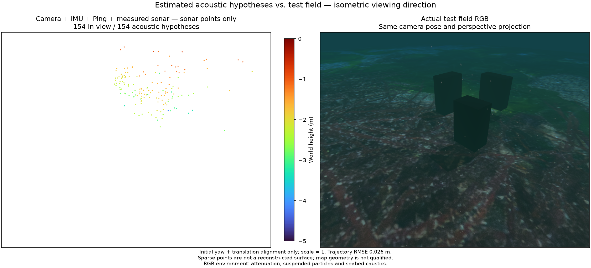
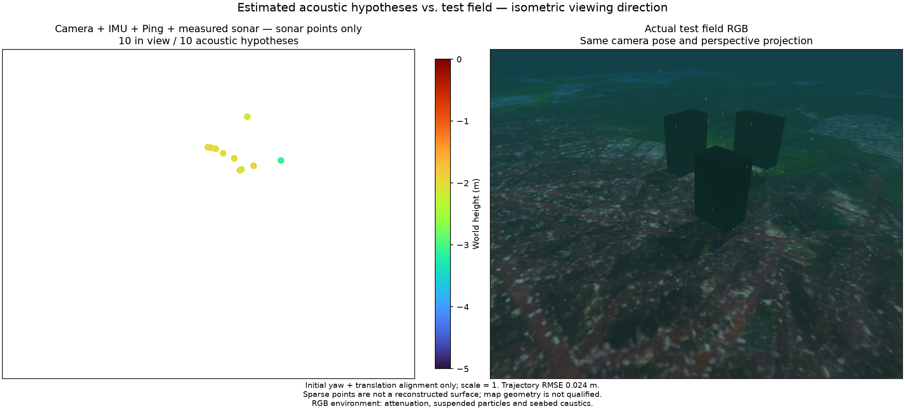
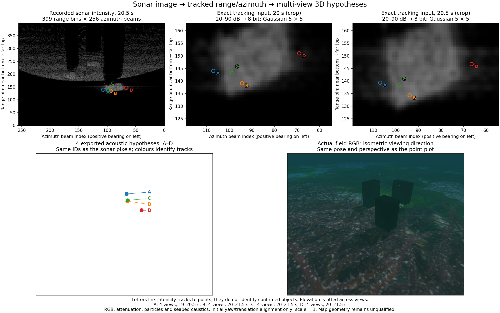
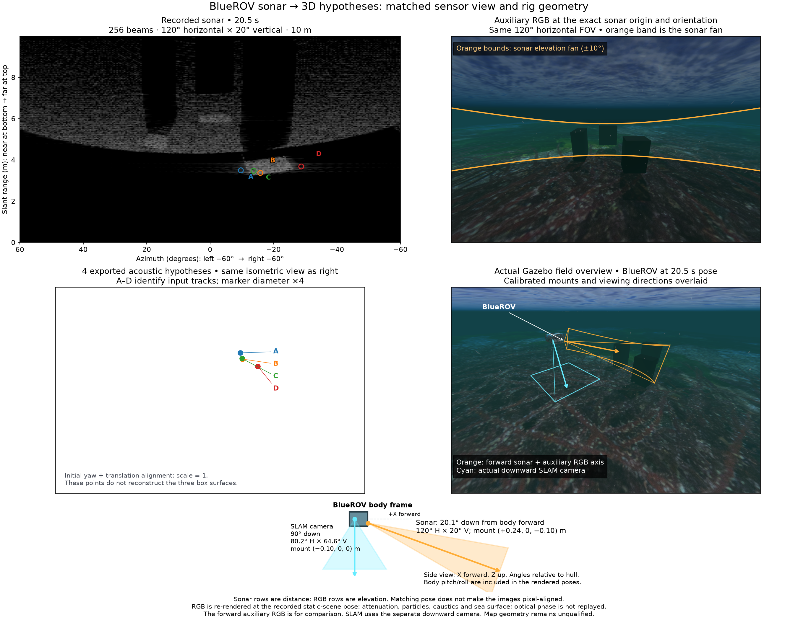

# Measured sonar fusion / 실측 소나 결합

The comparison replays the same 63.2-second BlueROV camera, raw IMU and single
Ping recording with Basalt `0f3b2b52c807f70ff4e2973ce253c73329eea7bc` and POSIM
native extensions. The recent-state budget is 16. Only initial yaw and translation
align evaluation; scale stays 1. Truth is not an estimator input.

New acoustic points are fitted across retained estimated poses before admission.
The search checks both elevation signs, sensor support, local rank, fit residual
and competing solutions. Joint LM regularizes point increments as well as pose
increments. Frozen derivative references do not impose a second sensor FOV test.

같은 63.2초 BlueROV 카메라·원본 IMU·단일 Ping 기록을 위 Basalt 리비전과
POSIM 확장으로 재생합니다. 최근 상태 예산은 16개입니다. 평가에는 초기
방위각·위치만 정렬하고 축척은 1로 유지합니다. 정답값은 추정 입력이 아닙니다.
새 음향 점은 유지된 추정 자세와 여러 관측으로 맞춘 뒤 등록합니다. 양쪽 고도각,
센서 지원 범위, 국소 계수, 잔차와 경쟁 해를 확인합니다. 공동 LM은 점과 자세의
갱신량을 함께 감쇠하며, 고정 미분 기준에 별도의 센서 시야 검사를 적용하지 않습니다.

## Matched results / 같은 입력의 결과

- Camera + IMU + Ping: position RMSE **0.0250 m**, maximum **0.1023 m**;
  2,487 visual landmarks, 2,075 in view.
- With default acoustic tracks: RMSE **0.0363 m**, maximum **0.0793 m**;
  2,530 visual landmarks, 2,102 in view. 52 distinct acoustic tracks are admitted,
  with active acoustic factors in 78 of 641 output states.
- With optional reference-consistency acoustic tracks: RMSE **0.0257 m**,
  maximum **0.1014 m**; 2,486 visual landmarks, 2,078 in view. 87 acoustic tracks
  are admitted, with active acoustic factors in 204 states.

All three pass this recording's position gate (RMSE ≤ 0.10 m, maximum ≤ 0.25 m).
Sonar does not improve RMSE over the control. Accepted optimizer steps while
acoustic tracks are active include the other sensors' terms; they do not isolate
an acoustic contribution. All 641 states and the final visual PLY are exported.

세 재생 모두 이 기록의 위치 기준(RMSE ≤ 0.10 m, 최대 ≤ 0.25 m)을 통과합니다.
소나를 추가한 RMSE는 대조군보다 개선되지 않았습니다. 소나가 활성화된 최적화의
수락 횟수에도 다른 센서 항이 포함되므로 음향 기여만 분리한 값은 아닙니다.
각 재생은 상태 641개와 최종 시각 PLY를 내보냅니다. 기본 추적은 음향 트랙
52개·활성 상태 78개, 선택형 기준 영상 추적은 87개·204개입니다.

Every figure uses the same actual underwater RGB, isometric viewing direction,
perspective camera and Turbo height range −5 to 0 m. Attenuation, suspended
particles and seabed caustics remain visible. The PLY contains sparse visual
landmarks, not acoustic points. It still does not reconstruct the box surfaces.
Position-gate success does not qualify map geometry or the installed live mode.

모든 그림은 동일한 실제 수중 RGB, 등각 방향, 원근 카메라와 Turbo 높이 범위
−5~0 m를 사용합니다. 거리 감쇠·부유 입자·해저 집광무늬가 적용됩니다.
PLY는 희소 시각 랜드마크이며 음향 점이 아닙니다. 상자 표면을 여전히 복원하지
못하므로 위치 기준 통과를 지도 형상이나 설치형 라이브 모드의 검증 완료로 보지 않습니다.

The diagnostic noise is one range bin (0.02508 m) and one azimuth bin
(0.008213 rad), independent across measurements. It is not sensor calibration.
Initialization holds estimated poses fixed and samples a finite set of seeds;
it neither accounts for pose uncertainty nor proves a unique physical scatterer.
Physical association, calibrated uncertainty, acoustic point export and object
coverage remain unresolved. The client terminates the worker after export;
exit −15 denotes this teardown rather than a worker crash.

진단용 잡음은 거리 한 빈(0.02508 m), 방위각 한 빈(0.008213 rad)의 독립
오차를 가정하며 센서 보정값이 아닙니다. 초기화는 추정 자세를 고정하고 유한한
시작값만 탐색하므로 자세 불확실성이나 물리적 산란체의 유일성을 보장하지 않습니다.
물리적 대응 관계·잡음 보정·음향 점 내보내기·물체 관측 범위가 남아 있습니다.
내보내기 후 클라이언트가 작업자를 종료하므로 종료 코드 −15가 남습니다.

[Quadratic-loss failure / 제곱 손실 실패](measured-sonar.png) ·
[Huber-only position-gate failure / Huber 단독 위치 기준 실패](measured-sonar-huber.png) ·
[Uninitialized reference-track divergence / 다중 시점 초기화 없는 기준 추적 발산](measured-sonar-reference-failure.png)

## Separate acoustic points / 소나 점 분리

The native worker reports acoustic hypotheses before their factors retire.
`SonarPointArchive` retains accepted updates by source track ID, so internal
rebinding does not add duplicate entries for one source track. Visual landmarks
are excluded from these PLYs. The 63.2-second repeat has 71 points with chained
tracks and 154 with birth-reference consistency. The latter checks image-path
agreement; it does not prove one physical reflector generated a track.

The default repeat has trajectory RMSE 0.042946 m and maximum 0.299518 m: it fails
the 0.25 m maximum gate that the earlier run passed. The reference-consistent
repeat has RMSE 0.025786 m and maximum 0.101401 m. Both clouds fail to recover the
box surfaces. These points remain hypotheses with unverified physical identity
and joint uncertainty. See [exact binary/input hashes and metrics](sonar-point-export.json).
The estimator objective is unchanged; a passing earlier trajectory is not proof
of repeatable acceptance. This separate export is inspection support, not a map
accuracy improvement.

추정기는 소나 요인이 제거되기 전에 소나 점 가설을 보고합니다. 원본 추적 ID로
보관하므로 같은 추적점의 내부 ID가 바뀌어도 중복으로 추가하지 않습니다.
시각점은 이 PLY에 포함하지 않습니다. 같은 63.2초 기록을 다시 재생한 결과는
기본 연쇄 추적 71점, 출생 프레임과 일치 여부를 확인한 추적 154점입니다.
이 일치 검사는 영상 경로를 확인하며 동일한 실제 반사체라는 증거는 아닙니다.

기본 추적의 위치 RMSE는 0.042946m, 최대 오차는 0.299518m로 최대 0.25m 기준에
실패했습니다. 기준 프레임 검사는 각각 0.025786m와 0.101401m입니다. 두 점군 모두
상자 표면을 복원하지 못했습니다. 물리적 대응과 공동 불확실성 검증은 남아 있습니다.
추정 목적함수는 바뀌지 않았으며 이전 재생의 통과가 반복 가능한 성능을 뜻하지 않습니다.
별도 내보내기는 지도 검사 기능이며 정확도 개선을 뜻하지 않습니다.

The paired views use the same camera pose and isometric viewing direction.
Actual RGB shows attenuation, suspended particles and seabed caustics. Orca5
terrain/textures retain MIT attribution; see the repository's third-party notices.

비교 영상은 같은 카메라 위치와 등각 방향을 사용합니다. 실제 RGB에는 거리 감쇠,
부유 입자, 해저 집광무늬가 적용되어 있습니다. Orca5 지형과 텍스처의 MIT 고지는
저장소의 제3자 라이선스 문서에 유지합니다.

## Elevation admission and input-pixel provenance

New acoustic points must have a local conditional elevation standard deviation
whose 3-sigma half-width is smaller than half the vertical FOV. The native solver
uses the undamped point Jacobian whitened with the complete supplied covariance.
Numerical rank and multistart uniqueness alone do not establish this precision.
The calculation fixes estimated poses; it does not include their uncertainty or
prove physical correspondence. Rejected new candidates can be reconsidered when
more retained observations arrive. This check follows the distinction between
well-constrained and under-constrained landmarks discussed by
[Westman et al., ICRA 2018, section V-A](https://www.cs.cmu.edu/~kaess/pub/Westman18icra.pdf);
the 3-sigma/FOV admission criterion here is POSIM's own necessary check, not a
reproduction of that paper's eigenvalue-ratio criterion or nonparametric solver.

The same 63.2-second recording yields 10 acoustic hypotheses with default chained
tracks (position RMSE 0.024207 m, maximum 0.102329 m), and four with birth-reference
consistency (RMSE 0.023528 m, maximum 0.102329 m). Both position results meet the
recording's 0.10 m / 0.25 m gates. Neither cloud recovers the box surfaces.
Independent one-bin noise remains a diagnostic assumption. The hypothesis count
is not an obstacle count, and the method remains experimental.

The input is a simulated Sonoptix ECHO short-range configuration: 700 kHz,
256 horizontal beams, 120° horizontal / 20° vertical FOV, 256 vertical rays,
10 m range cap and 2 Hz frames. Vertical rays contribute to intensity; the
399-by-256 intensity matrix contains range/azimuth, not a measured elevation.
The frontend clips 20–90 dB to 8 bits, applies a 5-by-5 Gaussian filter, detects
Shi–Tomasi corners and tracks them with pyramidal Lucas–Kanade flow. The figure
labels exact native-owned observations and the resulting four exported points.
A uses 19.0–20.5 s; B–D use 20.0–21.5 s, four observations each. Colours here
identify tracks. The comparison plots retain Turbo height colours. The RGB
includes attenuation, particles and seabed caustics; initial yaw/translation
alignment keeps scale at one. [Pixel-to-point records](point-provenance.json).

새 소나 점은 조건부 고도 표준편차의 3배가 수직 시야각의 절반보다 작아야
등록됩니다. 전체 공분산으로 백색화한 점 자코비안을 사용하며 LM 감쇠는
포함하지 않습니다. 수치적 랭크와 여러 시작값의 수렴만으로는 고도 정밀도를
보장할 수 없습니다. 추정 자세를 고정한 계산이므로 자세 불확실성과 물리적
대응 관계는 별도 검증이 필요합니다. 보류한 새 후보는 관측이 늘면 다시
평가할 수 있습니다. 위 논문의 충분히 구속된 랜드마크 구분을 참고했으며,
3시그마/시야각 기준은 POSIM의 필수 조건입니다. 논문의 고유값 비율 기준이나
비모수 추정기를 구현한 것으로 해석하면 안 됩니다.

같은 63.2초 기록에서 기본 추적은 소나 점 가설 10개, 위치 RMSE 0.024207 m,
최대 오차 0.102329 m입니다. 첫 프레임과 일관성을 대조한 추적은 4개,
RMSE 0.023528 m, 최대 오차 0.102329 m입니다. 두 위치 결과는 이 기록의
0.10 m / 0.25 m 기준을 만족하지만 상자 표면은 복원하지 못합니다.
한 빈의 독립 잡음은 진단용 가정입니다. 점 가설 수는 장애물 수가 아닙니다.

입력은 Sonoptix ECHO 단거리 설정을 모사합니다. 700 kHz, 수평 256빔,
수평 120°·수직 20° 시야각, 수직 광선 256개, 최대 거리 10 m, 초당 2장을
사용합니다. 수직 광선은 강도에 기여하며, 399×256 강도 행렬은 거리와
방위각을 담고 고도를 측정하지 않습니다. 프런트엔드는 20–90 dB를 8비트로
변환하고 5×5 가우시안 필터, Shi–Tomasi 특징점, 피라미드 Lucas–Kanade
추적을 사용합니다. 그림의 A–D는 추정기가 실제 소유한 입력 관측과 내보낸
4점을 연결합니다. A는 19.0–20.5초, B–D는 20.0–21.5초의 관측 4개를
사용합니다. 대응 그림의 색은 추적 ID이며 비교 그림의 높이 색은 Turbo입니다.
RGB에는 수중 감쇠·입자·해저 집광무늬가 적용됩니다. 초기 방위각·위치만
정렬하며 축척은 1입니다.

## Sensor viewpoint and mount geometry / 센서 시점과 장착 방향

The upper RGB is an auxiliary Gazebo camera at the recorded sonar pose (20.5 s),
with the same origin, rotation and 120° horizontal FOV. Its rectilinear image has
98.2° vertical FOV; orange curves mark the sonar's ±10° elevation fan. Sonar rows
are slant range, while RGB rows are elevation, so this is a geometric comparison,
not pixel alignment. Positive azimuth is displayed on the left in both views. Sonar range increases
upward: near at the bottom, far at the top.
The lower pair shares an isometric camera pose and perspective. A–D keep the
verified track identities; marker diameter is four times the earlier 4 pt² marker.

The physical sonar mount is (+0.24, 0, −0.10) m with 20.1° downward pitch relative
to the hull. The actual SLAM camera is at (−0.10, 0, 0) m, points 90° down, and has
80.2° horizontal / 64.6° vertical FOV. Its downward orientation comes from the
imported Orca5 model (`camera_link` pitch `@d90`). The overview includes the actual vehicle
and projected viewing frusta. Static scene geometry and recorded body pose are
preserved; optical phase is re-rendered with attenuation, particles, caustics and
sea surface. Ground truth sets the illustration pose only; it does not enter the
estimator. [Capture/projection evidence](sonar-common-view.json).

위쪽 RGB는 20.5초의 소나와 위치·회전·수평 시야 120°가 같은 비교용
Gazebo 렌더링입니다. RGB 수직 시야는 98.2°이며 주황색 곡선은 소나의
수직 시야 ±10°입니다. 소나의 세로축은 경사거리, RGB의 세로축은 고도각이므로
픽셀 일대일 대응이 아닙니다. 두 영상 모두 양의 방위각을 왼쪽에 표시하며 소나는 아래가 가까운 거리,
위가 먼 거리입니다.
아래 점군과 시험장 RGB는 등각 방향·원근 투영이 같습니다. A–D는 검증된
추적 ID이며 점 지름은 기존 4 pt² 마커의 4배입니다.

차량 좌표계에서 소나는 (+0.24, 0, −0.10) m에 장착되어 전방 아래 20.1°를
봅니다. 실제 SLAM 카메라는 (−0.10, 0, 0) m에서 아래 90°를 보며 시야는
수평 80.2°·수직 64.6°입니다. 하향 방향은 가져온 Orca5 원본 모델의
`camera_link` pitch `@d90` 설정입니다. 개요에 실제 차량과 센서 시야를 표시합니다.
정적 장면·차량 자세는 기록과 일치하며 수중 감쇠·입자·해저 집광무늬·수면은
다시 렌더링됩니다. 참값 자세는 그림 제작에만 사용하며 추정기에 넣지 않습니다.

[Echo, shadow and ground-onset research / 반사·그림자·해저 시작점 연구](sonar-surface-research.md).
