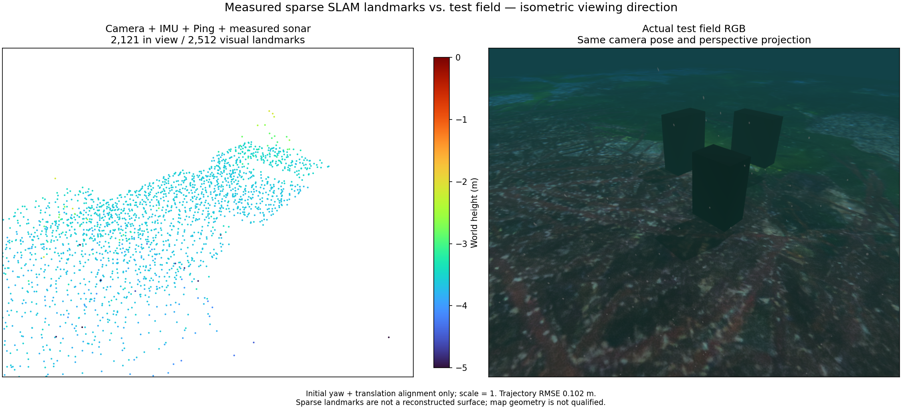
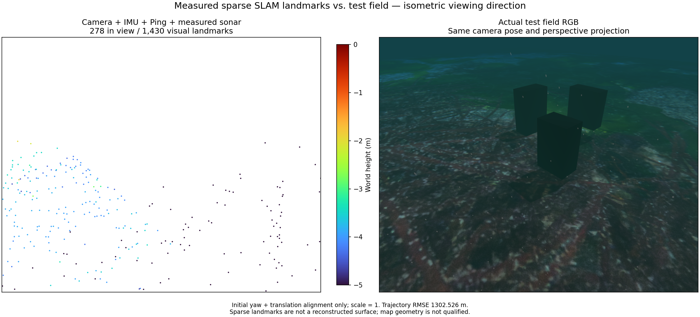

# Measured sonar fusion comparison / 실측 소나 결합 비교

Both runs replay the same 63.2-second camera, raw IMU and single Ping recording,
with the same 16-state window and sonar event times. Basalt revision:
`0f3b2b52c807f70ff4e2973ce253c73329eea7bc`, with POSIM native extensions.
Initial yaw and translation align the assessment; scale stays 1.

두 실행은 같은 63.2초 카메라·원시 IMU·단일 Ping 기록, 최근 상태 16개,
소나 이벤트 시각을 사용합니다. 평가는 초기 yaw와 위치만 정렬하며 축척은 1입니다.

Without sonar factors, position RMSE is 0.025 m and maximum error is 0.102 m.
With measured sonar intensity tracks and quadratic loss, RMSE is 0.983 m and
maximum error is 1.628 m. This fusion result fails the 0.10 m / 0.25 m position
gate and does not preserve useful object geometry.

소나 관측을 제외하면 위치 RMSE는 0.025 m, 최대 오차는 0.102 m입니다.
실측 소나 강도 트랙을 제곱 손실로 결합하면 각각 0.983 m, 1.628 m로 증가합니다.
이 결합 결과는 위치 기준 0.10 m / 0.25 m를 넘고 물체 형상을 유지하지 못합니다.

Each panel shows all retained visual landmarks beside the same actual underwater
RGB scene, using the same isometric viewing direction and camera projection.
The RGB keeps the recorded underwater environmental effects. The fixed Turbo
height range is −5 to 0 m. These PLYs contain visual landmarks, not exported
acoustic points or reconstructed surfaces. Truth is used only for assessment.

각 그림은 보관된 시각 랜드마크 전체와 같은 실제 수중 RGB 장면을 동일한
등각 방향·카메라 투영으로 비교합니다. RGB에는 기록 당시의 수중 환경 효과가
유지됩니다. Turbo 높이 범위는 −5~0 m로 고정합니다. 이 PLY는 시각 랜드마크이며
음향 점이나 복원 표면이 아닙니다. 정답값은 평가에만 사용합니다.

The sonar experiment supplies independent diagonal uncertainty of one range bin
(0.02508 m) and one azimuth bin (0.008213 rad). These are diagnostic assumptions,
not calibrated sensor uncertainties. Tracking does not establish a persistent
physical scatterer. This result does not enable or qualify the product mode.

소나 실험은 거리 한 빈(0.02508 m), 방위각 한 빈(0.008213 rad)의 독립 대각
불확실성을 가정합니다. 센서 잡음 보정값이 아니며, 영상 추적만으로 동일한
물리적 산란체를 추적한다고 판단할 수 없습니다. 이 결과로 제품 모드를 활성화하거나
사용 가능 판정을 내리지 않습니다.

## Robust track loss / 트랙 강건 손실

Huber loss over the full whitened track reduces this replay's RMSE to 0.102 m
and maximum error to 0.304 m. All 641 states and 2512 visual landmarks are exported.
The position gate still fails; sparse object geometry remains incomplete.
A completed replay does not resolve the earlier intermittent FOV failure or
establish repeatability. The client terminates the worker after the final export;
its −15 exit code is expected teardown, not a claim of graceful worker shutdown.

전체 백색화 트랙에 Huber 손실을 적용하면 이 재생의 RMSE는 0.102 m,
최대 오차는 0.304 m로 줄어듭니다. 상태 641개와 시각 랜드마크 2,512개를
내보냈지만 위치 기준을 여전히 넘고 물체 형상도 불완전합니다. 한 번의 전체
재생 완료로 이전의 간헐적 시야 오류나 재현성이 해결됐다고 판단하지 않습니다.
최종 내보내기 후 클라이언트가 작업 프로세스를 종료하므로 종료 코드 −15가
남습니다. 이는 정상적인 프로세스 내부 종료를 검증한 결과는 아닙니다.

## Reference-track failure / 기준 영상 추적 실패

Adding image-reference consistency to acoustic tracking does not establish
physical correspondence. With that optional trace, the 63.2-second replay
diverges: position RMSE 1,302.526 m, 1,430 retained visual points, only 278 in the
comparison view. No Ping constraints are fused. At 24.51 s the estimated
accelerometer bias changes abruptly by 1.5553 m/s², immediately after all 16
active acoustic tracks retire. The cause within optimization and marginalization
is unresolved; this trace is not the default.

음향 추적에 기준 영상 일관성 검사를 추가해도 물리적 대응 관계는 입증되지
않습니다. 이 선택형 추적 기록의 63.2초 재생은 위치 RMSE 1,302.526 m로
발산합니다. 보존된 시각 점 1,430개 중 비교 시야 안에는 278개만 있으며
Ping 제약은 반영되지 않았습니다. 활성 음향 트랙 16개가 모두 제거된 직후인
24.51초에 가속도계 바이어스 추정이 1.5553 m/s² 급변합니다. 최적화·주변화
안에서의 원인은 아직 해결되지 않았으며 이 추적 설정은 기본값이 아닙니다.

Joint trials reject loss of previously valid visual projections, so dropping a
residual cannot count as cost improvement. The rejection count is zero in this
failed replay; that separate defect does not explain this divergence. The same
worker without acoustic factors retains position RMSE 0.025 m and maximum error
0.102 m. Sparse map geometry remains unqualified.

공동 최적화는 유효했던 시각 투영을 잃는 단계를 거부하여 잔차 누락을 비용
개선으로 판단하지 않습니다. 이 실패 재생에서는 해당 거부가 0회이므로 별도로
확인한 이 결함이 발산을 설명하지는 않습니다. 같은 작업자에서 음향 관측을
제외한 대조군은 위치 RMSE 0.025 m, 최대 오차 0.102 m를 유지합니다.
희소 지도의 형상은 여전히 검증되지 않았습니다.

