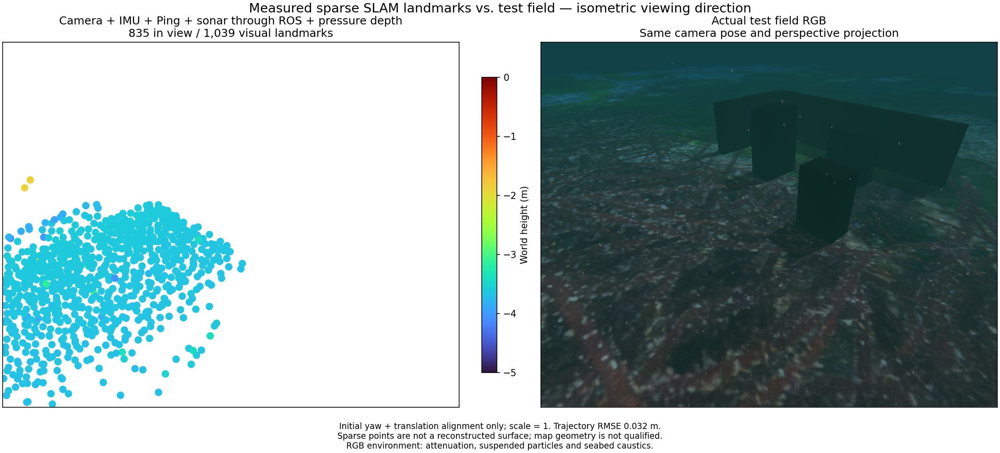
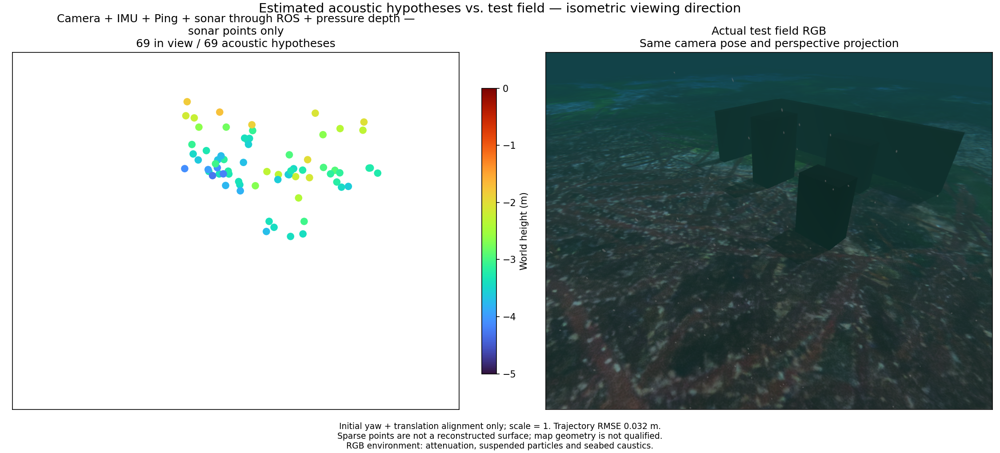

# Mixed visual/sonar pressure input

The experimental ROS owner combines camera, raw IMU, single Ping, imaging sonar and hydrostatic pressure depth. Pressure factors use calibrated variance, sensor mounting offset and one shared unknown height datum. Measurements retain their original timestamps. Validated arrivals advance input ordering independently of the 1 Hz pressure factor limit. Both map outputs and exports require recent acknowledged pressure optimization on both sensor and wall clocks.

The recorded ROS/native run exports 1,039 visual points and 69 acoustic hypotheses at a 5 Hz camera cap and 0.6x playback. Initial yaw/translation alignment keeps scale one. Position RMSE is 0.032 m. Only 37 acoustic hypotheses lie within 10 cm of a physical surface; surface-distance p90 is 0.311 m and maximum is 0.622 m. The sparse acoustic map does not reconstruct the terrain and remains unqualified.

Each pair uses the same isometric perspective, fixed Turbo height limits and enlarged markers. Field RGB includes underwater attenuation, suspended particles, seabed caustics and sea surface. This RGB overview and simulator geometry are evaluation-only. Estimation uses the recorded onboard camera, raw IMU, Ping, sonar and pressure observations.

Pressure interruption clears the acoustic map and rejects export. A fresh segment recovers 422 visual points, 12 acoustic hypotheses and 11 optimized pressure states. Sonar interruption also recovers; the camera/IMU/Ping control passes. These are recorded-input ROS/native integration checks, not new Gazebo missions, real-time deadlines or installed-app qualification. A 5 Hz/0.7x run overflows the bounded queue after a 2.7 s native processing stall; a 3 Hz trial loses visual support. Both failures remain open. Lower camera rates cannot qualify the default provider.

## 한국어

실험용 ROS 경로는 카메라·원본 IMU·단일 Ping·영상 소나·정수압 수심을 결합합니다. 압력 제약은 보정된 분산, 센서 장착 위치와 공유 미지 높이 기준값을 사용합니다. 원래 측정 시각을 유지하며, 검증된 수신 시각은 1 Hz 제약 선택과 독립적으로 입력 정렬을 갱신합니다. 두 지도 모두 센서·실시간 시계에서 최근 압력의 실제 최적화 반영을 확인해야 표시·내보내기를 허용합니다.

위 비교는 카메라 한도 5 Hz, 0.6배속 재생에서 얻은 시각 점 1,039개와 소나 가설점 69개입니다. 초기 방위각·위치만 정렬하며 축척은 1입니다. 위치 RMSE는 0.032 m이고 소나 점 37개만 실제 표면 10 cm 이내입니다. 표면 거리 오차 p90은 0.311 m, 최대는 0.622 m여서 지형 복원 합격으로 인정하지 않습니다.

두 비교는 같은 등각 방향 원근 투영, 고정 Turbo 높이 범위와 확대된 점을 사용합니다. RGB에는 수중 감쇠·부유 입자·해저 집광무늬·수면이 포함됩니다. 이 현장 RGB와 지형은 평가용이고, 추정 입력은 기록된 차량 카메라·IMU·Ping·소나·수압입니다.

압력 중단 뒤 새 구간에서 시각 점 422개·소나 가설점 12개·압력 최적화 상태 11개로 복구합니다. 소나 중단 복구와 기존 카메라·IMU·Ping 대조 실행도 통과합니다. 기록 기반 ROS/네이티브 연동 결과이며 새 Gazebo 주행·실시간 성능·설치형 앱 합격은 아닙니다. 5 Hz/0.7배속에서는 약 2.7초 처리 지연 후 큐가 넘쳤고, 3 Hz에서는 시각 추적을 잃었습니다. 두 문제는 미해결이며 낮은 카메라 주기만으로 기본 설정의 합격을 인정하지 않습니다.
