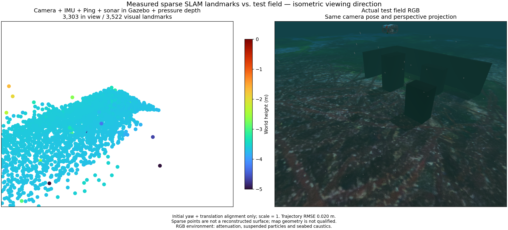
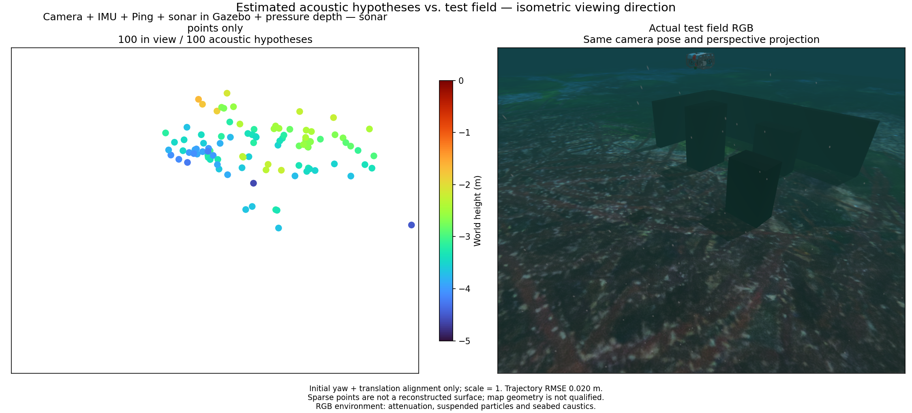

# Moving recovery / 이동 중 복구

The experimental camera + raw IMU + single Ping + imaging sonar + pressure combination can track a continuous submerged maneuver, but recovery while moving remains unqualified. Sensor delivery and small image reprojection error alone do not establish a correct metric trajectory.

In the isolated Gazebo/ArduSub example, a 4 m route repeats at depths of 1.5 and 2.1 m after one 2.4 m initialization excursion. The 90-second observation retains one estimator segment during the mission, with 450 published poses, 3,522 visual points and 100 acoustic hypotheses. Position RMSE is 0.0203 m over 89.8 s. Only 58 acoustic points are within 10 cm of physical surfaces; surface-distance p90 is 0.353 m and maximum is 0.979 m. This sparse map remains unqualified as a terrain reconstruction.

The comparison uses matching isometric perspective, fixed Turbo height limits and 4× point diameter. The RGB view includes underwater attenuation, suspended particles, caustics and sea surface. Simulator truth and field RGB are evaluation-only; the estimator receives measured sensor inputs.

A separate 1x ROS replay interrupts pressure for three seconds and then admits fresh camera, sonar, IMU and pressure measurements. Both stale maps clear and exports reject. The new segment produces poses and fused pressure, but no acoustic points: all 336 submitted track updates fail geometric consistency or observability checks. Independent truth confirms that this interval includes 1.63 m horizontal and 0.60 m vertical position spans. This case is not explained by the earlier near-stationary recovery interval.

The initial replay segment has 0.0252 m position RMSE; the restarted 11.2-second segment has 42.57 m RMSE and 114.83 m maximum error. The estimated trajectory is already wrong before acoustic map acceptance. Current startup uses a multi-sample gravity direction with zero initial velocity and bias; it is not a qualified moving initializer. The exact contribution of startup and subsequent optimization still needs controlled isolation. Keep the geometry checks, and address moving initialization and healthy-state continuity before enabling this mode.

The raw recording includes unpaired camera/sonar acquisition timestamps and two uncovered IMU intervals at its end. Asynchronous sonar events retain their original clocks. The assessed replay interval, 10.7–80.0 s, has complete measured IMU coverage; the excluded tail remains recorded as incomplete. No timestamp is shifted and the full recording is not described as fully covered.

Paired controls start at the same measured time, 68.8 s, with the same 5 Hz camera admission. Camera/IMU/Ping and camera/IMU with Ping factors disabled both diverge to 27.37 m position RMSE over 7.6 s (93.64 m maximum). Their trajectories agree to numerical precision. The failure also occurs without sonar or pressure factors; the common camera/IMU startup and estimation path needs investigation. The controls pass transport checks only, not accuracy.

## 한국어

대조 시험 둘은 같은 측정 시각 68.8초에서 같은 5 Hz 카메라 선택으로 시작합니다. 카메라·IMU·Ping과 Ping 제약을 끈 카메라·IMU 모두 7.6초 위치 RMSE 27.37 m·최대 오차 93.64 m로 발산하며 경로가 수치 정밀도 수준에서 같습니다. 소나·수압 제약이 없어도 발생하므로 공통 카메라·IMU 시작 및 추정 경로를 조사해야 합니다. 대조 시험은 전송 검사만 통과했으며 정확도 합격이 아닙니다.

실험용 카메라·원본 IMU·단일 Ping·영상 소나·수압 조합은 연속 수중 기동을 추적하지만, 이동 중 복구는 아직 합격하지 못했습니다. 센서 수신과 작은 영상 재투영 오차만으로 실제 거리 단위의 경로가 정확하다고 판단할 수 없습니다.

격리된 Gazebo·ArduSub 예시는 처음 한 번 2.4 m로 잠항한 뒤 1.5 m와 2.1 m 수심에서 4 m 경로를 반복합니다. 90초 관측 동안 임무의 추정 구간을 유지하며 자세 450개, 시각 점 3,522개와 소나 가설점 100개를 생성합니다. 89.8초 위치 RMSE는 0.0203 m입니다. 소나 점 58개만 실제 표면 10 cm 이내이며 표면 거리 오차 p90은 0.353 m, 최대는 0.979 m입니다. 지형 복원 합격으로 인정하지 않습니다.

비교는 같은 등각 방향 원근 투영, 고정 Turbo 높이 범위와 지름 4배의 점을 사용합니다. RGB에는 수중 감쇠·부유 입자·집광무늬·수면이 포함됩니다. 시뮬레이터 참값과 현장 RGB는 평가 전용이며 추정기에는 측정 센서 입력만 전달합니다.

별도의 1배속 ROS 재생에서 수압을 3초 중단한 뒤 새로운 카메라·소나·IMU·수압 측정을 받습니다. 중단 시 두 지도를 비우고 내보내기를 거부합니다. 새 구간은 자세와 압력 융합을 생성하지만 소나 점은 없으며, 제출된 트랙 갱신 336건 모두 기하 일관성 또는 관측 가능성 검사에서 거부됩니다. 이 구간의 독립 참값은 수평 1.63 m·수직 0.60 m의 위치 변화 폭을 보여, 앞선 정지에 가까운 복구 구간만으로 설명할 수 없습니다.

재생의 초기 구간은 위치 RMSE 0.0252 m지만 다시 시작한 11.2초 구간은 RMSE 42.57 m·최대 오차 114.83 m로 발산합니다. 소나 지도 승인 이전의 경로 추정부터 잘못됩니다. 현재 시작 경로는 여러 IMU 표본의 중력 방향과 초기 속도·바이어스 0을 사용하며, 검증된 이동 중 초기화가 아닙니다. 초기값과 후속 최적화의 영향을 더 분리해야 합니다. 기하 기준을 유지하면서 이동 중 초기화와 정상 센서 추정 상태의 연속성을 해결해야 모드를 활성화할 수 있습니다.

원본 기록에는 서로 다른 카메라·소나 측정 시각과 마지막의 IMU 미포함 구간 두 개가 있습니다. 비동기 소나 이벤트는 원래 시각을 유지합니다. 평가한 10.7~80.0초 재생 구간은 실제 IMU가 모두 포함되며, 제외된 마지막 구간은 불완전한 기록으로 남깁니다. 시각을 이동하거나 전체 기록이 완전하다고 처리하지 않습니다.
