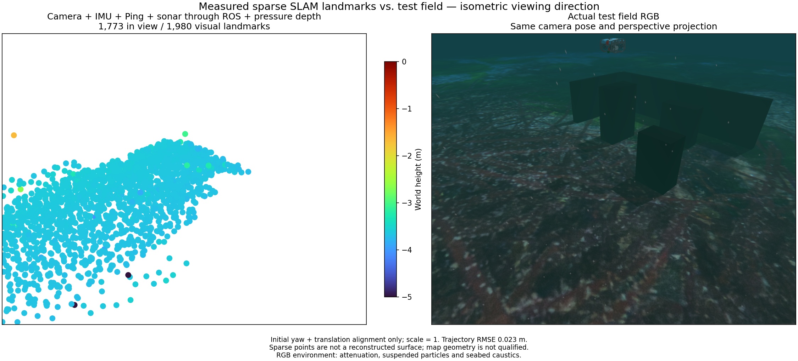
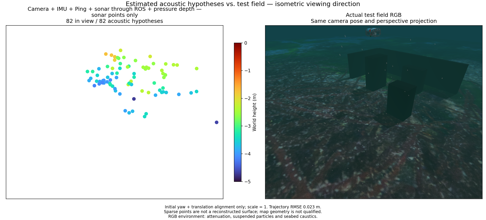

# Measured moving startup / 측정 기반 이동 초기화

The experimental camera + IMU + Ping + multibeam + pressure replay uses a
camera-track/IMU linear seed for gravity direction and initial velocity. Biases
remain conditioned at zero during startup; covariance and robust observability
are not qualified. Truth is used only for independent evaluation.

The initial segment has 2.26 cm position RMSE over 50.4 s. After a three-second
pressure outage, the new local segment has 6.17 mm RMSE over 8.2 s. Each segment
uses its own initial yaw and translation alignment, with scale fixed at one.
This does not establish continuity of a global map across the reset.

The initial export has 1,980 visual points and 82 acoustic hypotheses. Only
44 acoustic points are within 10 cm of physical collision surfaces: median
8.49 cm, p90 36.63 cm, maximum 1.075 m. Recovery exports 356 visual points and
only 4 acoustic hypotheses. These counts do not establish recovered surface
area or valid physical correspondences. Acoustic mapping remains unqualified.

The figures show initial exports with identical isometric viewing direction and
perspective, fixed Turbo height limits and four-times point diameter. The RGB
reference is the same static field captured after the mission, not a simultaneous
vehicle image. It includes attenuation, suspended particles, caustics and surface
waves. Simulation geometry and RGB are evaluation-only. No terrain truth enters
the estimator. Improved navigation therefore leaves acoustic correspondence,
elevation observability and reconstruction quality as separate problems.

## 한국어

실험용 카메라·IMU·Ping·멀티빔·수압 재생은 카메라 특징점 궤적과 IMU로
중력 방향과 초기 속도를 구합니다. 시작 시 바이어스는 0으로 고정하며,
공분산과 강건한 관측 가능성은 아직 검증되지 않았습니다. 참값은 독립 평가에만 씁니다.

초기 50.4초 구간의 위치 RMSE는 2.26 cm입니다. 수압을 3초 중단한 뒤
새 구간의 8.2초 RMSE는 6.17 mm입니다. 각 구간은 초기 방위각과 위치만
따로 정렬하고 축척은 1로 유지합니다. 재설정 전후 전역 지도의 연속성을 입증하지는 않습니다.

초기 지도는 시각 점 1,980개와 소나 가설점 82개입니다. 실제 충돌 표면에서
10 cm 이내인 소나 점은 44개입니다. 표면 거리는 중앙값 8.49 cm,
p90 36.63 cm, 최대 1.075 m입니다. 복구 지도는 시각 점 356개와 소나 점
4개입니다. 점 개수는 복원 면적이나 올바른 물체 대응을 뜻하지 않으며 소나 지도는 미검증 상태입니다.

그림은 초기 지도와 같은 등각 방향·원근 투영의 현장을 비교합니다. Turbo 높이
범위는 고정하며 점 지름은 4배입니다. RGB는 임무 후 촬영한 같은 정적 현장으로,
차량 영상과 동시 촬영한 것이 아닙니다. 수중 감쇠·부유 입자·집광무늬·수면 파도를
포함합니다. 시뮬레이터 지형과 RGB는 평가 전용입니다. 위치 추정이 개선되어도
소나 대응점, 높이 관측 가능성, 지형 복원 품질은 별도로 해결해야 합니다.
