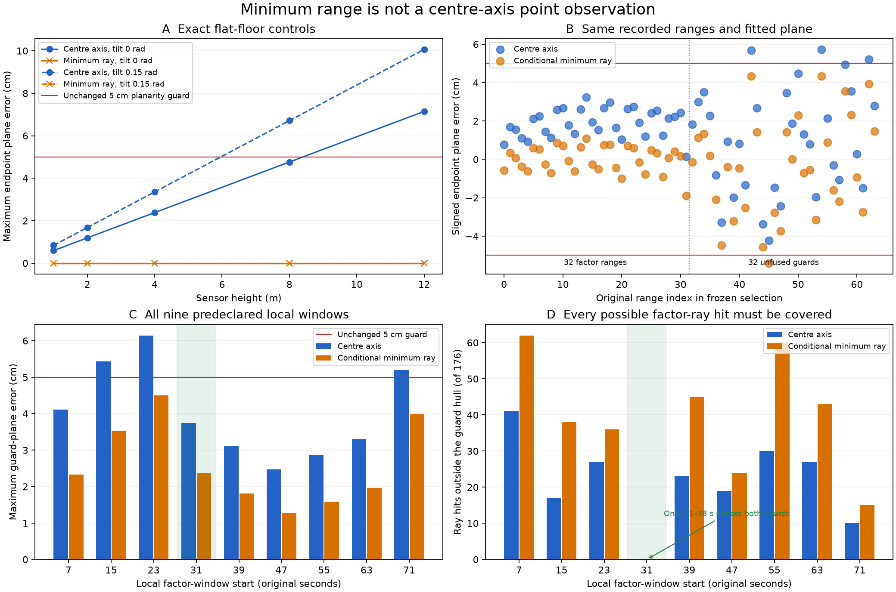

# Native local DVL surface and forward-view coverage

Nine predeclared windows each use eight consecutive DVL packets as range
factors, with four preceding and four following packets as unfused guards.
Every window is retained. The original support checks admit only the 31.01–38.01 s
window. The other eight fail planarity or spatial coverage. This uses the
existing model, without changing its 5 cm planarity limit, 0.75 m gap limit,
16-pose block limit, noise or 32 MiB workspace budget.

At 85.01 s, the real native Basalt owner accepts its 32 original ranges once,
keeps the guard readings unfused and retains one unknown plane. Replay continues
through 92.50 s and all 271 original state times. Fresh native snapshots retain
the 32-entry ledger and shared retirement conditionals. Final support still
passes; preparing the same original readings again is rejected. The incremental
workspace bound is 7,956,840 bytes. No independent pose or fitted-plane prior is
inserted. Camera, Ping and forward-sonar factors remain absent; raw IMU,
DVL velocity and pressure participate in navigation.

At three original DVL times, correlated predicted-range 3σ is **2.10–2.71 cm**.
These are local frozen-weight Gaussian approximations under an **uncalibrated**
20 mm independent / 10 mm packet-shared error model. Conditional independence
from DVL velocity noise is assumed. They are neither measured sensor accuracy
nor map error. The new native build's initial 24D marginal differs from the
retained build by at most 2.95e-15 in mean coordinates and 2.47e-15 in covariance.
The serialized bytes differ; the first byte-equality failure is preserved in
the private operational record. The driver finishes normally and closes the
worker with SIGTERM (-15), so installed shutdown qualification remains open.

## Minimum range and physical support



A finite-aperture minimum range is not a centre-axis point observation. In an
exact flat-floor control at 8 m height and 0.15 rad tilt, that conversion produces
6.71 cm of false plane deviation. Using the conditional minimum-ray direction
with the **original measured range** removes this geometric bias, without
forcing a point onto the fitted plane. On the original extended-support field
case it still leaves 5.41 cm maximum deviation and 30 unsupported ray hits.
Neither endpoint representation qualifies that case. The native local control
above retains the existing nominal-axis guard; no endpoint-conversion patch is
needed to make its single supported window pass.

The cubemap adapter evaluates supplied angles in float64, including float32
wire arrays, and returns float64 unit directions. This preserves the angle
values while avoiding storage-dependent normalization. The retained float64
DVL directions and original 332-range replay are unchanged.

The forward-view check uses all **181 actual original sonar timestamps** and
the source-derived 256×256 ray grid already retained in the adjacent
[renderer-sampling record](../sonar-renderer-sampling-20261101/README.md).
The installed finite patch partially overlaps 81 views, but **no view has a
complete vertical ray column inside it**. The hull of all 332 original DVL
endpoints has potential full-column coverage in ten views; those endpoints do
not establish one valid global plane or dense occupancy. Unknown geometry
outside the patch is not assigned zero return. No forward-sonar likelihood is
installed and no sonar cloud is accepted. The next operational test must sound
the intended floor region before imaging it from translated return viewpoints.

## Recheck

```sh
PYTHONPATH=src python docs/diagnostics/native-local-floor-20261101/verify.py
```

The verifier uses this independent library and NumPy. It reuses the adjacent
native-initial-bias snapshot and original sampled-DVL inputs. The source adapter
reconstructs the exact 256×256 ray grid from 512 retained float32 angles, checked
by its array hash. Only the new final native snapshot is added. It recomputes all nine admissions,
original-reading ownership, final support, correlated range queries and all
181 geometric coverage cases. It checks recorded native transport evidence;
it does not restart a worker, renderer or simulator. No SDK, full raw recording
or private WWW-POSIM implementation is included. The figure depicts conditional
geometry and guards, not observed XYZ landmarks or a reconstructed SLAM map.

## 네이티브 국소 DVL 표면과 전방 관측 영역

미리 정한 9개 구간을 모두 검사합니다. 각 구간은 연속 DVL 패킷 8개의
거리 32개를 제약으로 사용하고, 앞뒤 패킷 4개씩은 관측 영역 검사에만
사용합니다. 기존 검사에서 **31.01–38.01초 구간 하나만 통과**합니다.
평면 편차 5 cm, 관측 간격 0.75 m, 자세 16개와 메모리 32 MiB 한도 및
잡음 설정을 유지합니다. 나머지 8개 구간의 거부 결과도 보존합니다.

85.01초에 실제 네이티브 Basalt 추정기가 원본 거리 32개를 한 번만
반영합니다. 검사 전용 거리는 융합하지 않습니다. 이후 92.50초까지
원래 상태 시각 271개를 모두 재생합니다. 미지 평면과 시점 간 조건부
관계를 보존하고, 같은 거리의 재사용을 거부합니다. 마지막 관측 영역
검사도 통과하며 추가 계산 공간 상한은 7,956,840바이트입니다.
카메라·Ping·전방 소나 제약은 없고, 원시 IMU·DVL 속도·수압은 사용합니다.

거리 예측의 3σ는 세 DVL 시각에서 2.10–2.71 cm입니다. 독립 오차 20 mm와
패킷 공통 오차 10 mm 및 속도 잡음과의 조건부 독립을 가정한 국소 근사입니다.
센서 보정값이나 지도 오차가 아닙니다. 새 빌드와 기존 빌드의 초기 24차원
분포 차이는 평균 좌표 2.95e-15, 공분산 2.47e-15 이하입니다. 직렬화된
바이트는 다릅니다. 드라이버는 정상 완료하고 작업자를 SIGTERM(-15)으로
종료하므로 설치형 앱의 종료 검증은 별도로 남습니다.

최소 거리를 빔 중앙축에 놓으면 평평한 해저도 틀어진 표면처럼 보일 수
있습니다. 높이 8 m·기울기 0.15 rad 대조군의 편차는 6.71 cm입니다.
조건부 최소 음선 방향에 **원래 측정 거리**를 적용하면 이 기하 편향은
없어지지만, 기존 현장 대조군에는 편차 5.41 cm와 관측 영역 밖 교점
30개가 남습니다. 이 보정만으로 지도를 수용하지 않습니다. 위 네이티브
시험은 기존 중앙축 검사를 유지해 통과하며, 표시된 끝점은 측정 XYZ가 아닙니다.

큐브맵 어댑터는 float32로 전달된 각도도 값 자체는 유지하고 float64로
계산해 단위 음선 방향을 반환합니다. 기존 float64 DVL 방향과 원래 거리
332개의 재생 결과는 같습니다.

전방 검사는 실제 소나 시각 **181개 전체**와 소스에서 구한 256×256 음선
격자를 사용합니다. 유효한 국소 패치는 81개 시점에서 일부 겹치지만,
수직 음선 전체를 포함하는 빔은 없습니다. DVL 끝점 332개 전체의 볼록
껍질은 10개 시점에 잠재적 포함 영역을 제공하지만, 유효한 단일 평면이나
빈틈없는 해저 관측을 입증하지 않습니다. 영역 밖을 반사 없음으로 놓지
않으며 소나 제약·점군 지도는 수용하지 않습니다. 다음 현장 시험은 DVL로
먼저 훑은 영역을 이동한 복귀 시점의 소나가 다시 보도록 구성합니다.

위 명령은 공개 라이브러리와 NumPy만으로 9개 구간, 거리 소유권·재사용
거부·마지막 영역 검사·결합 불확실성과 181개 시점의 기하를 다시 계산합니다.
네이티브 동작은 저장된 기록으로 확인하며 작업자를 재실행하지 않습니다.
음선 격자는 보존된 float32 각도 512개와 소스 어댑터로 정확히 재구성하고
배열 해시를 검사합니다. 원본 전체·SDK·WWW-POSIM 비공개 코드는 포함하지 않습니다.
