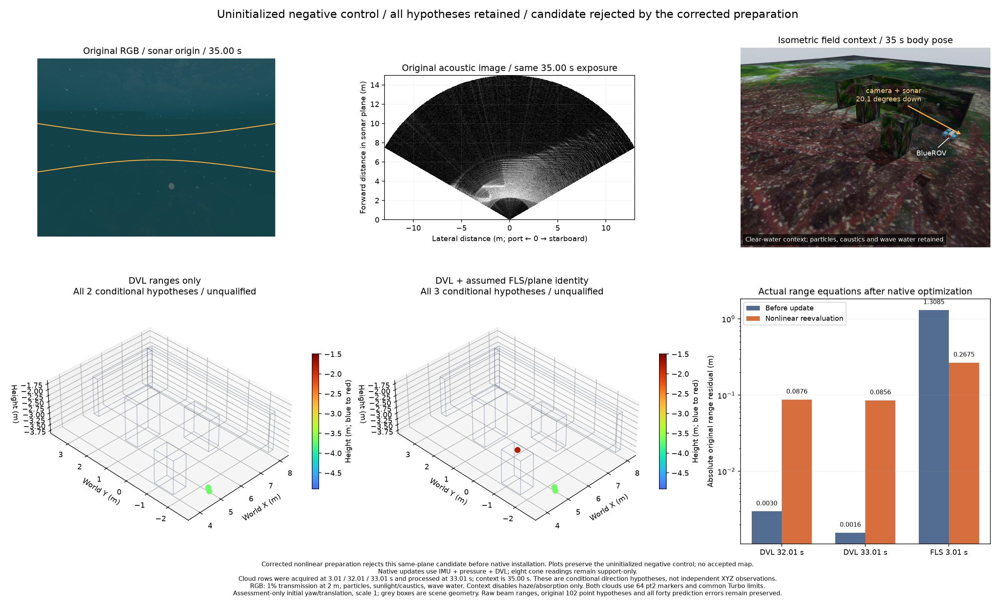

# Original range rows and nonlinear surface initialization

`native_surface_ranges` connects original DVL cone and FLS fan observations to
the native snapshot/increment API. Exact owned timestamps, mounting, joint
pose/plane derivatives and the full supplied covariance stay together. It
neither converts DVL ranges to measured XYZ nor inserts a fitted-plane prior.

New unknown planes are initialized with their actual nonlinear factor rows.
The complete support geometry is checked again at the solved reference before
any native installation. Numerical damping belongs only to this initialization
solve. Its Hessian, covariance and damping never become probability information.
Support-only readings remain guards and add no likelihood. A failed candidate
is rejected whole; no source reading is removed to make it fit.

Read-only linearization also reevaluates already consumed observations without
adding them again. Conditional observability retains unbounded normal/distance
modes. A fan prediction may remain observable despite an unobservable plane,
so plane rank alone is not used as an acceptance switch. These diagnostics fix
poses and exclude native prior information; they are not joint uncertainty.

## Measured failure and correction

The candidate is selected first by causal availability in the retained 15 m
record, never by onset residual. At 33.01 s, it links sonar beam 70 from 3.01 s
to a later DVL patch. Nine original cone readings supply nominal support.
Eight remain support-only because their entire cones do not fit within the
observed hull. Only two cone readings become likelihood rows.

The uninitialized native control accepts those two rows and the assumed FLS
association. The two cone rows leave one plane direction unbounded. Adding
the FLS row makes the conditional matrix full rank, but it does not establish
physical correspondence. Native optimization changes plane rotation
coordinates by about 1.10 rad and distance coordinates by 5.99 m while the
trajectory changes by less than 0.35 mm. Nonlinear reevaluation retains DVL
errors of 8.76/8.56 cm and an FLS error of 26.75 cm. Cost reduction and a stable
trajectory therefore do not qualify the map.

The corrected preparation initializes against all actual associated rows and
rechecks every support condition. The same FLS/plane candidate fails
`dvl_support_not_planar` **before installation**. Before/after native
coordinates, references, conditionals, prior revision, owner revision and
reading ledger are exactly equal. The whole replay still emits all 178 states
at original timestamps and differs from its no-acoustic baseline only at
floating-point tolerance.

The DVL-only candidate initializes in seven iterations, reducing initial
squared-residual cost from 0.01136 to 6.47e-23 without an added prior. It
installs two original readings in the actual native worker. After native
optimization, complete support still passes and the actual nonlinear range
errors are 14.7/17.5 micrometres. These are one diagnostic instance, not hardware
accuracy: its plane still has an unbounded direction, range variance is
unreported, and velocity/range cross-covariance is unmodelled.

The figure preserves the uninitialized negative control. Clouds contain all
two/three conditional measured-range hypotheses, not a qualified SLAM map or
independent XYZ measurements. Marker area is 64 pt², with common Turbo limits
−4.9 to −1.5 m. Initial yaw/translation alignment and grey scene boxes are
assessment-only. Range rows are acquired at 3.01/32.01/33.01 s and processed at
33.01 s. The RGB and acoustic images share the 35.00 s exposure/origin; the
isometric context uses the same 35 s body pose and shows camera/sonar direction.
RGB uses 1% transmission at 2 m, particles, sunlight/caustics and wave water.
Context disables haze/absorption only; those other visual effects remain.

## All original hypotheses remain

All 664 published predictions across eighteen selected patch groups remain in
the known-pose scan. Reinitializing cone geometry yields 601 finite conditional
predictions, 53 unbounded predictions and ten geometry/support rejections.
All forty original errors above 10 cm remain: 36/1/3 respectively. Finite
conditional variance does not identify an echo or qualify a map. The earlier
historical-plane scan is retained separately because support membership can
change when the plane model is initialized consistently.

Historical compact patches contain stamps/nominal endpoints without beam IDs.
This diagnostic recovers each ID through unique equality to the original raw
beam endpoint, with maximum first-patch discrepancy below 1e-15 m. Those
historical XYZ values never become support geometry or measurements: current
owned poses and immutable original ranges rebuild every support point.

## Verification and scope

Nine new Python controls cover original-row information, gauge directions,
full covariance, support-only accounting, owned plane coordinates, expired
and duplicate readings, read-only reevaluation, unbounded prediction modes,
nonlinear initialization and whole-candidate rejection. Independent frozen
source and an outside-installed wheel each run 503 tests: 487 pass and sixteen
optional legacy native/decoder checks skip explicitly.

Four native original-input replays retain all 178 states each: uninitialized
DVL and DVL/FLS controls, then the corrected DVL and rejected-FLS controls.
Original sensor clocks, noise, retention limits and all 102 earlier point
hypotheses/forty larger prediction errors stay fixed. Every client closes with
the existing SIGTERM (-15); this is not a normal-zero acquisition or live
throughput qualification. The prior source-matched native core is reused;
every tracked native recipe file matches its build manifest. A broad initial
inventory check also included generated test bytecode from another checkout;
the canonical source comparison uses the complete tracked recipe inventory.
No SDK, provider receipt, LIVE process or runner is modified.

Complete requests, receipts, native events, snapshots, increments, mathematical
logs, rejected controls and conditional PLYs are retained. Identical processed
snapshots have one content-addressed copy per record. Raw sensors remain once
in the [canonical dataset](../sonar-low-altitude-15m-20261029/data-pointer.json).
`verify.py` checks this record and reproduces initialization/rejection using
only the library plus stored snapshots/requests. Full acquisition replay needs
that dataset and the corresponding WWW-POSIM diagnostic driver; private
application implementation is not included here.

The next requirements are full joint landmark uncertainty, physical echo
identity and calibrated range noise, nonlinear consistency for continuing
owned-surface updates, useful complete maps and live timing. Do not expand
physical trials or expose this backend as an accepted map until these short
cases pass. Installed recovery/export, final BlueROV/product/VRX and later
WAM-V survey acceptance remain open. Nonlinear initialization and Gaussian
block algebra are established operations; this record makes no novelty claim.

한국어: 원본 빔 거리와 현재 추정 상태를 함께 계산하는 연결부를 추가했습니다.
지지 확인용 표본을 독립적인 평면 사전정보로 다시 넣지 않습니다. 실제 거리식으로
새 미지 평면을 초기화한 뒤 지지 범위를 재검사합니다. 잘못된 대응은 일부 관측을
버려 맞추지 않고 후보 전체를 거부하며, 네이티브 상태를 갱신하지 않습니다.

첫 원본 후보는 거리 제약으로 쓸 수 있는 DVL 관측이 두 개뿐입니다. 잘못 연결한
소나 관측을 초기화 없이 넣으면 궤적은 0.35mm 이내로 유지돼도 평면 추정이 크게
틀어집니다. 수정된 경로는 같은 후보를 설치 전에 거부합니다. 자세·기준 좌표·조건부
관계·사전정보·원본 관측 기록이 정확히 보존됩니다. DVL만 사용한 대조군은 설치와
설치 후 지지 재검사를 통과하지만, 평면의 관측 불가능한 방향은 그대로 남습니다.

그림은 거부된 대조군의 모든 조건부 가설을 보존합니다. 점 두세 개로 완성된 지도나
독립 XYZ 관측을 주장하지 않습니다. 카메라·소나 원본은 같은 35초 영상이며 현장
등각도 영상에는 BlueROV와 두 센서 방향을 표시했습니다. RGB의 2m 시야 감쇠,
입자·집광무늬·수면 파도를 유지하고, 현장 참고 영상만 안개·흡수를 끕니다.

원본 예측 664개와 큰 오차 40개를 모두 보존했습니다. 새 Python 검사 9개가
통과했고 독립 소스와 별도 설치 wheel은 각각 503개 중 487개 통과, 선택 검사
16개 생략입니다. 센서 원본을 복사하거나 잡음·상태 예산·지도 기준을 완화하지
않았습니다. 반사면 대응, 전체 결합 불확실성, 계속 갱신하는 평면의 비선형 일관성과
실제 유용한 지도는 다음 검증 과제입니다.
