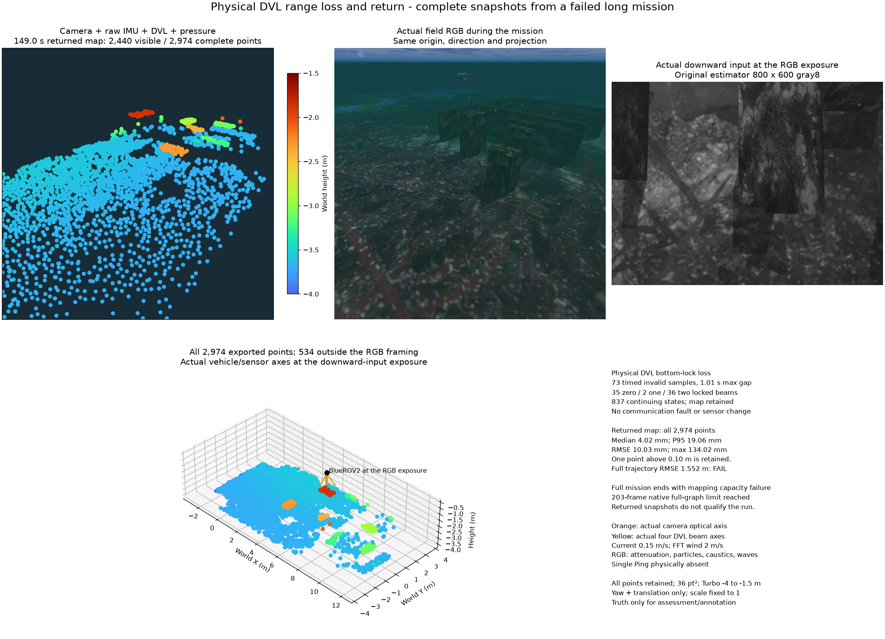

# 실제 DVL bottom-lock 상실과 지도 용량 경계

실제 카메라·원시 IMU·DVL·수압을 사용하며 Ping은 없습니다. DVL의 20m
범위·4개 음선·잡음은 유지합니다. 얕은 Orca5 구간 뒤에 약 30m 깊이의
시험 해저를 만들고 시각·충돌 메시와 항법 지형을 함께 갱신했습니다.
동쪽 0.15m/s 조류와 풍속 2m/s의 FFT 파도를 실제 모델 응답으로 확인했습니다.
제품 기본 지형을 바꾼 결과는 아닙니다.

73.00~145.01초에 원본 시각을 가진 bottom-lock 무효 표본 73개가 들어왔습니다.
수신 간격은 최대 1.01초입니다. 0/1/2개 음선 추적이 각각 35/2/36개였고
무효 속도는 융합하지 않았습니다. 같은 워커·좌표 구간에서 자세 837개와
최소 2,744점이 유지됐으며 지도 준비 상태는 거짓이었습니다. 통신을 끊거나
무효 값을 주입하지 않았습니다. 시간표가 있는 무효 관측은 스트림 시계를
진행시키므로 통신 유실용 `suspended_streams` 판정과 구분합니다.

복귀 뒤 147/149초에 전체 2,936/2,974점을 다운로드했습니다. 각 지도는 물체
범위 6개를 충족합니다. 149초 전 점 중앙값/P95/RMSE/최대는
4.017/19.061/10.030/134.024mm이며 10cm 초과 1점도 남깁니다.
RGB와 원본 하향 입력·차량 및 센서 축은 같은 38.0초 노출입니다.
RGB와 점군 투영은 같은 카메라입니다. 전체 패널에는 화면 밖 534점도 있습니다.
Turbo −4~−1.5m·36pt²와 축척 1을 사용합니다. 수중 감쇠·입자·집광무늬·파도를
적용했고, 주황은 카메라 광축, 노랑은 실제 DVL 음선 방향입니다.

**전체 운용은 실패입니다.** 원래 위치 검사에서 1,619개 자세의 RMSE/최대는
1.552/4.236m로 실패했습니다. 156.96초에 12개 도착·부상은 완료했지만
마지막 지도는 `mapping_image_capacity`로 제공되지 않았습니다. 입력 SQLite의
실제 프레임 수는 203개로 한도와 같고, 영상 환산 누적 값은 48,720,000B로
96MiB보다 작습니다. 마지막 화면의 195개는 이전 완료 계산의 통계이므로
실패 배치 크기로 해석하지 않습니다. 원시 영상은 이 저장소에 남지 않으며
단순 RAM 증설로 전체 그래프의 유한 상태 차원이 해결되지 않습니다.

검증 관측기는 중단 전 다운로드를 늦게 요청해 두 PLY를 모두 복귀 뒤에
얻었습니다. 유실 중 실제 HTTP 다운로드 요청 증거는 없습니다. 해당 실패
판정을 보존하며 사후 분석을 전체 실행 통과로 바꾸지 않습니다.

같은 원본을 기존 선택형 `conditional_paged_v1`로 재생하면 223프레임·
3,557점까지 계산하고 용량 오류 없이 진행합니다. 16프레임 선읽기는 원본
해시·바이트·시각과 384MiB 예산을 유지하며 최대 예약량은 9,185,536B입니다.
하지만 최종 전체 다운로드는 원래 10초 한도의 `map_update_timeout`으로
실패했습니다. 원래 값·잡음·최신성·지도 채택 한도와 기본 정책을 유지합니다.
새 알고리즘이나 기본값 수용으로 주장하지 않습니다. 첫 재생은 SSD 80GB
보존 기준으로 종료됐고, 공간이 회복된 뒤 한 번 다시 재생했습니다.

[전체 수치·자원·한계](summary.json) · [147초 전체 PLY](returned-147s.ply) ·
[149초 전체 PLY](returned-149s.ply).

[그림의 제3자 고지](../../../THIRD_PARTY.md) · [English](README.md)

시간 계측만 추가한 별도 네이티브 재생은 원본 전송 바이트·시간표를
보존합니다(최대 발행 지연 7.35ms). 요청 리비전 220은 진행 중 계산을
3.940초 기다린 뒤 6.379초를 계산하여 원래 10초 기한에 대해 합계
10.318초가 걸렸습니다. 그래프 갱신은 5.206초, 정보 추출은 0.981초입니다.
실패를 재현한 원인 계측이며 다운로드 수용은 아닙니다.
[요청 시간 계측](request-timing.json)에 원본 개수·실패를 보존합니다.
기한·수치 정책은 유지합니다.
