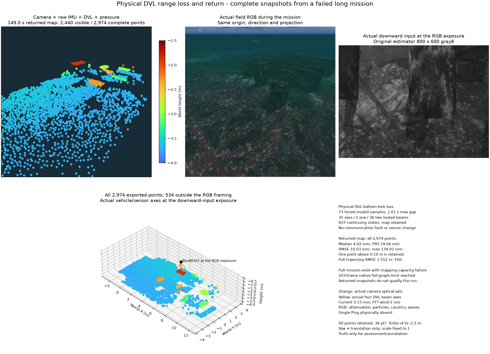

# Physical DVL bottom-lock loss and mapping capacity

The physical payload contains camera, raw IMU, DVL and pressure, without Ping.
The DVL retains its 20 m range, four beams and noise. An authored approximately
30 m deep shelf follows the shallow Orca5 field; visual/collision meshes and
navigation terrain are updated together. Actual solver readbacks confirm an
0.15 m/s eastward current and FFT waves with 2 m/s wind. Product-default terrain
is unchanged.

From 73.00 to 145.01 seconds, 73 original timestamped invalid bottom-lock samples
arrive at intervals no greater than 1.01 seconds. Zero/one/two locked beams occur
35/2/36 times. Invalid velocities are not fused. The same worker/frame retains
837 continuing poses and at least 2,744 map points while reporting not ready.
Neither communication nor invalid values are injected. Timed invalid samples
advance the stream clock; communication-only suspended-stream checks differ.

Complete exports at 147/149 seconds contain 2,936/2,974 points, each meeting six
object-coverage conditions. The 149-second all-point surface median/P95/RMSE/
maximum is 4.017/19.061/10.030/134.024 mm. The point above 10 cm remains included.
RGB, original downward input and vehicle/sensor axes use the same 38.0-second
exposure. RGB and projected cloud use the same camera. The complete panel also
shows all 534 points outside that framing. Markers are 36 pt², Turbo spans −4 to
−1.5 m and scale is fixed to 1. RGB includes attenuation, particles, caustics and
waves. Orange shows the camera axis; yellow shows actual DVL beam directions.

**The complete run fails.** Its original position gate rejects 1,619 poses with
RMSE/maximum 1.552/4.236 m. Twelve arrivals including surfacing complete in
156.96 seconds, but final mapping reports `mapping_image_capacity`. The actual
SQLite frame count is 203, equal to its configured ceiling. Cumulative processed-
image accounting is 48,720,000 bytes, below 96 MiB. The last reported 195 frames
belong to the previous completed computation, not the failing batch. This store
does not retain raw images; additional RAM alone does not remove the full graph's
finite state dimension.

The observer requests its pre-loss export too late: both retained PLYs are after
return. An actual HTTP export attempt during loss is missing. The failed verdict
remains preserved; the independent audit does not turn it into a passing run.

Replaying the same original input with existing opt-in `conditional_paged_v1`
reaches 223 frames and 3,557 points without a capacity error. Ordered 16-frame
prefetch preserves original hashes, bytes and stamps within the same 384 MiB
budget; peak reserved input is 9,185,536 bytes. Final complete export nevertheless
fails the original 10-second `map_update_timeout`. Noise, freshness, map admission
and the default policy remain unchanged. This does not qualify a new algorithm
or default. The first replay stops at the 80 GB SSD reserve; one replay follows
after free space recovers.

[Complete results, resources and limitations](summary.json) ·
[Complete 147-second PLY](returned-147s.ply) · [Complete 149-second PLY](returned-149s.ply).

[Third-party figure notices](../../../THIRD_PARTY.md) · [한국어](README.ko.md)

A timing-only native replay preserves every recorded wire payload and schedule
(maximum sending lag 7.35 ms). The requested revision 220 waits 3.940 s for
the in-flight update, then takes 6.379 s: 10.318 s total against the unchanged
10 s deadline. Graph update is 5.206 s and information extraction 0.981 s.
The request fails; this is causal timing evidence rather than export acceptance.
See [request timing](request-timing.json). No deadline or numerical policy changes.
