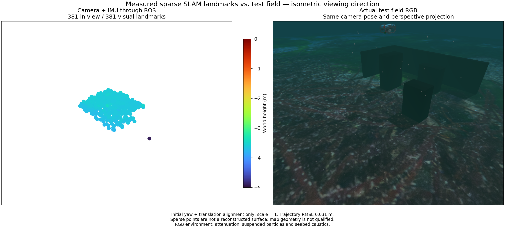

# Experimental ROS moving startup

WWW-POSIM's ROS owner exposes `--moving-initialization` as an experimental CLI
option. It uses the component's native startup tracking and `tracked_imu_seed`;
the GUI/default provider does not enable it. Startup images are capped at 5 Hz,
even when the normal camera rate is higher. At least three seconds of measured
features and raw IMU precede the first metric state, within the existing
32-frame bound. Sensor loss resets feature frames, candidate/submitted seeds,
raw IMU history and the map together. Startup export is rejected and navigation
readiness remains false. Provider source receipts include the seed module.

A camera/IMU ROS replay with exact Ping input pairing but native Ping factors
disabled exports 381 visual points. Over 53 evaluated states and 10.4 seconds,
position RMSE is 0.03134 m and maximum error 0.05600 m. Three lifecycle tests and
eight provider/source tests pass. Both actual ROS replays verify that map export
is unavailable during startup; saved statuses show no pre-estimator map/ready
claim. All owned workers and threads stop.

The visual points cover a small seabed patch. Matching isometric field RGB
includes attenuation, suspended particles and seabed caustics. Height uses
Turbo and markers have four-times diameter. This is not a qualified terrain map.

The camera/IMU/Ping/sonar/pressure trial deliberately loses pressure, clears the
old maps and reinitializes. The initial trajectory RMSE is 0.01036 m over 10.5 s;
the recovered trajectory RMSE is 0.00673 m, maximum 0.01244 m, over 8.2 s.
Pressure is fused again in eight states. However, the recovered acoustic archive
has zero points and sonar export fails. **The mixed recovery trial fails.**
Its 169 acoustic initialization rejections comprise 128 inconsistent/unobservable,
38 elevation-underconstrained and three ambiguous-elevation cases. The initial
acoustic export contains only three points. No geometry gate is relaxed.

This separates the repaired moving VIO startup in this record from the remaining
sonar landmark geometry problem. Bias uncertainty, outlier-robust initialization,
longer/more varied trajectories, mixed acoustic map recovery and installed GUI
qualification remain open. A low trajectory residual is not complete SLAM
acceptance or a research novelty claim.

## 한국어

WWW-POSIM ROS 관리자는 실험용 CLI 옵션 `--moving-initialization`으로
네이티브 초기 특징점 추적과 `tracked_imu_seed`를 사용합니다. GUI·기본
공급자는 이 옵션을 켜지 않습니다. 일반 영상 속도가 더 높아도 초기 영상은
최대 5Hz이고, 최소 3초의 특징점·원시 IMU를 수집합니다. 32프레임 제한을
유지하며 센서 단절 시 특징점, 초기값, IMU 기록, 지도를 함께 비웁니다.
초기화 중 다운로드는 거부하고 항법 준비 완료는 표시하지 않습니다.
공급자 소스 검증 목록에도 초기화 모듈을 포함합니다.

카메라/IMU ROS 시험은 Ping 입력 시각을 맞추되 네이티브 Ping 제약은 끕니다.
시각 점 381개를 내보냈고, 53개 상태·10.4초의 위치 RMSE는 0.03134m,
최대 오차는 0.05600m입니다. 수명주기 검사 3개와 공급자·소스 검사 8개가
통과했습니다. 실제 ROS 시험에서도 초기 다운로드 차단과 초기 지도·준비
완료 미표시를 확인했습니다. 사용한 작업자와 스레드는 모두 종료했습니다.

위 그림은 작은 해저 영역의 점군입니다. RGB와 같은 등각 시선·투영을
사용하며 수중 감쇠·부유 입자·해저 집광무늬를 포함합니다. Turbo 높이 색상과
지름 4배 표시를 유지하며 지도 형상은 아직 합격하지 않았습니다.

카메라/IMU/Ping/소나/압력 혼합 시험에서는 압력을 끊고 기존 지도를 비운 뒤
재초기화했습니다. 초기 10.5초의 위치 RMSE는 0.01036m이고, 복구 후
8.2초의 RMSE는 0.00673m, 최대 오차는 0.01244m입니다. 압력도 8개 상태에서
다시 융합했습니다. 그러나 복구된 음향 점은 0개여서 **혼합 복구 시험은
실패**입니다. 소나 초기화 거부 169회는 관측 불일치·관측 불가 128회,
높이 제약 부족 38회, 높이 모호성 3회입니다. 초기 음향 내보내기도 3점뿐이며
기하 판정 기준은 완화하지 않았습니다.

이 기록의 이동 VIO 초기화 개선과 소나 랜드마크 기하 문제를 구분합니다.
바이어스 불확실성, 이상 관측에 강건한 초기화, 더 다양한 장시간 궤적,
음향 지도 복구와 설치형 GUI 검증이 남아 있습니다. 작은 궤적 오차만으로
SLAM 전체의 합격이나 연구 신규성을 주장하지 않습니다.
