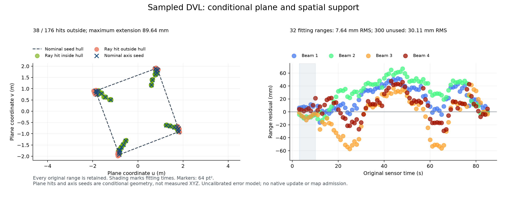

# Sampled DVL ranges and conditional background

This controlled replay uses the original DVL bottom ranges and the shared native
IMU/DVL-velocity/pressure posterior. The first eight packets supply 32 range
factors for one unknown coarse plane; 300 later ranges remain unused in fitting.
Scene geometry, simulator truth, RGB and sonar images do not enter inference.

The sampling hypothesis references gz-sensors 10.1.1 and gz-rendering 10.0.2.
Original sensor-frame axes determine nominal cone membership; nearest cubemap
texels determine intersection directions. This is not an exact DVL producer
operand/pose trace. Reported range variance is missing. The frozen diagnostic
model assumes 20 mm independent error and 10 mm packet-shared error, with
conditional independence from velocity noise. These are uncalibrated assumptions.

The original full conditional-recovery query exceeds its unchanged 32 MiB limit.
`recover_modes` obtains the same eight conditional poses as the complete joint
query with a 29,880-byte numeric workspace bound. This mode query computes no
uncertainty. Adding the original range likelihood keeps the full native root
information once, all shared pose dependence and 232 updated conditionals. Its
workspace bound is 9,961,320 bytes. No fitted plane prior or independent pose
observation is added. The batch solve is one local Gaussian approximation.

- Training ranges: RMS **7.64 mm**, maximum **21.23 mm**, all 32 retained.
- Unused ranges: RMS **30.11 mm**, maximum **66.76 mm**, all 300 retained.
- Spatial support: **38 of 176** conditional ray hits lie outside the nominal
  seed hull; maximum extrapolation is **89.64 mm**.

The strict support check rejects the plane. A separately labelled calculation
without that check diagnoses the model; it does not install an update or admit
a map. The error values are not universal marine acceptance limits. Next work
must represent finite spatial support and terrain variation with uncertainty,
then check unused views before coupling the background to sonar reflectors.



The left panel shows conditional plane intersections and nominal axis seeds,
not observed XYZ landmarks. The right panel retains every range residual.
Point markers are 64 pt². The scene is not rendered in this diagnostic and no
new sensor combination or useful sonar point cloud is qualified here.

```sh
PYTHONPATH=src python docs/diagnostics/sampled-dvl-background-20261101/verify.py
```

The NumPy verifier reuses the public native snapshot in the adjacent
`native-initial-bias-20261101` record. It checks original-reading ownership,
joint uncertainty, every range residual and the support rejection. It neither
starts a simulator/worker nor copies the complete sensor recording or SDK.

## 표본 DVL 거리와 조건부 배경

실제 DVL 해저 거리와 IMU·DVL 속도·수압의 네이티브 사후 분포를 사용합니다.
처음 8개 패킷의 거리 32개로 미지 평면을 추정하고 이후 거리 300개는 적합에
쓰지 않습니다. 장면 형상·정답·RGB·소나 영상은 추정 입력이 아닙니다.

gz-sensors 10.1.1과 gz-rendering 10.0.2의 표본 음선 모델을 사용합니다.
센서 좌표계의 원래 축으로 원뿔 포함 여부를 정하고 큐브맵 텍셀의 방향으로
교점을 계산합니다. 실제 DVL 생성기의 입력·자세를 직접 대조한 기록은 아닙니다.
거리 분산은 보고되지 않았습니다. 독립 오차 20 mm와 패킷 공통 오차 10 mm,
속도 잡음과의 조건부 독립은 보정되지 않은 진단 가정입니다.

전체 조건부 복원은 기존 32 MiB 한도를 초과하지만 `recover_modes`는 자세값만
조회합니다. 메모리 상한은 29,880바이트이며 전체 결합 조회와 같은 자세값을
얻습니다. 이 조회는 불확실성을 계산하지 않습니다. 거리 결합은 기존 정보를
한 번만 사용하고 자세 간 상관관계와 조건부 관계 232개를 갱신합니다.
추가 평면 사전 정보나 독립 자세 관측은 없으며 계산은 국소 가우시안 근사입니다.

학습 거리 RMS는 7.64 mm, 미사용 거리 RMS는 30.11 mm입니다. 조건부 음선 교점
176개 중 38개가 명목 중심축으로 만든 관측 영역 밖에 있고 최대 차이는
89.64 mm입니다. 엄격한 영역 검사가 평면을 거부하므로 지도에 넣지 않습니다.
별도의 제한 없는 계산은 원인 분석용이며 네이티브 상태를 갱신하지 않습니다.
이 수치는 해양 SLAM의 보편적인 허용 오차 기준이 아닙니다.

그림 왼쪽은 조건부 교점과 명목 중심축 끝점이며 측정된 XYZ 랜드마크가 아닙니다.
오른쪽은 거리 332개의 잔차 전체입니다. 점 크기는 64 pt²입니다. 현장 렌더링이나
새 센서 조합의 점군 합격 그림은 아닙니다. 위 명령으로 원본 거리 소유권·결합
불확실성·전체 잔차와 영역 거부를 다시 검사합니다. 시뮬레이터는 실행하지 않습니다.
다음 단계는 유한한 관측 영역과 지형 변화를 불확실성과 함께 표현하고, 미사용
시점에서 검증한 뒤 소나 반사체 추정에 연결하는 것입니다.
