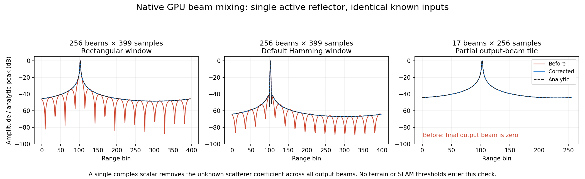

# Beam mixing and terrain observations

The POSIM WGPU acoustic backend mixes complex echoes across horizontal beams before its range transform. Its 16 × 16 GPU tile must load operands using each input matrix's bounds. Threads outside the output rectangle can still supply shared-memory operands needed by valid output threads. Using the output mask for those loads drops contributions at partial tiles.

A native Metal comparison uses one active reflector, a known nonconstant mixing matrix and an analytic complex range response. One common complex scatterer coefficient is fitted across all output beams. It covers 16/17/31/32/256 beams, 256/399/400 samples, first/interior/last source beam, and rectangular/Hamming windows.

| Case | Before | After |
|---|---:|---:|
| 256 × 399, rectangular | 19.389% | 0.000753% |
| 256 × 399, Hamming | 2.581% | 0.000391% |
| 17 × 256, rectangular | 34.523% | 0.000776% |

The listed cases use source beam 15. The fixed acceptance bound is 0.3% relative complex L2. All 84 corrected cases pass, with maximum error 0.0008464%; 22 fail before correction. An independent 36-case range-transform regression also passes. [Complete native metrics](sonar-beam-mixing.json).

Six paired flat-seabed geometries/seeds, two mixing models and 24 frames per case use the same analytic depth/incidence inputs and unchanged ground-entry code: 576 frames across both builds. Physical-beam onset-error p90 stays at 2.93–3.35 cm. Only one case changes at that precision (2.9773 → 2.9524 cm). Steep-scene normal-error p90 worsens from 1.3324° to 1.3436°. The numerical fix therefore does not establish improved terrain mapping. [All paired metrics](sonar-beam-ground.json).

This is a sensor-model numerical correction, not a new SLAM method. Moving-scene input needs recapture; old intensity images omit the complex phase needed to undo the error. [Existing terrain-map limitations](sonar-terrain-support.md) remain relevant. Missing elevation, viewpoint-dependent reflection and terrain association remain unresolved. The component introduces no dependency or third-party code; the application preserves the sensor patch and its existing notices. Hardware accuracy and other GPU backends are outside this test.

## 한국어

POSIM WGPU 음향 백엔드는 거리 변환 전에 수평 빔 사이의 복소 반사를 혼합합니다. 16 × 16 GPU 타일의 공유 메모리 입력은 각 입력 행렬의 범위로 검사해야 합니다. 출력 영역 밖 스레드도 유효한 출력에 필요한 데이터를 읽습니다. 출력 범위로 이 읽기까지 차단하면 부분 타일에서 기여분이 누락됩니다.

실제 Metal 시험은 단일 활성 반사체, 값이 일정하지 않은 혼합 행렬과 해석적인 복소 거리 응답을 사용합니다. 미지 산란 계수 하나를 전체 출력에 공통으로 적합합니다. 여러 빔 수·샘플 수·활성 빔과 직사각형/Hamming 창의 84개 경우를 확인했습니다. 수정 전 22개가 실패했고 수정 후 전부 고정 허용치 0.3% 이내입니다. 최대 상대 복소 L2 오차는 0.0008464%이며, 별도 거리 변환 회귀 시험 36개도 통과했습니다.

표의 활성 입력은 15번 빔입니다. 그림은 마지막 출력 빔을 해석적 최대 진폭으로 정규화합니다. 올바른 위상·스펙트럼으로 바뀌면 일부 부엽의 진폭이 커질 수 있으므로 밝기가 낮다는 이유만으로 정확하다고 판단할 수 없습니다.

동일한 깊이·입사각·시드를 사용하는 평탄 해저 여섯 조건과 두 빔 모델에서 각 24프레임을 비교했습니다. 두 빌드를 합해 576프레임이며 관측 추출 코드는 그대로입니다. 물리적 빔 모델의 시작 거리 오차 p90은 2.93–3.35 cm로 거의 같고, 한 조건만 2.9773→2.9524 cm로 바뀝니다. 급경사 법선 오차 p90은 1.3324°→1.3436°로 악화됩니다. 수치 오류 수정이 지형 지도 개선을 입증하지는 않습니다.

새 SLAM 방법이 아닌 센서 수치 계산 수정입니다. 이동 장면은 다시 기록해야 하며, 복소 위상을 버린 기존 강도 영상만으로 오류를 되돌릴 수 없습니다. 기존 지형 지도 실패와 고각·시점에 따른 반사 변화·지형 연결 문제는 남습니다. 라이브러리에 새 의존성이나 외부 코드는 추가하지 않습니다. 앱은 센서 수정 소스와 기존 고지를 보존합니다. 실기 정확도와 다른 GPU 백엔드는 이 검증의 대상이 아닙니다.
