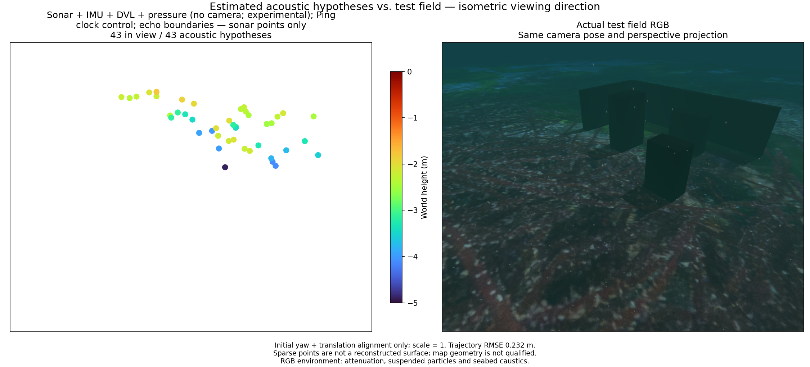
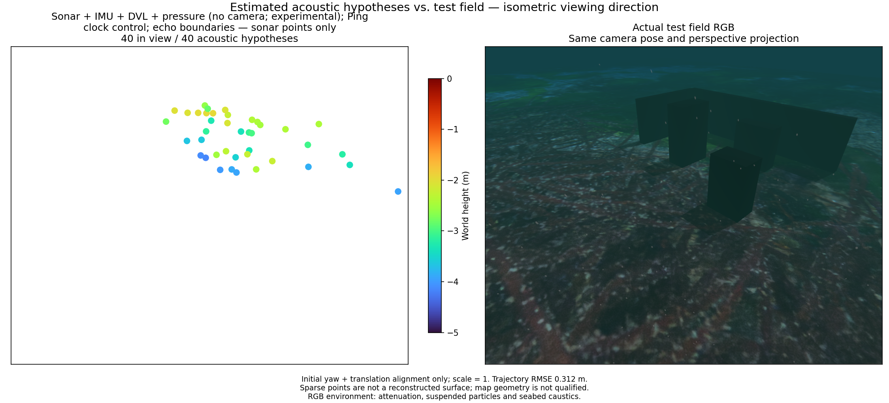
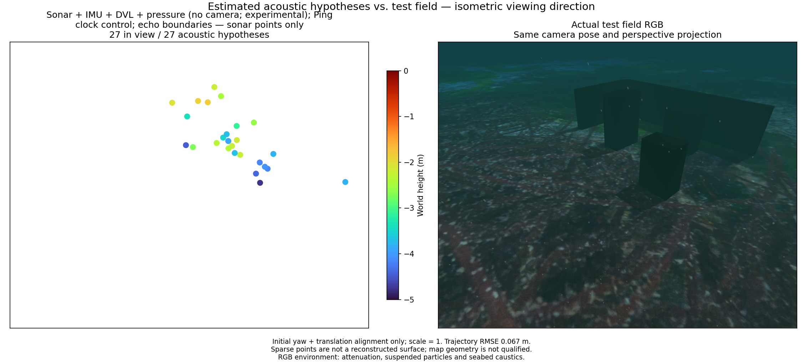

# Camera-free echo boundaries and depth changes / 카메라 없는 반사 경계와 수심 변화

[Metrics and hashes / 수치·해시](sonar-causal-depth.json) · [Earlier ground-band experiment / 해저 구간 실험](sonar-echo-boundaries.md)

The optional `AcousticTracks(frontend='echo_boundary')` can process raw sonar
frames without a supplied ground-entry band. Missing geometry means no ground
label or exclusion. Explicit malformed bands still fail validation. Median
filtering, same-range background subtraction, positive range gradients,
adjacent-beam support and LK tracking are unchanged. No elevation is inferred
from a bright edge. The default remains the intensity frontend.

선택형 반사 경계 추출기는 해저 시작 구간 없이 원본 소나를 처리할 수 있습니다.
해저 정보가 없으면 지면으로 분류하거나 제외하지 않습니다. 잘못 제공한 구간은
계속 거부합니다. 중앙값 필터·같은 거리의 배경 제거·밝기 증가·인접 빔 지지·LK
추적은 유지합니다. 밝은 경계에서 높이를 만들지 않으며 기본값은 강도 추적입니다.

## Recorded experiment / 기록 실험

Each pair replays identical raw inputs, original event clocks and native binary
with sonar + IMU + DVL + pressure. Ping contributes clock events only. Camera
frames, VIO poses and simulator geometry never enter the replay estimator.
The managed recording session uses a frozen VIO collector; its pass/fail is
reported separately. Sonar sampling is 2 Hz; the worker retains 16 states.
Noise scales are diagnostic: range 0.02508354 m, azimuth 0.00821331 rad.
No parameter is retuned between recordings. Initial yaw/translation alignment
uses scale 1; the whole trajectory is never fitted to truth.

각 대조 쌍은 같은 원본 입력·관측 시각·네이티브 바이너리를 사용합니다.
소나·IMU·DVL·수압을 융합하며 Ping은 시각만 제공합니다. 카메라·VIO 자세·
시뮬레이터 형상은 재생 추정기에 입력하지 않습니다. 실제 기록 수집은 별도의
고정 VIO 실행을 사용하며 그 합격 여부는 따로 기록합니다. 소나는 2 Hz,
최근 상태는 16개입니다. 거리 0.02508354 m·방위각 0.00821331 rad는 보정된
잡음이 아닌 실험 가정입니다. 기록마다 값을 조정하지 않습니다. 초기 요각·
이동만 정렬하며 축척은 1입니다.

A surveys 5 m at 1.5 m depth; B surveys 4 m at 1.8 m. C and D both survey
4 m at 1.5 m after an initial 2.4 m dive. C descends 0.6 m at the midpoint,
continues at 2.1 m depth, ascends at the far endpoint, then returns. D keeps
survey depth constant. They are separate physical runs with different sampled
waves and sensor signals, not identical-input motion ablations. The route uses
the controller preview, not landmark coordinates. All four use the same
three-box/two-wall scene and 65 s observation request.

A는 수심 1.5 m에서 5 m, B는 수심 1.8 m에서 4 m를 탐사합니다. C와 D는
처음 2.4 m로 잠수한 뒤 수심 1.5 m에서 4 m를 탐사합니다. C만 중간에서
0.6 m 하강하고 수심 2.1 m로 끝점까지 간 뒤 상승하여 돌아옵니다. D는 일정
수심을 유지합니다. 서로 다른 실제 실행이므로 파도·센서 신호가 다릅니다.
입력이 동일한 이동 대조 실험은 아닙니다. 경로는 물체 좌표가 아닌 제어기의
미리보기에서 생성합니다. 같은 상자 세 개·벽 두 개 장면이며 관측 요청은 65초입니다.

| Recording / 기록 | Frontend / 추출기 | Position RMSE (m) | Attitude RMSE (°) | Within 10 cm / total | Surface p90 (m) |
|---|---|---:|---:|---:|---:|
| A | intensity | 0.266 | 2.13 | 39/85 | 0.394 |
| A | echo_boundary | 0.232 | 1.68 | 11/43 | 0.471 |
| B | intensity | 0.252 | 2.41 | 47/90 | 0.315 |
| B | echo_boundary | 0.067 | 2.93 | 4/40 | 0.706 |
| C | intensity | 0.104 | 1.79 | 52/106 | 0.286 |
| C | echo_boundary | 0.312 | 2.28 | 9/40 | 0.551 |
| D | intensity | 0.065 | 2.11 | 38/72 | 0.303 |
| D | echo_boundary | 0.067 | 1.61 | 5/27 | 0.703 |

With the intensity frontend, C has 106 points versus D's 72, but position RMSE
is 0.104 m versus 0.065 m. Surface p90 is 0.286 m versus 0.303 m. This single
pair does not establish a reliable benefit from vertical motion. With the echo
frontend, every recording has worse surface p90 than its same-input intensity
control, so the new causal option is not promoted to the default.

강도 추적에서 C의 점은 106개로 D의 72개보다 많지만 위치 RMSE는
0.104 m로 D의 0.065 m보다 큽니다. 표면 거리 p90은 0.286 m와 0.303 m입니다.
이 한 쌍으로 수직 이동의 안정적인 효과를 입증할 수 없습니다. 반사 경계
추출은 네 기록 모두 같은 입력의 강도 추적보다 표면 거리 p90이 나빠
기본값으로 채택하지 않습니다.

**None of these maps is qualified.** Surface distances are to physical collision
surfaces after estimation; proximity neither identifies the correct reflector
nor measures reconstructed area. Echo boundaries do not establish fixed 3D
correspondences. A small trajectory error can coexist with an incorrect map.
Depth changes alone do not repair this correspondence model. There is no terrain
association, terrain loop closure or dense bathymetric reconstruction here.

**어느 지도도 합격하지 못했습니다.** 표면 거리는 추정 후 물리 충돌면까지
측정하며 가까운 점이 올바른 반사점이거나 복원 면적을 확보했다는 뜻은 아닙니다.
반사 경계만으로 고정된 3D 대응점은 성립하지 않습니다. 작은 궤적 오차와 틀린
지도가 함께 나올 수 있으며 수심 변화만으로 대응 모델을 해결할 수 없습니다.
지형 연결·지형 루프 폐쇄·조밀한 수심 복원은 구현되지 않았습니다.

## Same-view map and field / 같은 시점의 지도·현장

Each pair shares the actual reference-camera pose and perspective, looking in
an isometric direction. Turbo spans −5 to 0 m; marker area is 64 pt² (4×).
RGB is captured after the mission with attenuation, suspended particles,
seabed caustics and sea surface. It is evaluation-only and is not a measured
2 m optical-visibility test. Sparse points are not rendered as a recovered mesh.

각 그림의 두 패널은 실제 참조 카메라 위치·방향·원근 투영을 공유하며 등각
방향으로 봅니다. Turbo 범위는 −5~0 m, 점 면적은 64 pt²(4배)입니다.
RGB는 임무 뒤 감쇠·부유입자·해저 집광무늬·수면을 켜고 촬영한 평가용 참조입니다.
광학 가시거리 2 m를 검증한 시험은 아니며 희소 점을 복원 메시처럼 그리지 않습니다.

## Qualification and research / 검증·연구

A first 90 s vertical run restarted the frozen VIO collector and failed its
segment-continuity gate. Its mission completed, but the former recorder omitted
truth when VIO failed. The recorder now preserves assessment truth independently
and writes a single-frame state CSV only for coherent poses; failure is never
converted into acceptance. That failed run is retained separately. The 65 s
vertical rerun completed the collection and the collector's position gate;
this does not qualify the camera-free map or installed application.

첫 90초 수직 실행은 고정 VIO 수집기가 재시작하여 구간 연속성 판정에 실패했습니다.
임무는 완료됐지만 기존 수집기는 VIO 실패 시 정답 기록을 저장하지 않았습니다.
수집기는 이제 평가용 정답을 독립적으로 보존하며, 같은 좌표계의 일관된 자세만
단일 상태 CSV로 씁니다. 실패를 합격으로 바꾸지 않습니다. 실패 기록도 보존합니다.
65초 수직 재실행은 수집과 VIO 위치 판정을 통과했지만 카메라 없는 지도나
설치형 앱의 합격은 아닙니다.

Optional ground masking, bright-edge tracking and deliberate view changes are
standard ingredients, not demonstrated research novelty. A candidate research
question remains whether a fan-integrated acoustic observation model and
uncertain terrain patches can preserve useful constraints when discrete point
identity fails. This experiment does not implement or validate that method.
[Prior-art notes](sonar-surface-research.md).

선택형 해저 제외·밝은 경계 추적·의도적 시점 변화는 알려진 구성 요소이며 신규
연구 성과로 주장하지 않습니다. 점 동일성이 깨지는 경우 수직 팬에 걸쳐 합성된
음향 관측 모델과 불확실한 지형 패치가 유효한 제약을 유지할 수 있는지는 연구
후보입니다. 이번 실험은 그 방법의 구현이나 검증이 아닙니다.
