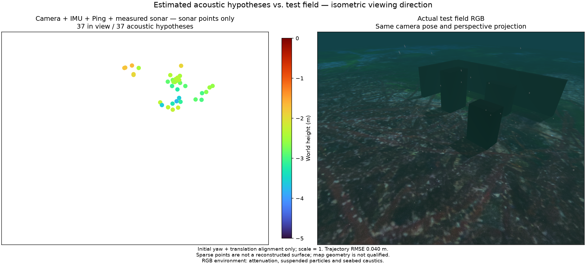

# Causal sonar fusion execution / 순차 소나 결합 실행

`SonarFusion` in the independent POSIM-SLAM package owns measured track history, native factor acknowledgements and the acoustic point archive. Each camera/sonar event is prepared and acknowledged at its original timestamp before the next event. The caller provides sensor ordering and IMU coverage. Invalid input fails the segment and prevents further export. A valid response is checked before points enter the map; native retirement/rebinding preserves physical-candidate source identity.

독립 POSIM-SLAM의 `SonarFusion`은 측정 트랙 이력·네이티브 요인 응답·소나 점 보관을 함께 관리합니다. 카메라·소나 이벤트를 원래 시각에 준비하고 정확한 응답을 받은 뒤 다음 이벤트로 진행합니다. 센서 시각 정렬과 IMU 구간은 호출자가 제공합니다. 잘못된 입력은 해당 구간의 처리·내보내기를 중단하며 정상 응답을 확인하기 전에 새 점을 지도에 넣지 않습니다. 네이티브 요인이 제거·재등록돼도 원본 후보 ID를 유지합니다.

## Recorded native verification / 기록 기반 네이티브 검증

The same depth-changing corner recording, 16-state native worker and diagnostic noise as the [previous matched test](sonar-corner-depth.md) are used. Raw intensity frames now pass through `AcousticTracks` during the native event loop; no precomputed trace is read. The frontend processes only frames already reached on the sensor timeline, including pre-bootstrap frames. All 158 output track frames exactly match the earlier precomputed trace. The native run completes 794 states over 77.9 s and exports 37 acoustic hypotheses with the same source identities.

이전 수심 변경 기록·16개 상태 네이티브 실행 파일·진단 잡음 설정을 사용합니다. 이번 경로는 미리 추출한 파일을 읽지 않고 네이티브 이벤트 반복 중 원본 강도 프레임을 `AcousticTracks`로 처리합니다. 센서 시간에 이미 도착한 프레임만 사용하며 초기화 이전 프레임도 포함합니다. 158개 트랙 결과가 기존 사전 추출과 정확히 일치합니다. 77.9초의 네이티브 상태 794개를 처리하고 같은 원본 ID의 소나 가설 37개를 내보냅니다.

The native results are not bitwise identical: maximum per-coordinate differences from the previous run are 7.31 mm for trajectory positions and 0.0431 mm for acoustic points. The cause of this numerical variation has not been established. Position RMSE is 4.03 cm; 22/37 points lie within 10 cm of a true surface, with median surface distance 6.86 cm and maximum 48.90 cm. This verifies the execution path without improving or qualifying map geometry.

네이티브 출력은 바이트 단위로 같지는 않습니다. 이전 실행과의 좌표 성분별 최대 차이는 궤적 7.31 mm, 소나 점 0.0431 mm이며 수치 차이의 원인은 확정하지 않았습니다. 위치 RMSE는 4.03 cm, 실제 표면 10 cm 이내의 점은 22/37개, 표면 거리 중앙값은 6.86 cm, 최대값은 48.90 cm입니다. 실행 경로를 검증했으며 지도 형상의 개선·합격을 의미하지 않습니다.

Camera + raw IMU + single Ping + measured sonar. Four-times-size markers, fixed Turbo height scale, initial yaw/translation alignment only. RGB shows underwater attenuation, particles, caustics and sea surface. [Machine-readable evidence](sonar-causal-stream.json).

카메라·원본 IMU·단일 Ping·실측 소나의 결합입니다. 점 크기는 네 배, Turbo 높이 범위는 고정이며 초기 방위각·위치만 정렬합니다. RGB에는 수중 감쇠·부유 입자·집광무늬·수면이 포함됩니다. [검증 JSON](sonar-causal-stream.json).

## Compute and scope / 계산량과 범위

On the tested Mac with the same research OpenCV 4.10.0 frontend, median/p95 extraction time is 10.29/12.99 ms. Fusion preparation across all events is 0.003/5.22 ms and acknowledgement processing 0.21/1.45 ms. These are measured replay costs, not a ROS callback-latency or installed-package benchmark. The standalone package also passes affected tests from a wheel relocated to a directory containing spaces under SDK Python 3.14.

같은 연구용 OpenCV 4.10.0을 쓴 시험 Mac에서 추출 시간 중앙값/95분위수는 10.29/12.99 ms입니다. 전체 이벤트의 결합 준비는 0.003/5.22 ms, 응답 처리는 0.21/1.45 ms입니다. 기록 재생의 처리 비용이며 ROS 콜백 지연·설치 패키지 성능 측정이 아닙니다. 독립 패키지는 공백이 포함된 경로로 옮긴 wheel에서 SDK Python 3.14 관련 검사를 통과합니다.

Live ROS sensor ordering/backpressure, panel activation, physical acoustic correspondence and useful reconstruction remain required. No new dependency, calibrated noise model or research novelty is claimed by this execution refactor.

실시간 ROS 센서 순서·처리 지연 관리, 패널 활성화, 실제 음향 대응 및 유용한 표면 복원이 남아 있습니다. 이번 실행부 통합은 새 의존성·보정된 잡음 모델·연구 신규성을 추가하지 않습니다.

## Ordered arrival replay / 도착 순서 변경 재생

The independent `SensorEvents` queue retains original timestamps, waits for both image streams and a later IMU sample, and releases the next event only after a validated native acknowledgement. Its default bound is 16 pending payloads plus one in flight. Synthetic camera delays up to 120 ms and sonar delays up to 80 ms exercise cross-stream arrival order on the same recorded inputs. Peak occupancy is 6; all 794 state timestamps and 158 frontend frames match the preceding replay, with no auxiliary frames omitted. This is recorded transport stress, not live ROS qualification.

독립 `SensorEvents` 큐는 원래 시각을 유지하고 두 영상 입력과 이후 IMU를 기다리며, 네이티브 응답 검증 후 다음 이벤트를 내보냅니다. 기본 한도는 대기 입력 16개와 처리 중 1개입니다. 같은 기록에 카메라 최대 120 ms·소나 최대 80 ms의 인위적 도착 지연을 적용했습니다. 최대 대기 입력은 6개이고, 상태 시각 794개와 프런트엔드 결과 158개가 이전 재생과 일치하며 생략한 보조 소나는 없습니다. 기록 기반 전달 순서 시험이며 실시간 ROS 검증은 아닙니다.

The resulting 37 hypotheses retain their source IDs. Position RMSE is 4.029 cm; 22/37 points are within 10 cm of a physical surface. Maximum coordinate differences from the preceding run are 1.683 mm for trajectory and 1.091 mm for acoustic points; the cause of numerical variation is unestablished. Map geometry remains unqualified. [Recorded evidence](sonar-ordered-stream.json).

소나 가설 37개의 원본 ID가 유지됩니다. 위치 RMSE는 4.029 cm이며 실제 표면 10 cm 이내의 점은 22/37개입니다. 이전 실행과 좌표 성분별 최대 차이는 궤적 1.683 mm·소나 점 1.091 mm이고 수치 차이의 원인은 확정하지 않았습니다. 지도 형상은 여전히 합격 기준을 충족하지 않습니다. [검증 JSON](sonar-ordered-stream.json).

Same camera + IMU + single Ping + sonar combination and isometric view. Four-times-size markers, fixed Turbo height scale; RGB includes underwater attenuation, particles, caustics and sea surface.

같은 카메라·IMU·단일 Ping·소나 조합과 등각 방향 시점입니다. 점 크기는 네 배, Turbo 높이 범위는 고정이며 RGB에는 수중 감쇠·부유 입자·집광무늬·수면이 포함됩니다.
