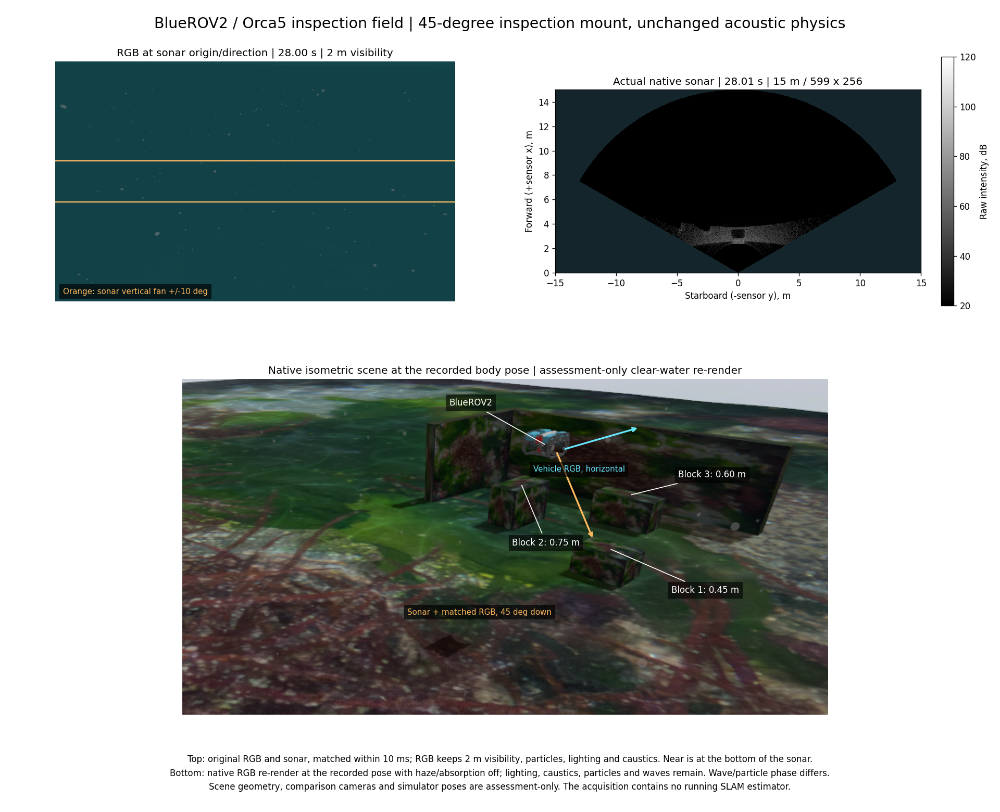
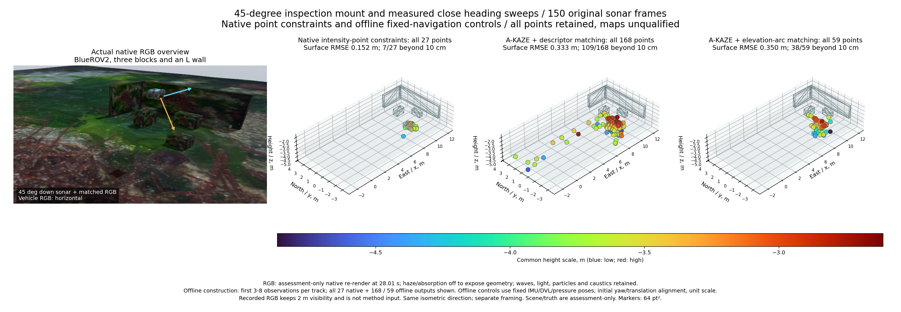

# 장착 각도를 명시한 근거리 소나 관측

[English](README.md)

이 검증은 POSIM main `8c47601c`, #6과 #31–36의 최신 커밋을 별도 브랜치 `ffecee9b`에 통합해 사용합니다. 원본 PR은 모두 열린 상태이며 병합하지 않았습니다. 실제 로드된 센서·시스템 라이브러리 해시는 수정 소스의 검증 기록과 일치합니다. 기존 Gazebo 로더·렌더링 의존성 설정을 명시적으로 사용하며, 설치된 SDK는 변경하지 않았습니다.

| PR | 커밋 | SLAM 입력에서 확인할 내용 |
| --- | --- | --- |
| [#31](https://github.com/IOES-Lab/POSIM/pull/31) | `7dc96021` | 센서 단일 생성과 초기 장착 자세 |
| [#32](https://github.com/IOES-Lab/POSIM/pull/32) | `f1055f48` | ROS 컨텍스트 수명과 촬영 시각 |
| [#33](https://github.com/IOES-Lab/POSIM/pull/33) | `5f327fd5` | 행렬 가장자리의 불완전한 타일 입력 |
| [#34](https://github.com/IOES-Lab/POSIM/pull/34) | `801f8866` | 원래 길이의 거리 변환과 부동소수점 스펙트럼 합산 |
| [#35](https://github.com/IOES-Lab/POSIM/pull/35) | `02f6dccd` | 무반사 영상의 검정 표시와 유효한 원본 영전력 |
| [#36](https://github.com/IOES-Lab/POSIM/pull/36) | `fbfd000d` | 실제 거리 간격·마지막 표본과 CPU 거리 구간 정렬 |

## 설정과 실제 기록

기존 [95프레임 관측 기록](../sonar-inspection-scene-20261031/README.ko.md)은 그대로 보존합니다. 안전한 근거리 위치에서 기존 20.1° 하향 장착은 첫 블록 상단을 이상적인 시야 계산에서도 보지 못합니다. 이번에는 기존 센서 설정 기능으로 생성된 검증 차량에만 45° 하향 장착을 적용했습니다. 모델 생성 전에 설정하며, 비교 RGB와 보정값도 실제 SDF에서 가져옵니다. 제품 기본값과 저장된 차량은 유지합니다. 장착과 운용을 함께 바꾸었으므로 장착 각도 하나의 효과만 분리한 대조는 아닙니다.

- 위치는 x 6 m, y −1.35 m, 수심 1.5 m입니다. 방향 0°, −45°, +45°, −45°, +45°, 0°에서 각각 6초 머무른 뒤 복귀합니다.
- 실제 항해가 완료됐습니다. 기존 전체 계획 영역으로 확인한 최소 여유거리는 1.4325 m입니다. 추종 여유나 안전 한계는 줄이지 않았습니다.
- 소나는 15 m, 256빔, 수직 광선 256개, 120° × 20°, 2 Hz입니다. 모델 반송 주파수는 700 kHz, 대역폭은 29.9 kHz입니다. 원본 150프레임 모두 599 × 256개 값과 실제 15 m 끝점을 가집니다.
- 차량 RGB 376개, 원본 IMU 7,529개, 압력 753개, DVL 75개, 같은 장착의 비교 RGB 151개, 등각 영상 76개를 기록했습니다. DVL 75개 모두 네 빔의 바닥 고정이 유효하며 Ping은 물리적으로 없습니다.
- 원본 전체의 해시·거리 격자·시각 검사가 통과했습니다. 비교 RGB의 시각 차이는 최대 10 ms입니다. 소유한 네 프로세스 그룹은 모두 정상 종료했습니다. 불변 자산 752.6 MB는 하드링크로 재사용했고 소스 3,983바이트만 복사했습니다. 새 원본 기록 약 121 MB는 외장 디스크에 한 번만 보존합니다.

평가용으로 넓게 잡은 근거리 위치 구간에는 소나 78프레임이 있으며, 76프레임에서 알려진 블록 상단이 기하학적으로 시야 안에 있습니다. 이탈·복귀 회전 중 시야를 벗어난 두 프레임도 보존합니다. 물리적 가시성의 확인이며, 영상 특징이 같은 반사점이라는 증명은 아닙니다. 시뮬레이터 자세와 장면 표면은 SLAM에 입력하지 않습니다.

원본 RGB에는 가시거리 2 m, 수중 조명, 부유 입자와 해저 집광무늬를 적용합니다. 주황 선은 비교 카메라의 더 넓은 수직 시야 안에서 소나의 ±10° 영역을 나타냅니다. 두 센서의 위치·방향과 수평 시야 120°는 같습니다. 소나의 아래쪽이 가까우며, 축은 거리 단위입니다. 극좌표 셀 경계를 직접 사용합니다. 등각 장면은 기록된 28.01초의 차량 자세로 다시 렌더링한 평가 영상입니다. 구조를 보기 위해 안개·흡수만 끄고 파도·조명·입자·집광무늬는 유지하며, 효과의 위상은 다릅니다. 장면·비교 카메라는 추정기의 입력이 아닙니다.

## 전체 결과

네이티브 대조는 기존의 미지 IMU 편향 초기화, 원본 IMU·DVL·압력, 동일 시각과 같은 진단용 잡음을 사용합니다. 항법 대조에는 소나와 RGB를 넣지 않습니다. 두 경우 모두 상태 223개 전체를 평가했습니다. 위치 RMSE는 **소나 점 없이 0.0587 m**, **기존 소나 강도 점 제약을 추가하면 0.1792 m**입니다. 네이티브 점 27개 모두를 보존하며 표면 RMSE 0.152 m, 중앙값 0.0639 m, 10 cm 초과 7개입니다. 항법 개선으로 인정하지 않습니다.

같은 [오프라인 대응 실험](../sonar-return-support-20261031/README.ko.md)을 변경 없이 적용했습니다. 재생 가능한 148프레임에서 동일한 A-KAZE 특징 2,554개를 두 방법에 사용합니다. 초기 두 프레임도 원본에 남습니다. 항법의 추정 평균을 고정하며 자세 불확실성은 전파하지 않습니다.

| 조건부 오프라인 결과 | 특징 기술자 대응 | 고도각 원호 대응 |
| --- | ---: | ---: |
| 반복 추적 / 해를 얻지 못한 추적 | 170 / 2 | 59 / 0 |
| 출력·평가한 점 전체 | 168 | 59 |
| 표면 RMSE / 중앙값 (m) | 0.333 / 0.164 | 0.350 / 0.211 |
| 10 cm 초과 점 | 109 / 168 | 38 / 59 |
| 자세 고정·측정만 고려한 위치 3σ 중앙값 (m) | 4.520 | 1.731 |
| 이 낙관적 3σ가 10 cm 이하인 점 | 1 | 3 |
| 구성 구간 종료 2초 이후까지 남는 추적 / 관측 | 4 / 12 | 3 / 10 |

점 254개 전체, 해를 얻지 못한 추적, 아홉 초기 고도의 결과, 소실·시야 밖 후속 관측을 보존합니다. 점 크기는 64 pt²이며 전체 높이 범위에 공통 Turbo 색상을 적용합니다. 초기 방향과 평행 이동만 정렬하며 길이 배율은 1입니다. 오프라인 점은 네이티브 최적화에 넣지 않습니다. 10 cm는 진단용 개수 기준이며 보편적인 해양 합격 기준이 아닙니다.

## 운용 변경으로 확인한 것

물리적 시야는 개선됐지만, 영상 특징 추적이 유익한 회전을 오래 유지하지 못합니다. 특징 기술자·원호 대응의 반복 추적별 방향 변화 중앙값은 0.34°·1.56°, 지속 시간 중앙값은 1.49·3.51초입니다. 전체 추적에서 20° 이상을 유지한 것은 11/170·18/59개이고, 점 구성 구간에서는 11/170·15/59개입니다. 차량 전체의 큰 회전을 같은 반사점의 여러 시점 관측으로 볼 수 없습니다.

원호 표본 65·257개 대조에서 숫자 ID가 달라지는 프레임은 82개입니다. 임의 ID 대신 첫 관측의 시각·픽셀로 실제 추적 구성원을 비교하면 차이는 **두 프레임, 세 특징**입니다. 두 수치를 모두 남기며 연속 원호의 정확성은 보장하지 않습니다. 시야 개선만으로 안정적인 점 대응, 자세를 포함한 불확실성, 유용한 지도를 입증하지 못했습니다. 현재 지도는 미합격으로 보존합니다. 네이티브 점 제약이나 대규모 시험을 늘리기 전에 같은 물리적 반사를 유익한 여러 시점에서 유지하는지 확인해야 합니다.

같은 공개 POSIM-SLAM 소스와 NumPy 환경에서 `python verify.py`를 실행합니다. 공유된 준비 입력 재생기에 이 기록의 보정값을 명시적으로 전달하며 OpenCV·SDK·비공개 앱 코드를 가져오지 않습니다. 추적 이력 전체, 점·초기값·후속 관측, 해를 얻지 못한 경우, 숫자 ID 변경 불변성, 원본 메타데이터와 보존된 대표 원본 프레임을 검사합니다. 모든 원본 영상은 공개 기록에 중복하지 않고 외장 디스크에 한 번 보관하며 해시 목록을 제공합니다. 표면 삼각형은 배열 전체의 정확한 일치를 확인한 뒤 이전 기록과 [Orca5 MIT 고지](../sonar-inspection-scene-20261031/Orca5-LICENSE.txt)를 재사용합니다. 소스·수신 검사, 유용한 지도, 설치형·브라우저·플랫폼 동작, DVL 소실 시 효과, VRX와 이후 WAM-V 측량은 각각 별도 합격 조건입니다.
