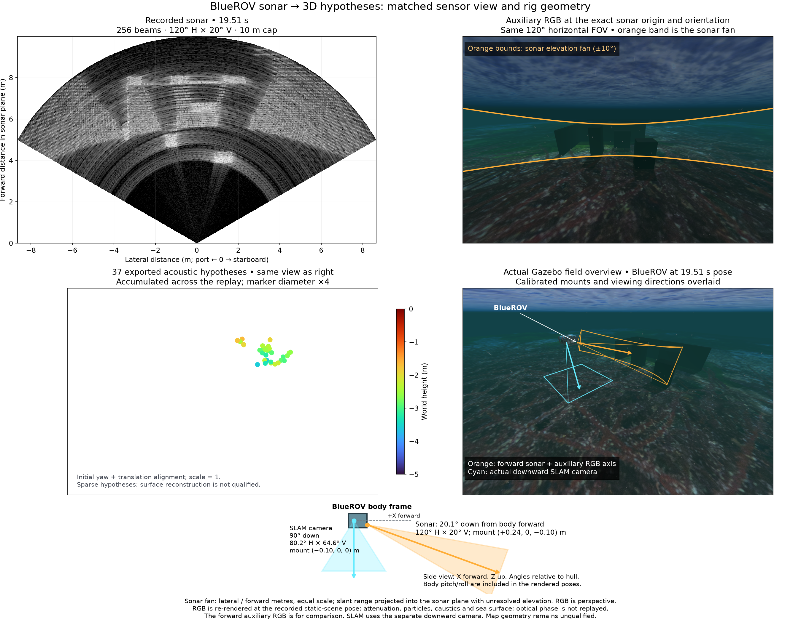
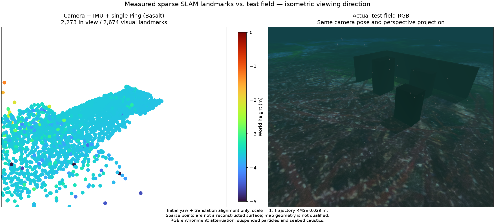
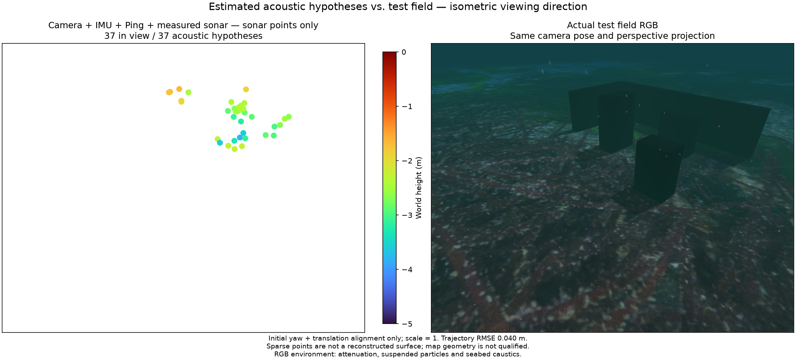

# Depth-change corner experiment / 수심 변경 모서리 실험

The vehicle dives to 1 m, changes to 2 m, travels 5.5 m out and back, and surfaces beside three physical boxes and two walls. The recording contains 158 sonar frames, 790 camera frames, 7,902 raw IMU samples and 790 single Ping measurements. All three replays use the same inputs, native executable and 16-state window. The evaluated span is 77.9 seconds, with complete raw IMU coverage.

차량은 수심 1 m에서 2 m로 이동하고 5.5 m 왕복 후 부상합니다. 실제 형상을 가진 상자 세 개와 벽 두 개를 사용합니다. 기록에는 소나 158프레임, 카메라 790프레임, 원본 IMU 7,902개, 단일 Ping 790개가 있습니다. 세 재생은 입력·네이티브 실행 파일·16개 상태 창이 같습니다. 평가 구간은 77.9초이며 원본 IMU가 전체 구간을 포함합니다.

## Matched results / 동일 기록 결과

| Method / 방법 | Sonar points / 소나 점 | Within 10 cm / 10 cm 이내 | Median surface distance / 표면 거리 중앙값 | Position RMSE / 위치 RMSE |
| --- | ---: | ---: | ---: | ---: |
| Camera + IMU + single Ping / 카메라·IMU·단일 Ping | 0 | — | — | 3.87 cm |
| Sonar, source-ID order / 소나, ID 순서 | 35 | 24 | 5.81 cm | 4.39 cm |
| Sonar, oldest waiting first / 소나, 오래 기다린 후보 우선 | 37 | 22 | 6.86 cm | 4.02 cm |

The maximum surface distances are 44.87 and 48.90 cm for the two sonar runs. These hypotheses do not yet reconstruct the boxes or walls reliably. Fair scheduling improves access to computation, but does not improve map surface accuracy in this test. Simulator truth is used only for evaluation. This trajectory differs from the earlier corner recording; comparisons with that recording are not a depth-only ablation.

두 소나 재생의 최대 표면 거리는 각각 44.87 cm와 48.90 cm입니다. 현재 가설 점군은 상자와 벽을 신뢰성 있게 복원하지 못합니다. 대기 순서에 따른 배정은 계산 기회를 늘렸으나 이번 시험의 지도 표면 정확도는 개선하지 않았습니다. 시뮬레이터 정답은 평가에만 사용합니다. 이전 모서리 기록과는 궤적이 달라 수심 변경만의 효과로 비교할 수 없습니다.

## Observation lifetime and selection / 관측 수명과 후보 배정

Only observations whose poses are still retained by the native estimator are kept for the next snapshot. Stable source IDs and native-owned observations/covariance remain intact. This prevents a long-lived feature from exceeding the 64-observation limit through expired poses.

Active native histories receive updates first. Free slots use the oldest waiting candidate, with at most 16 factors and 300 input candidates. Scheduling changes commit after a valid native acknowledgement. Of 2,566 temporally eligible candidates, attempted candidates increase from 425 to 890; the longest never-attempted wait drops from 62 to five evaluation windows. Temporal eligibility alone does not establish physical correspondence.

다음 스냅숏에는 추정기가 아직 보유한 자세 시각의 관측만 남깁니다. 특징 ID와 네이티브 추정기가 사용하는 관측·공분산은 보존합니다. 만료된 자세가 쌓여 64개 관측 한도를 넘는 오류를 방지합니다.

사용 중인 관측은 우선 갱신하고 빈 슬롯은 가장 오래 기다린 후보에 배정합니다. 한도는 요인 16개·입력 후보 300개이며 정상 응답을 받은 뒤 배정 상태를 확정합니다. 시간 조건을 만족한 후보 2,566개 중 평가받은 후보는 425개에서 890개로 늘고, 한 번도 평가받지 않은 최대 대기는 62회에서 5회로 줄었습니다. 시간 조건만으로 동일한 물리 반사점임을 보장하지는 않습니다.

## Views / 비교 그림

The raw sonar and re-rendered RGB share the sonar pose at exactly 19.51 s. The sonar fan uses equal metric axes: lateral distance and forward distance, near below and far above. A range–bearing sample is drawn at x = −r sin θ, y = r cos θ. Radius remains measured slant range; unresolved elevation prevents interpreting this as a horizontal ground map. RGB uses perspective projection. Particles, underwater fading and seabed caustics affect RGB. Acoustic hypotheses use four-times-size markers and a fixed height colour scale.

원본 소나와 다시 렌더링한 RGB는 정확히 19.51초의 소나 위치·방향을 공유합니다. 소나는 좌우·전방 거리를 같은 미터 배율로 표시하며 가까운 곳은 아래, 먼 곳은 위입니다. 거리·방위각 표본을 x = −r sin θ, y = r cos θ로 그립니다. 반지름은 측정 경사거리이므로 고도각이 불명확한 이 그림을 수평 지도로 해석할 수 없습니다. RGB는 원근 투영이며 부유 입자·수중 감쇠·해저 집광무늬를 포함합니다. 소나 가설은 네 배 크기 점과 고정 높이 색 범위를 사용합니다.

The map and RGB field views use matching isometric framing. The control contains visual points; the sonar view contains only acoustic hypotheses. [Machine-readable evidence](sonar-corner-depth.json) includes hashes and metrics. See also the [earlier corner scene](sonar-corner-scene.md) and [echo-boundary experiment](sonar-echo-boundaries.md).

지도와 RGB 현장은 같은 등각 구도를 사용합니다. 기준 그림은 시각 점군, 소나 그림은 소나 가설만 표시합니다. [검증 JSON](sonar-corner-depth.json)에 해시와 수치를 보존합니다. [이전 모서리 장면](sonar-corner-scene.md)과 [에코 경계 실험](sonar-echo-boundaries.md)도 참고할 수 있습니다.
