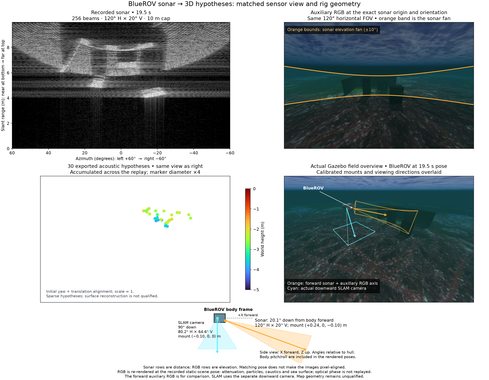
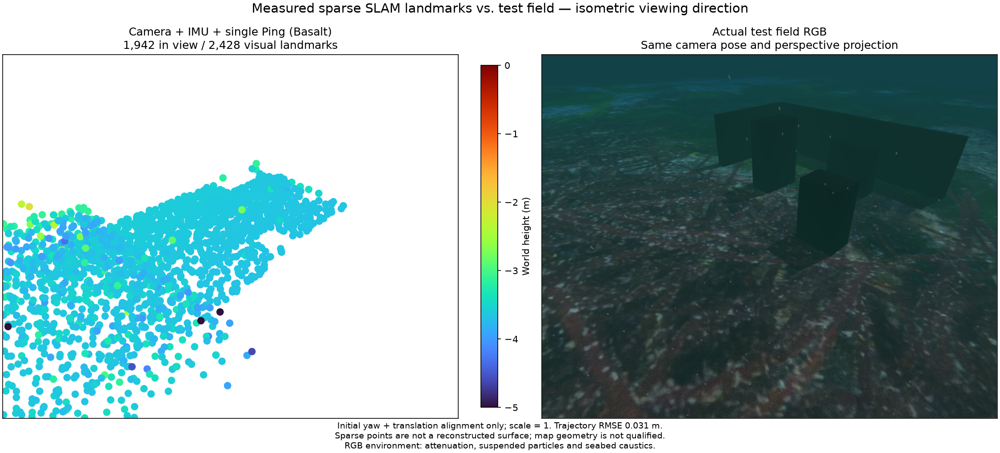
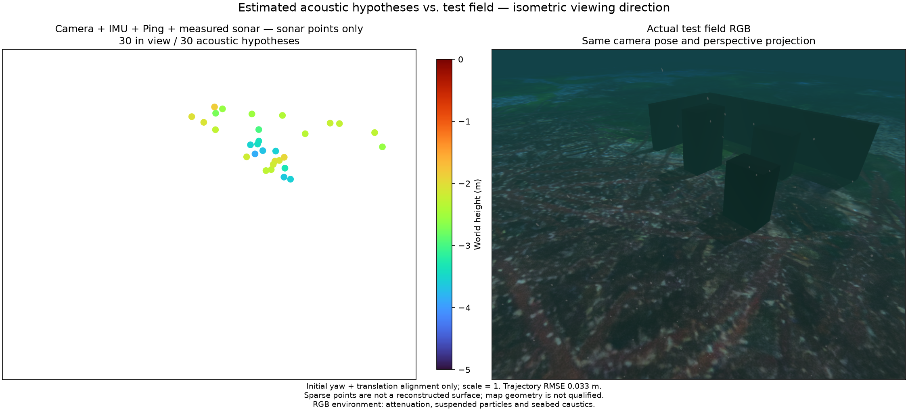
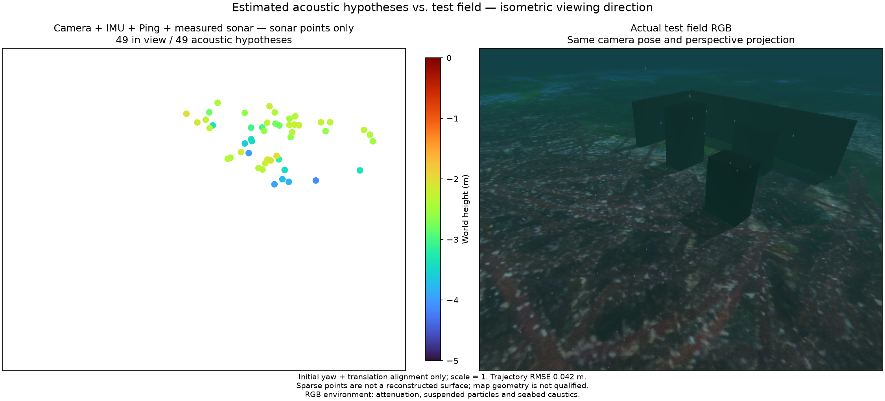

# Physical corner scene / 실제 모서리 시험장

The imported Orca5 `pnw.world` at `5f7cdc1f044926ebd56f2ce8a1fc4a82990cfa5e`
contains a textured heightfield, the vehicle, axes and sun. It has no wall or
separate rock objects. The 60 m adaptation preserves its approximately 0.39 m
height range. This test adds three boxes and two low wall sections forming an L.
Their visual and collision boxes match; bases intersect the local seabed instead
of floating above it. These structures are test fixtures, not upstream assets.
Orca5 geometry and imagery retain their MIT attribution in
[third-party notices](../../THIRD_PARTY.md).

가져온 Orca5 원본은 사진을 입힌 높이맵·차량·축·태양으로 구성되며 벽이나 독립된
바위 물체는 없습니다. 60 m로 확대한 지형의 높이 차는 약 0.39 m입니다. 이 시험은
상자 세 개와 ㄱ자 벽을 이루는 낮은 벽 두 개를 추가합니다. 시각·충돌 형상이
일치하며 바닥은 해저에 닿습니다. 추가 구조물은 원본 Orca5 자산과 구분합니다.
Orca5 형상·이미지의 MIT 고지는 제3자 라이선스 문서에 유지합니다.

The raw sonar at 19.5 s and auxiliary RGB share the calibrated sensor origin,
orientation and horizontal field of view. Near range is at the bottom. Orange
bounds show the corrected 20° vertical fan. The overview shows the actual ROV,
the sonar pointing 20.1° down from body forward and the separate 90° downward
SLAM camera. The point plot accumulates the entire replay; it is not a depth
conversion of that one sonar image. RGB attenuation, particles, caustics and sea
surface are re-rendered at the recorded pose; optical phase is not replayed.

19.5초 원본 소나와 보조 RGB의 위치·방향·수평 시야는 같습니다. 소나의 가까운
거리는 아래쪽이며 주황색은 수정된 수직 시야 20°입니다. 개요에 실제 ROV와
전방 아래 20.1°의 소나, 별도의 수직 하향 SLAM 카메라를 표시합니다. 점군은
전체 재생 구간에서 누적한 결과이며 한 장의 소나를 깊이 영상으로 변환한 것이
아닙니다. RGB의 감쇠·입자·집광무늬·수면 효과는 기록 자세에서 다시 렌더링합니다.

## Same-recording results / 같은 기록 비교

All three replays use Basalt `0f3b2b52c807f70ff4e2973ce253c73329eea7bc` with
POSIM extensions, camera, raw IMU and single Ping. The two acoustic runs also
use the same chained intensity tracks, with independent one-bin diagnostic
noise (range σ 0.0250835 m; azimuth σ 0.00821331 rad). This is not a calibrated
sensor-noise model. The native executable SHA-256 is
`bea37b633a8c54aa6f19935d430e9c28bafe961242d48cc38ddac060e35e313d`.
The full input, output and recipe hashes are in [the evidence JSON](sonar-corner-scene.json).

세 재생 모두 같은 Basalt·카메라·원본 IMU·단일 Ping을 사용합니다. 소나를 추가한
두 실험은 같은 연쇄 강도 추적과 독립적인 한 빈 잡음 가정을 사용합니다. 이
잡음은 센서 보정 결과가 아닙니다. 입력·출력·구현 해시는 위 근거 파일에 있습니다.

| Method / 방법 | Recent states / 최근 상태 | Sonar points / 소나 점 | Position RMSE / 위치 RMSE | Maximum / 최대 위치 오차 |
|---|---:|---:|---:|---:|
| Camera + IMU + Ping | 16 | 0 | 0.0310 m | 0.0944 m |
| + sonar | 16 | 30 | 0.0328 m | 0.0967 m |
| + sonar | 32 | 49 | 0.0422 m | 0.1743 m |

Each replay completes 636 native states over 63.0 seconds. Evaluation aligns only
initial yaw and translation, with scale fixed at one. Simulator poses and mesh
geometry are used only after estimation. The raw acquisition starts with a sonar
frame at 10.50 s and IMU at 10.51 s; its first interval is unbracketed. The replay
starts at 11.60 s after IMU initialization. All 126 overlapping sonar intervals
in that replay span are covered. The original incomplete boundary is retained,
not filled with invented data or described as complete raw acquisition.

각 재생은 63초 동안 네이티브 상태 636개를 완료합니다. 초기 방위각·이동만
정렬하고 축척을 1로 고정합니다. 정답 자세와 지형은 추정 후 평가에만 사용합니다.
원본 기록의 첫 소나는 10.50초, 첫 IMU는 10.51초여서 첫 구간의 시작을 IMU가
감싸지 못합니다. 재생은 IMU 초기화 후 11.60초에 시작하며 해당 범위의 소나
구간 126개에는 IMU가 모두 있습니다. 원본의 시작 경계 누락은 그대로 보존합니다.

All point/RGB pairs share camera pose, projection and metric scale. Point marker
diameter is four times the original plotting size. Turbo encodes world height
with the same −5 to 0 m limits. The baseline plot contains visual landmarks;
the two sonar plots exclude visual points.

점군·RGB 쌍은 같은 시점·투영·축척을 사용합니다. 점 지름은 원래 표시의 4배이며
Turbo의 공통 −5~0 m 범위로 세계 좌표계 높이를 표시합니다. 기준 실험은 시각점,
소나 실험의 두 그림은 시각점을 제외한 소나 점만 보여줍니다.

## Surface quality / 표면 품질

Distances are measured to the actual collision-box and terrain triangles.
With 16 states, 16/30 points are within 0.10 m of a surface (eight near walls,
six near boxes and two near seabed). Median / 90th percentile / maximum
distance is 0.0817 / 0.2218 / 0.3774 m. With 32 states, 23/49 points are within
0.10 m; distances are 0.1059 / 0.2442 / 0.4341 m. These proximity counts do not
prove track identity, independent landmarks or reconstructed surface area.
Neither result reconstructs the wall or box surfaces. More retained states
increase count without improving the reported errors; defaults are not raised.
Map acceptance remains false. The next unresolved issue is physical echo
association, not generating more points by weakening elevation admission.

The [echo-boundary experiment](sonar-echo-boundaries.md) compares an optional
background-relative frontend on this same recording; it does not improve map quality.

실제 상자·벽 충돌 형상과 지형 삼각형까지 거리를 측정합니다. 상태 16개에서는
30점 중 16점이 표면 10 cm 이내에 있고, 벽 근처 8점·상자 6점·해저 2점입니다.
중앙값·90백분위·최대 거리는 8.17·22.18·37.74 cm입니다. 상태 32개에서는
49점 중 23점이 10 cm 이내이며 각각 10.59·24.42·43.41 cm입니다. 표면에
가깝다는 사실이 실제 반사체의 동일성이나 복원한 표면 면적을 입증하지는 않습니다.
두 결과 모두 벽·상자 표면을 복원하지 못했습니다. 보관량 증가는 점 수만 늘리고
오차를 개선하지 않았으므로 기본값은 올리지 않습니다. 지도 합격은 보류하며 실제
에코의 연속 대응을 개선해야 합니다.

[에코 경계 실험](sonar-echo-boundaries.md)은 같은 기록에서 배경 대비 추출기를
비교하며, 지도 품질은 개선되지 않았습니다.

The native matrix budget now derives from the supported recent-state and
keyframe budgets. The previously failing 32-state configuration completes this
recording. Native tests also check information preservation through 32/64-state
and incoming-state marginalization, and sonar whitening with extra pose slots.
This fixes a window-size contract, not the sparse mapping problem.

네이티브 행렬 한도는 최근 상태·키프레임 보관 한도에서 계산합니다. 중단됐던
32개 상태 설정이 이 기록에서는 끝까지 완료됩니다. 네이티브 테스트는 32·64개
상태와 새 상태 추가 시 주변화의 정보 보존, 추가 자세 열에서 소나 백색화도
확인합니다. 이는 크기 한도의 수정이며 희소 지도 문제의 해결은 아닙니다.
