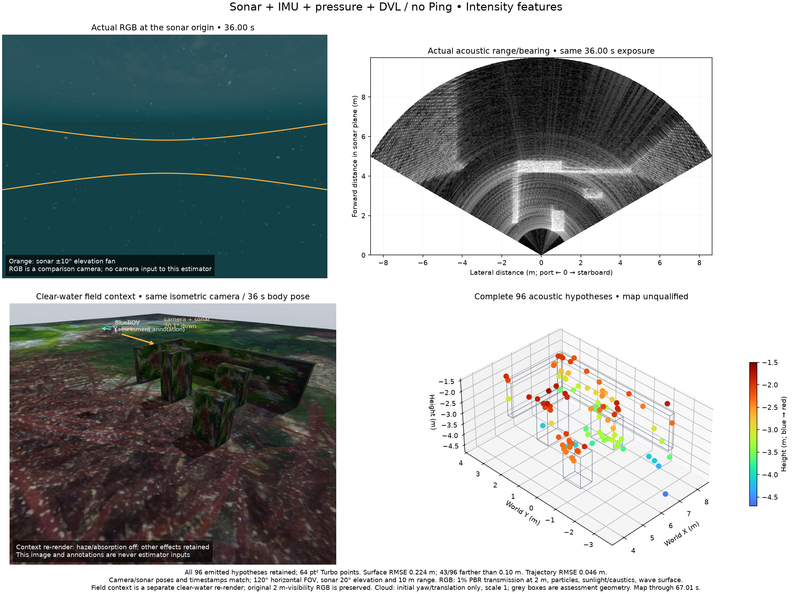
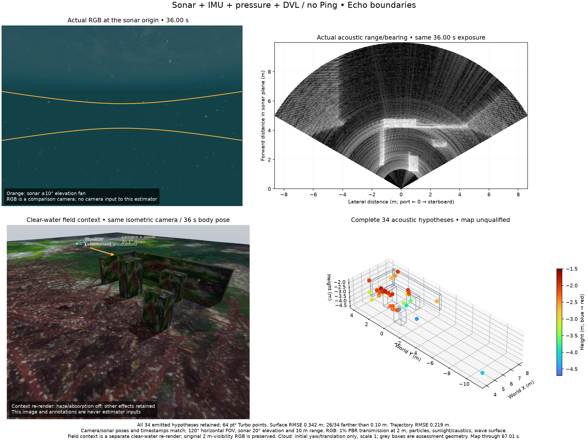

# Moving sonar, IMU, pressure and DVL: current sensor record

This record uses the POSIM current-main sonar integration `867d214`, with the
source-bound application corrections and Metal binary identified in
`source.json`. It has no single Ping sensor. A real ArduSub controller completes
the seven authored waypoints. Assessment-only truth measures 18.47 m travel,
7.06 × 4.04 × 1.11 m position extent and 185.38° heading span during motion.

All original estimator-input frames are retained in **one** `capture.tar.gz`.
It contains 132 sonar frames, 330 full RGB exposures, 6,592 raw IMU samples,
66 bottom-locked DVL measurements and 659 pressure samples. The timeline and
source/gray8 checksums preserve the received pixels and timestamps. Truth is a
separate assessment file and never an estimator input. The complete sonar
replay span is 2.50–67.01 s, with at most 10 ms between IMU samples. Native
acquisition stops normally; the retained native replay workers close by SIGTERM
through their existing client-close protocol, separately from acquisition.

RGB and sonar share the physical origin, direction and 120° horizontal field of
view in this diagnostic rig. Sonar elevation is 20°, range is limited to 10 m
and output is 256 beams × 399 bins at about 2 Hz. The 5 Hz RGB stream has fifteen
exact sonar-time pairs; other nearest exposures differ by up to 100 ms. Camera
input is excluded from both estimates below. The figure uses an exact 36 s pair.

The PBR water-path profile bounds transmission to 1% at 2 m. Camera clipping
remains 100 m. Sunlight, caustics, suspended particles and waves are enabled.
The lower-left panel is an explicitly separate clear-water field re-render at
the recorded body pose: haze and absorption are off for context, with the other
effects retained. The original low-visibility isometric RGB is also included.
Neither overview image nor its annotated geometry enters estimation.

## Same-input baseline comparison

Both runs use unchanged committed POSIM-SLAM `e0521d6` sources and the same
native binary, calibration, pressure/DVL times and diagnostic noise. These noise
scales are research assumptions, not hardware calibration. The native acoustic
history remains sixteen states; no map-admission or geometry check is relaxed.
Alignment fixes only the initial yaw and translation, with scale fixed at one.

| Existing frontend | All emitted hypotheses | Trajectory RMSE | Surface RMSE / p90 / maximum | Beyond 10 cm |
| --- | ---: | ---: | --- | ---: |
| Intensity features | 96 | 0.0459 m | 0.2239 / 0.4035 / 0.9159 m | 43/96 |
| Echo boundaries | 34 | 0.2190 m | 0.3420 / 0.5492 / 0.8177 m | 26/34 |

The distance is the exact nearest physical box/seabed surface distance for
**every** emitted point. The 10 cm count is a diagnostic, not a universal marine
acceptance standard. It does not prove correspondence identity or surface-area
coverage. The archive explicitly lacks verified physical identity and joint
landmark uncertainty. Both maps remain unqualified. A smaller maximum on the
sparser boundary map does not establish improvement.

Both figures retain every point at 64 pt², with common blue-to-red Turbo height
limits. Grey boxes are assessment references. The raw RGB/sonar pair is at 36 s;
the accumulated map uses observations through 67.01 s. The comparison points to
association and 3D-landmark modelling as the next diagnostic boundary, while
retaining pose, calibration and uncertainty questions. No new algorithm or
research novelty is claimed by this acquisition/comparison.

The model requests 1,000 Hz IMU but this 10 ms physics profile actually publishes
100 Hz. DVL publishes about 1 Hz and pressure about 10 Hz. These measured rates
are separate from configured rates and wall-clock RTF. The baseline keeps its
declared-rate calibration; no timestamp, sample, noise or physics change is
made to improve these results.

`python3 verify.py` checks file hashes, the raw archive inventory and all retained
point/error populations with the standard library. `capture.tar.gz` contains
sensor data/configuration only, without WWW-POSIM implementation sources.
Simulator-derived meshes/images retain the [Orca5 MIT notice](ORCA5-LICENSE.txt).
The source repository is [clydemcqueen/orca5](https://github.com/clydemcqueen/orca5).
Library, OpenCV, Basalt and other component notices remain in the repository's
existing license/notice records. Data capture and mapping quality are separate
from SDK/package qualification.

## Measurement-model diagnosis

Independent assessment-pose controls fit all 96 original point histories. With
explicit independent one-bin noise, every optimistic local three-sigma major
axis exceeds 10 cm. Extending 31 histories from 890 to 1,133 observations leaves
all 96 above 10 cm (minimum 14.72 cm); surface-error p90 is 41.82/45.90 cm for
submitted/full history. Twelve/seventeen unconstrained fits leave the vertical
fan. These pose-conditioned diagnostics are not calibrated or joint confidence
and do not modify any map or estimator input.

The 66 raw DVL reports contain aggregate ranges but not individual beam ranges.
Installed gz-sensors 10.1.1 reports the shortest beam slant range, as shown in
its [source](https://github.com/gazebosim/gz-sensors/blob/gz-sensors10_10.1.1/src/DopplerVelocityLog.cc).
The measured minimum differs from the assessment-only vertical surface distance
by median 31.27 cm / absolute p90 72.71 cm. The centre-beam approximation has
absolute p90 error 4.05 cm; finite-cone sampling prevents treating this as a
calibration bound. Individual ranges cannot be reconstructed from the minimum.

The accompanying schema/calibration examples describe retained beam IDs,
locks, slant distances, apertures and reference axes. They are decoded from
a separate native fixture, not added to these 66 original reports. Missing or
default-zero range variance stays unknown. The application bridge preserves
these fields; this library's current native DVL factor still consumes velocity.
The next model must check local surface support, finite-cone returns, uncertainty
and informative viewpoints before enabling any range constraint. DVL does not
replace all forward-sonar landmark geometry.

## 한국어

최신 소나 커널로 실제 제어기의 이동을 기록했습니다. 소나·IMU·압력·DVL을
사용하고 단일 Ping은 없습니다. 원본 입력은 하나의 압축 파일에 보존하며,
정답 자세는 평가용으로만 분리합니다. 수중 RGB는 2 m에서 표면 투과율 1%인
조건입니다. 비교용 RGB와 소나는 같은 위치·방향이며, 그림의 두 원본 노출
시각은 36초로 같습니다. 아래의 등각 방향 RGB는 지형을 알아볼 수 있도록
감쇠를 끈 별도 참조 렌더링입니다. 원래의 짙은 안개 RGB도 함께 보존합니다.

같은 입력·바이너리·잡음으로 기존 두 방법을 비교했습니다. 명암 특징 방법은
96점 중 43점, 반사 경계 방법은 34점 중 26점이 실제 표면에서 10 cm를 벗어납니다.
전체 점을 평가하고 표시했으며, 작은 최댓값만으로 경계 방법을 개선으로
판단하지 않습니다. 아직 신뢰할 수 있는 물체 복원으로 인정하지 않습니다.
다음 진단은 동일 특징의 물리적 지속성과 다중 시점의 3차원 제약입니다.
허용 오차·신선도·잡음을 바꾸지 않습니다.

평가 전용 자세로 96개 트랙을 다시 맞춰도 고도 제약이 약합니다. 관측 이력을
890개에서 1,133개로 늘린 뒤에도 모든 점의 낙관적 조건부 3시그마 장축이
10 cm를 넘습니다. 이는 보정된 신뢰구간이나 자세·점의 결합 불확실성이 아닙니다.

DVL 원본 66개에 있는 최솟값은 빔의 비스듬한 거리이며 수직 고도가 아닙니다.
수직 표면 거리와의 차이는 중앙값 31.27 cm, 절댓값 p90 72.71 cm입니다.
중심 빔 근사는 절댓값 p90 4.05 cm이지만 실제 반환은 유한한 원뿔 안의
최단 거리이므로 보정 오차 한도로 삼지 않습니다. 별도 네이티브 자료에서
해석한 빔별 거리·잠금·방향·개구각 예시를 보존합니다. 이 값을 기존 66개
측정에 만들어 넣지 않으며, 제공되지 않은 거리 분산은 미상으로 둡니다.
현재 네이티브 추정기는 DVL 속도만 사용합니다. 다음은 국소 표면 지지와
원뿔 반환값·불확실성 모델을 검증하는 단계입니다.
