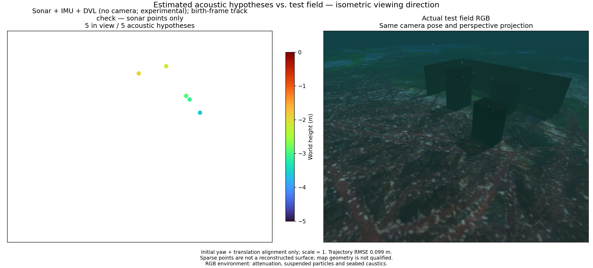
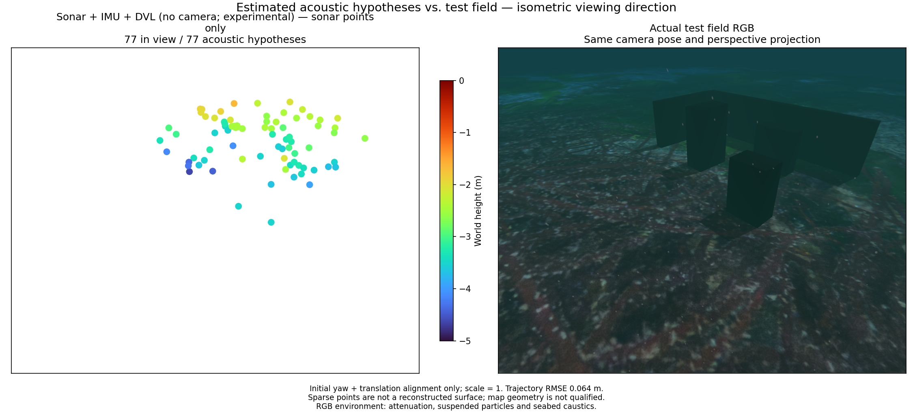
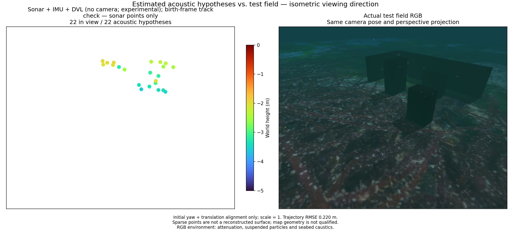

# Recorded sonar, IMU and DVL / 기록된 소나·IMU·DVL

[Metrics and provenance](sonar-dvl-recorded.json) · [Native method](../../native/basalt/README.md)

The camera-free estimator consumes simulated raw IMU, forward-looking sonar
range/bearing tracks and bottom-lock DVL velocity. The recording uses 2 Hz
sonar, 1 Hz DVL and approximately 100 Hz recorded IMU. The same 64.5-second
interval supplies 147 original-time states and 65 valid DVL measurements.
Pressure is recorded but not fused; no truth poses, terrain mesh, optical
pixels or point seeds enter the estimator.

The native backend is Basalt `0f3b2b52c807f70ff4e2973ce253c73329eea7bc` with
POSIM-SLAM native factors at `40891d40439a84c0b64f79d0511619ac1220c909`;
the acoustic frontend uses OpenCV 4.13.0. DVL uses the full reported covariance
and a calibrated rigid mount. Reported zero IMU covariance means unknown.
The explicitly assumed gyro model sigma is 0.01 rad/s; sonar sigmas are
0.02508354 m and 0.00821331 rad, with independent measurement errors. These
are diagnostic assumptions, not a hardware noise calibration.

| Same recording | Position RMSE | Attitude RMSE | Acoustic points | Within 10 cm of a surface |
|---|---:|---:|---:|---:|
| Sonar + IMU + DVL, chained intensity tracks | 0.735 m | 1.93° | 57 | 30 |
| Same sensors, birth-frame consistency check | 0.099 m | 3.43° | 5 | 4 |
| IMU + DVL, acoustic factors omitted | 0.449 m | 10.45° | — | — |
| Sonar + IMU, DVL omitted | Initialization fails | — | — | — |

All complete paths use initial yaw and translation alignment only, with scale
fixed at one and gravity-tilt error retained. The navigation ablation preserves
the event times and raw inputs, but omits acoustic optimizer observations; it
does not produce a SLAM map. The no-DVL run exhausts the bounded initialization
window after 61 emitted states, with no admitted acoustic tracks.

The birth-frame check compares chained optical flow with direct flow from the
first observation, using the existing 0.5-pixel consistency bound and maximum
eight observations. It improves this trajectory but discards most mapping
support. **Neither point cloud recovers the wall/block scene adequately.**
The default acoustic point surface-distance p90 is 0.749 m; the checked-track
variant has only five points. Filtering harder is not sufficient terrain SLAM.
These experiments do not qualify a new default or an application mode.

## Independent trajectory / 별도 경로

A separate recording changes mission depth from 1.5 to 1.8 m and outbound
distance from 5 to 4 m. Both methods retain their settings and process the same
67-second interval of this second recording. Ordinary tracking gives 0.063626 m
position RMSE, 0.950° attitude RMSE, 77 points, and 46 points within 10 cm of a
surface. The birth-frame check gives 0.220029 m, 5.752°, 22 points and 13 points
within 10 cm. The surface-distance p90 values are 0.344 m and 0.327 m. This is
a trajectory generalization check in the same simulated scene, not validation
across independent environments, sonar hardware or optical visibility.

The consistency check therefore has no established general advantage. Preserve
both outcomes and the default unchanged. Neither representation reconstructs
the scene; terrain/depth constraints and persistent physical region association
remain needed. Noise parameters are not retuned on this second recording.

별도 기록은 임무 깊이를 1.5 m에서 1.8 m로, 전진 거리를 5 m에서 4 m로 바꿉니다.
설정 변경 없이 같은 67초 구간을 재생하면 일반 추적은 위치 RMSE 0.063626 m,
자세 RMSE 0.950°, 77점 중 46점이 표면 10 cm 이내입니다. 첫 영상 대조는
각각 0.220029 m, 5.752°, 22점 중 13점입니다. 표면 거리 p90은 0.344 m와
0.327 m입니다. 같은 시뮬레이션 장면의 경로 일반화 시험이며 다른 환경·실물
소나·광학 가시거리 검증은 아닙니다. 두 번째 기록에서 잡음 계수를 조정하지
않았습니다. 일반적인 개선이 입증되지 않아 기본값을 유지합니다. 지형·깊이
제약과 물리적으로 지속되는 반사 영역의 대응이 여전히 필요합니다.

Both figures show the same isometric viewing direction and perspective.
Point diameter is four times the earlier small-marker setting; turbo colours
use fixed world heights −5 to 0 m. RGB includes attenuation, suspended particles,
seabed caustics and sea surface. The RGB reference is for evaluation only;
optical visibility at 2 m is not calibrated in this recording. No sea-trial,
full-map uncertainty, terrain-factor or pressure-factor result is claimed.

카메라 없는 추정기는 시뮬레이션의 원본 IMU, 전방 영상 소나의 거리·방위각
트랙과 바닥 잠금 DVL 속도를 사용합니다. 소나는 2 Hz, DVL은 1 Hz이며 기록된
IMU는 약 100 Hz입니다. 같은 64.5초 구간에서 원래 시각의 상태 147개와 유효한
DVL 관측 65개를 처리합니다. 수압은 기록만 하며 정답 자세·지형 메시·광학 영상·
점 초기값은 추정기에 들어가지 않습니다.

정확한 라이브러리 리비전과 잡음 가정은 위에 명시합니다. DVL의 전체 공분산과
장착 보정을 사용하며 IMU의 0 공분산은 미상으로 취급합니다. 자이로 0.01 rad/s와
소나 거리·방위각 표준편차는 진단용 가정이며 실물 센서의 보정값이 아닙니다.

표의 순서는 일반 소나·IMU·DVL, 첫 영상 대조를 추가한 같은 조합, 소나 제약을
뺀 IMU·DVL, DVL을 뺀 소나·IMU입니다. 위치 RMSE는 각각 0.735 m, 0.099 m,
0.449 m이며 마지막 경우는 상태 61개를 출력한 뒤 초기화 한도에서 실패합니다.
완료된 경로는 초기 yaw와 평행이동만 정렬하고 축척은 1로 고정합니다.
소나 제약을 뺀 대조군은 동일 시각과 입력을 유지하지만 SLAM 지도를 만들지 않습니다.

첫 영상 대조는 누적 광류와 첫 관측에서 직접 계산한 광류를 비교합니다.
기존 0.5픽셀 일관성 한도와 최대 8회 관측을 사용합니다. 경로 오차는 줄지만
점은 57개에서 5개로 감소합니다. **두 점군 모두 벽과 블록을 충분히 복원하지
못합니다.** 일반 추적의 표면 거리 p90은 0.749 m입니다. 더 강한 필터링만으로
지형 SLAM을 구현할 수 없으며 새 기본값이나 앱 모드의 합격 결과가 아닙니다.

비교 그림은 같은 등각 방향과 원근 투영을 사용합니다. 점 지름은 작은 표시의
4배이며 turbo 높이 범위는 −5~0 m로 고정합니다. RGB에는 수중 감쇠·입자·해저
집광무늬·수면이 포함됩니다. RGB는 평가용 참조이고 2 m 가시거리는 보정되지
않았습니다. 해상 실험, 전체 지도 불확실성, 지형·수압 제약은 별도 검증이 필요합니다.
