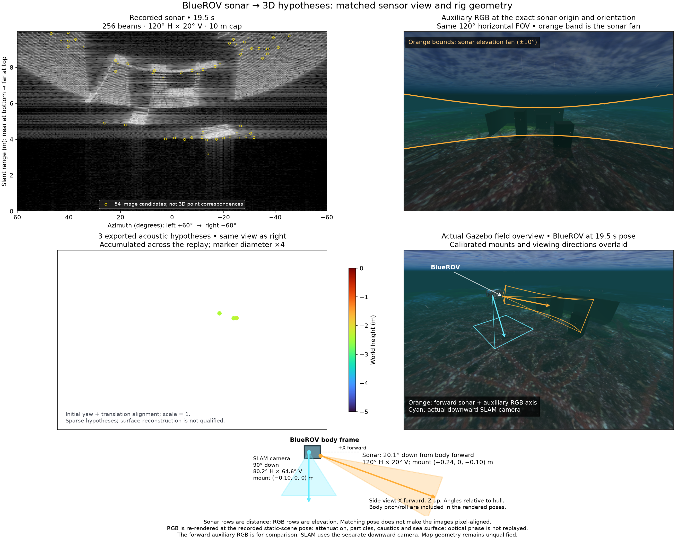
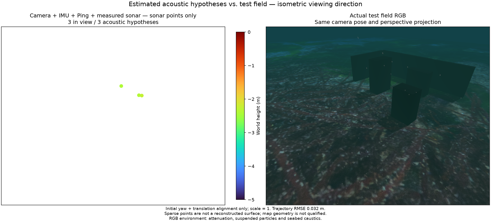

# Echo-boundary experiment / 에코 경계 실험

The [physical corner scene](sonar-corner-scene.md) provides three boxes and
two walls. The optional `AcousticTracks(frontend='echo_boundary')` frontend
uses median-filtered measured intensity, a positive range gradient, adjacent
beam support and excess over the same-range background. The same two-pixel
edge neighbourhood constrains corner seeds and retained LK tracks. A return
from shadow darkness to ordinary seabed brightness is excluded by the local
contrast requirement. No shadow height or elevation is assigned by this stage.

[실제 모서리 시험장](sonar-corner-scene.md)의 상자 세 개와 벽 두 개를 사용합니다.
실험용 추출기는 중앙값 필터, 거리 방향의 밝기 증가, 인접 빔의 연속성,
같은 거리의 배경 대비를 사용합니다. 특징점 선택과 LK 추적 유지에는 동일한
2픽셀 경계 주변을 허용합니다. 그림자 끝에서 평범한 해저 밝기로 회복하는 구간은
국소 대비 조건으로 제외합니다. 이 단계는 그림자로부터 높이나 고도각을 만들지 않습니다.

The caller supplies a ground-entry exclusion band. This replay obtains attitude
from an independent camera + IMU + single Ping replay of the same recording,
then uses exactly timestamped raw Ping, the minimum-ray model and sensor lever
arms. A locally horizontal seabed, ±0.15 m distance and ±5° normal bounds are
explicit diagnostic assumptions, not calibrated confidence intervals. A Ping
return from an object or a sloped seabed can invalidate them. The exclusion band
can also remove real object echoes at the same ranges. Missing exact states or
Ping reset tracking; this occurred on eight of 129 frames, including startup.
This is a two-pass offline experiment, not a live integrated method.

해저 시작 제외 구간은 외부에서 제공합니다. 같은 기록의 카메라·IMU·단일 Ping
기준 재생에서 추정 자세를 얻고, 정확히 같은 시각의 원본 Ping과 센서 장착 위치를
사용합니다. 국소 수평 해저, 거리 ±0.15 m·법선 ±5°는 실험 가정이며 보정된
신뢰구간이 아닙니다. 경사면이나 물체에서 돌아온 Ping은 가정을 깨뜨릴 수 있고,
같은 거리에 있는 실제 물체 에코도 제외될 수 있습니다. 정확한 시각의 상태나
Ping이 없으면 추적을 초기화합니다. 시작 구간을 포함해 129프레임 중 8개가
이에 해당합니다. 실시간 통합이 아닌 두 번의 오프라인 재생 실험입니다.

## Same-input comparison / 같은 입력 비교

All runs use 16 recent states, the same native executable and diagnostic sonar
noise as the corner-scene baseline. Simulator geometry is used only after
estimation for evaluation. The [evidence JSON](sonar-echo-boundaries.json)
preserves input, trace, implementation and output hashes.

모든 실험은 최근 상태 16개, 같은 네이티브 실행 파일과 같은 소나 잡음 가정을
사용합니다. 정답 형상은 추정 후 평가에만 사용합니다. 근거 JSON에 입력·추적·
구현·출력 해시를 보존합니다.

| Method / 방법 | Sonar points / 점 | Within 10 cm / 표면 10 cm 이내 | Median surface distance / 표면 거리 중앙값 | Position RMSE / 위치 RMSE |
|---|---:|---:|---:|---:|
| Existing intensity tracks / 기존 강도 추적 | 30 | 16 | 0.0817 m | 0.0328 m |
| Rising edges without local contrast / 국소 대비 없는 상승 경계 | 4 | 0 | 0.3579 m | 0.0315 m |
| Bright echo boundaries / 밝은 에코 경계 | 3 | 0 | 0.3096 m | 0.0321 m |

The point/RGB pair shares projection and scale; Turbo height limits remain
−5 to 0 m and marker diameter remains four times the initial plotting size.
RGB includes attenuation, particles, caustics and sea surface. The full replay
point cloud is not a depth conversion of the single illustrated sonar frame.

점군·RGB는 투영과 축척을 맞춥니다. Turbo 높이 범위는 −5~0 m이며 점 지름은
최초 표시의 4배입니다. RGB에는 감쇠·입자·집광무늬·수면 효과가 포함됩니다.
전체 재생의 점군이며, 표시한 소나 한 장을 깊이로 바꾼 결과가 아닙니다.

The experiment does not improve map quality and is not selected by default.
Synthetic tests verify gain invariance, shadow recovery exclusion, ground-band
censoring and known small translation; both research OpenCV 4.10 and native
OpenCV 4.13 pass. These tests do not validate real echo identity. The remaining
problem is associating the same physical scattering feature across views;
image-path consistency and positive brightness gradients are insufficient here.
Established boundary/sonar-motion research is discussed in
[the research notes](sonar-surface-research.md); this experiment establishes no novelty.

지도 품질은 개선되지 않아 기본 추출기로 채택하지 않습니다. 합성 시험의 밝기
변화·그림자 회복 제외·해저 구간 제외·작은 이동 추적은 OpenCV 4.10과
네이티브 OpenCV 4.13에서 통과했지만, 실제 에코 동일성을 입증하지 않습니다.
남은 핵심은 여러 시점에서 동일한 물리적 반사 특징을 연결하는 것입니다.
이 장면에서는 영상 추적의 일관성과 밝기 증가만으로 충분하지 않았습니다.
[관련 연구](sonar-surface-research.md)를 구분해 기록하며 신규성을 주장하지 않습니다.
