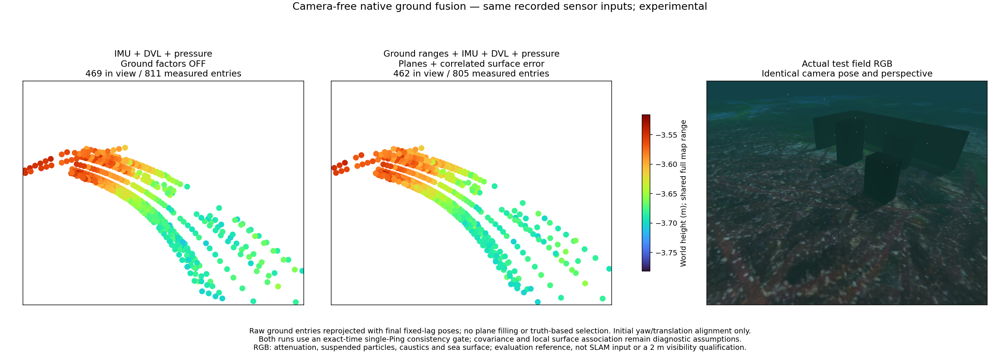
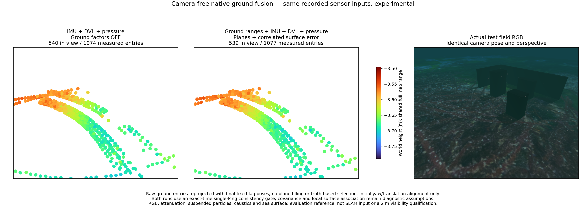
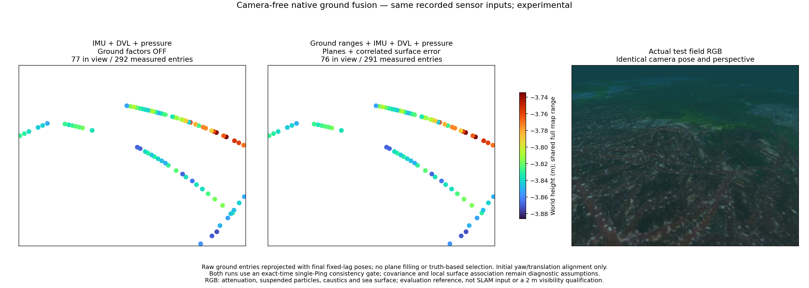
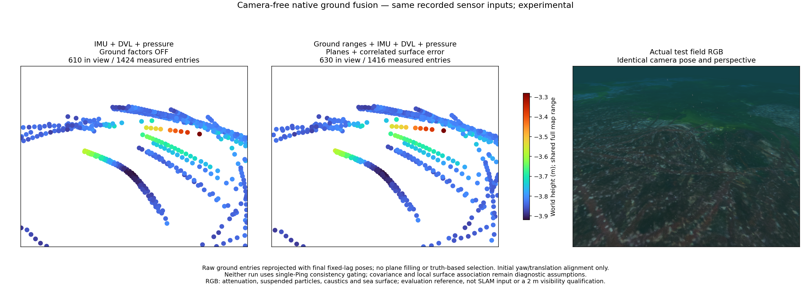

# Fresh acoustic captures and independent relief

Three isolated BlueROV captures use the exact acoustic range transform. Sixteen native replays produce eight matched control/ground comparisons. Every replay excludes RGB and collector poses from startup. **Ground fusion does not improve position RMSE in any comparison.** This is negative evidence for the current ground model, not evidence against all terrain-aided SLAM.

[Machine-readable measurements](sonar-exact-range-live.json) include final archived and online pose metrics. The table reports final archived position RMSE in meters, using initial yaw/translation alignment, fixed scale and retained gravity tilt. No trajectory-wide fit is used. Control uses IMU + DVL + pressure; Ground adds sonar ranges with the base covariance, and Spatial uses the spatial covariance. A/B contain corner objects.

| Case | Control | Ground | Spatial |
|---|---:|---:|---:|
| A | 0.0408 | 0.6118 | 0.1507 |
| B | 0.0200 | 0.2307 | 0.0381 |
| Relief + Ping check | 0.0689 | 0.0700 | 0.0694 |
| Relief, no check | 0.0689 | 0.2233 | 0.1685 |

All runs use the same corrected native worker and fixed observation settings. The spatial model retains the earlier 0.08 m amplitude / 2 m length; it is not retuned here. The control states are byte-identical across covariance choices and between relief gate settings. New recordings cannot isolate trajectory improvement over older sensor builds because motion and scheduling are not identical.

## What the comparison shows

The independent 60 × 60 m fixture contains two asymmetric hills and a shallow trough, with elevations from −3.922 to −3.200 m and maximum sampled slope 24.1°. No test bricks are added. The collision and visual terrain share the same numeric heightfield; no terrain map or simulator pose enters estimation. Acoustic reflectivity remains uniform.

With the Ping consistency check, only 7 of 40 fitted relief observations are eligible. Without it all 40 are eligible, but spatial-ground position RMSE worsens from 0.0694 to 0.1685 m. Removing the check is an ablation, not an adopted fix. A plane fitted across the sonar fan and extrapolated to the different Ping footprint is insufficient for curved terrain. These results do not isolate that assumption as the sole source of error.

The figures use the same isometric perspective for both point clouds and RGB, Turbo height colours, 10 cm voxels and 4× marker area. Points are first seabed-return entries under the aperture-boundary assumption, not complete terrain or obstacle reconstructions. Sparse return curves must not be presented as dense mapped surfaces. RGB is an evaluation reference with attenuation, particles, caustics and sea surface; it is excluded from all replays.

### A: corner objects

### B: corner objects

### Independent relief with Ping check

### Same relief without Ping check

Base-covariance figures: [A](../images/sonar-exact-live-a-plain.png), [B](../images/sonar-exact-live-b-plain.png), [relief with check](../images/sonar-exact-live-relief-plain.png), [relief without check](../images/sonar-exact-live-relief-no-ping-plain.png).

## Scope and next requirement

The simulator collector uses VIO for sensor collection and its own qualification. The separate estimator replays consume zero camera frames from initialization. This does not establish live camera-free application qualification or an optical visibility limit of 2 m. DVL dropout, reliable multi-view terrain association and loop closure remain unqualified. A map-free terrain model must preserve unobservable motion on flat or repeated terrain; simulator bathymetry cannot silently become an estimator prior.

The exact surface-distance evaluator now uses AABB branch-and-bound with unchanged point-to-triangle distances. Six completed baseline comparisons retain exactly the same metrics. A relief comparison that previously exceeded 120 seconds completes in about 5.4 seconds. This is evaluation engineering, not a SLAM accuracy improvement.

## 한국어

정확한 음향 거리 변환으로 BlueROV 이동 기록 세 개를 수집하고, RGB와 수집기 자세를 시작부터 제외한 네이티브 재생 16개로 대조군·해저 융합 비교 여덟 개를 만들었습니다. **어느 비교에서도 해저 융합이 위치 RMSE를 개선하지 못했습니다.** 표는 초기 방향·이동만 정렬하고 축척과 중력 기울기를 유지한 최종 보존 자세의 위치 RMSE(m)입니다. 온라인 지표도 JSON에 별도로 보존합니다. 이전 센서 빌드와 새 기록은 움직임·실행 시각이 달라 궤적 개선 효과를 직접 비교할 수 없습니다.

독립 시험 지형은 60 × 60 m에 비대칭 언덕 두 개와 얕은 골을 가지며, 높이는 −3.922~−3.200 m, 최대 표본 경사는 24.1°입니다. 벽돌을 추가하지 않았고 충돌·시각 메시가 같은 높이장을 사용합니다. 추정기에 지형 지도나 실제 위치를 입력하지 않습니다. 반사율은 균일합니다.

Ping 일치 검사를 사용하면 적합한 관측 40개 중 7개가 채택됩니다. 검사를 끄면 40개를 모두 쓰지만 공간 공분산 모델의 위치 RMSE가 0.0694 m에서 0.1685 m로 커집니다. 검사 해제는 원인 분리 실험이며 해결책으로 채택하지 않았습니다. 소나 부채꼴 전체를 평면으로 보고 다른 Ping 관측 영역까지 외삽하는 가정은 굴곡 지형에 충분하지 않습니다. 다만 이것만이 오차 원인이라고 단정할 수는 없습니다. 기존 공분산과 관측 설정은 유지했습니다.

그림의 두 점군과 RGB는 같은 등각 방향 원근 투영을 사용합니다. Turbo 높이 색상·10 cm 복셀·4배 점 면적을 적용합니다. 점은 수직 빔 경계 가정에 따른 해저 반사 시작점이며, 전체 지형이나 장애물 복원이 아닙니다. RGB는 감쇠·부유입자·집광무늬·수면이 있는 평가용 참조이고 재생 추정에는 입력하지 않습니다.

VIO를 사용하는 수집기와 카메라 없는 재생 추정기를 구분해야 합니다. 카메라 없는 실제 앱 운용, 가시거리 2 m 이하, DVL 손실, 안정적인 다중 시점 지형 대응과 루프 폐쇄는 아직 검증되지 않았습니다. 평탄하거나 반복되는 지형에서 관측할 수 없는 이동 방향을 유지해야 하며 시뮬레이터 해저 지도를 암묵적으로 입력해서는 안 됩니다.

표면 거리 평가는 정확한 삼각형 거리를 유지하는 AABB 탐색으로 개선했습니다. 기존 여섯 비교의 수치는 완전히 같으며, 120초를 넘겼던 굴곡 지형 비교는 약 5.4초에 끝납니다. 이는 평가 도구의 개선이지 SLAM 정확도 개선이 아닙니다.

[Supported local surfaces and elevation-arc diagnosis](sonar-terrain-support.md) / [국소 표면 지지와 수직각 진단](sonar-terrain-support.md).
