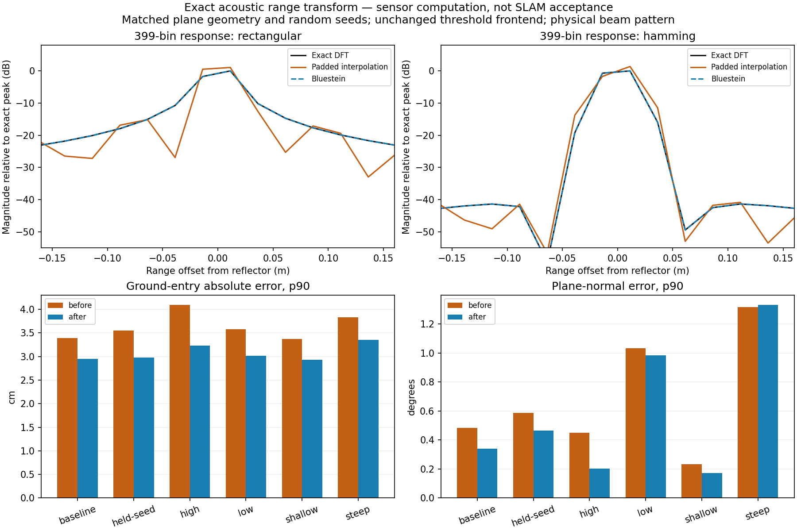

# Acoustic range transform / 음향 거리 변환

This paired simulator diagnostic isolates the range transform before the unchanged
SLAM ground frontend. Complex interpolation of a padded FFT does not equal the
DFT on the physical range grid. The exact transform uses radix-2 FFT for power-of-two
lengths, Bluestein convolution for other lengths up to 1024, and a direct DFT for
larger arbitrary lengths up to 4096. The 399-bin test uses Bluestein. This is a
sensor computation correction, not a new SLAM algorithm.

이 비교는 SLAM 해저 추출기 앞의 시뮬레이터 거리 변환만 분리합니다.
길이를 늘린 FFT의 복소 값을 보간한 결과는 실제 거리 격자의 DFT와 같지 않습니다.
정확한 변환은 2의 거듭제곱 길이에 radix-2 FFT, 그 밖의 1024 이하 길이에
Bluestein 합성곱, 더 큰 임의 길이에는 4096까지 직접 DFT를 사용합니다.
시험의 399빈에는 Bluestein을 사용합니다. 센서 계산 수정이며 새로운 SLAM 방법이 아닙니다.

[Measurements](sonar-exact-range.json): 36 native single-reflector responses agree
with NumPy's exact DFT within a maximum relative complex L2 error of 0.00284%.
Six plane conditions, two beam patterns and 24 frames each retain matched geometry,
random seeds and frontend settings. With beam mixing, ground-entry absolute-error
p90 improves from 3.37–4.10 cm to 2.93–3.35 cm. Steep-plane normal error p90
increases from 1.316° to 1.332°. These are sensor observations, not pose or map
accuracy. The figure profiles the unknown complex reflector coefficient.

[측정값](sonar-exact-range.json): 실제 단일 반사체 응답 36개와 NumPy의 정확한
DFT 간 상대 복소 L2 오차는 최대 0.00284%입니다. 여섯 평면 조건·두 빔 모델·각
24프레임의 기하·난수 시드·추출 설정을 유지했습니다. 빔 혼합 모델의 시작 거리
절대 오차 p90은 3.37–4.10 cm에서 2.93–3.35 cm로 줄었습니다. 급경사 법선 오차
p90은 1.316°에서 1.332°로 커졌습니다. 자세나 지도의 정확도가 아닌 센서
관측 결과입니다. 그림에서는 반사체의 미지 복소 계수를 적합했습니다.

The [earlier stationary evidence](sonar-ground-speckle.md) and recorded trajectory
failures remain valid for their original sensor builds. Recorded images are not
retroactively corrected. Moving-scene recapture, independent terrain, RGB visibility
≤2 m, absent-RGB startup and DVL dropout still require validation.

[기존 정지 시험](sonar-ground-speckle.md)과 기록 궤적의 실패는 당시 센서 빌드의
결과로 보존합니다. 기록 영상을 사후 수정하지 않습니다. 이동 장면의 새 기록,
독립 지형, RGB 가시거리 2 m 이하, RGB 없는 시작과 DVL 손실은 검증이 필요합니다.
