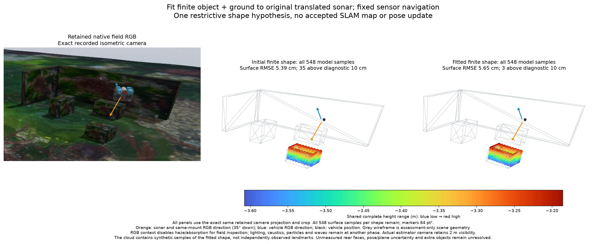
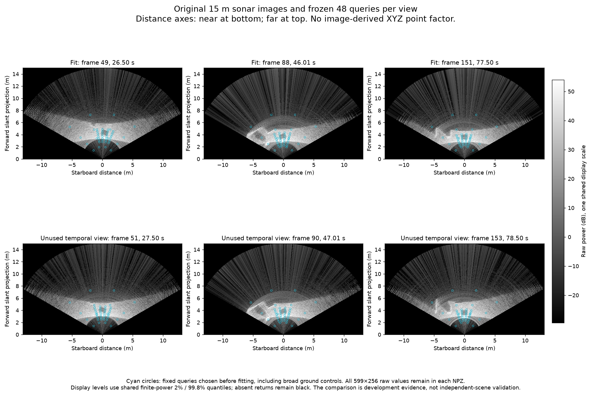

# Conditional finite-geometry fit on original sonar

[한국어](README.ko.md)



This fits geometry to original native sonar powers, using the existing source-
normal/Fourier observation model. It compares causal DVL planes, a shared plane
and one ground-supported opaque rectangular prism. The prism is a restrictive
shape hypothesis; its sampled surfaces are **not measured landmarks or an
accepted SLAM map**. Navigation is fixed and receives no acoustic update.

From initial to fitted prism, the composite mean-score sum falls from
**1086.626 to 1020.412** on the three fitting views and **1167.244 to 1152.789**
on three unused temporal views. Lower is better within these fixed queries;
these are not metre errors or calibrated likelihood-ratio statistics. Two of
the three unused views worsen individually. The causal/shared ground-only
scores are 1557.475/1144.620 for fitting and 1644.815/1557.370 for unused views.

Each shape emits all **548** fixed model surface samples. Complete nearest-
physical-surface RMSE changes **5.39 → 5.65 cm**, while the diagnostic count
above 10 cm changes 35 → 3. Against the assessment object's surface alone,
RMSE is **5.79 → 5.99 cm** and maximum distance **11.52 → 12.80 cm**. A lower
outlier count does not establish shape improvement. No zero-error requirement
or universal marine threshold is imposed. Full samples, including unseen rear
faces, remain in the [initial](initial_prism-complete.ply) and
[fitted](fitted_prism-complete.ply) PLYs. Walls and the seabed are not mapped.

## Inputs and frozen construction



The [protocol](protocol.json) predates fitting. From each of three fixed index
intervals, the available bright/shadow/recovery candidate count selects frames
49/88/151; temporal evaluation is +2 frames, 51/90/153. These already inspected
records are development data, not independent-scene validation. Every frame's
complete original 599×256 raw array and SHA-256 is retained. Query support is
frozen from the training seed's projection, plus broad ground controls: 48
pixels per view. Distance axes have near at bottom and far at top.

Only sensor-derived navigation, causal DVL plane means and training-view
angular-shadow candidates initialize the geometry. XY clustering retains both
clusters and all 73 candidates; the largest supplies the single-prism seed.
No scene mesh, pose truth, RGB, physical object dimensions or assessed point
array enters construction. The sealed result precedes separate assessment.

The bounded coordinate search recomputes first hits, source range-derived
normals and exact finite Fourier means at every candidate. It fits three plane
parameters, prism position/dimensions/height/yaw and one object/ground material
ratio. One positive common brightness gain is profiled per view. The final
ratio is 2.718; gain is not allowed to vary per pixel. Search bounds are
computational choices, not calibrated uncertainty or inferred object support.
Every accepted/rejected step and unavailable case remains in the trace.
One execution takes 301 s for 110 evaluation calls on this host; this offline
development run is not an operational performance claim.

Chunked exact means agree with the existing complete complex-covariance
operator at every final state. All selected powers, means and full correlated
covariances remain. The exponential marginal score is composite: fitting it
does not make pixels independent. Pose/plane uncertainty, inter-view shared
navigation error, extra objects/materials, unknown support and visibility
ambiguity remain outside this conditional fit. Initial/final box geometry and
all samples are kept even where their image contribution is small.

The global shared plane can absorb model error; better image score alone is
insufficient evidence for geometry. This bounded search does not prove a global
optimum or failure of acoustic rendering methods. Next, use the retained trace
and image residual support to examine geometry/material/ground confounding and
unresolved directions before selecting a richer surface family or native
factor. Joint uncertainty, independent scenes and actual DVL-loss/absence
navigation benefit remain admission gates. Do not convert these samples to
independent fixed XYZ measurements.

## Source and reproduction

[All current #6/#31–36 heads](source-pr-heads.json) are ancestors of separate
POSIM integration **ffecee9b**; the PRs remain open and unmerged. The profile is
15 m, 599 range bins, 256 beams and 256 vertical rays. The original inspection
mount is 35° down; it does not change the product default. IMU, pressure and DVL
are original streams; Ping is absent. No SDK, native factor, sensor physics,
noise, freshness or map-admission setting changes.

The comparison uses the exact retained isometric RGB camera projection and
crop, 64 pt² markers and one complete-height blue-to-red Turbo scale. RGB and
grey scene wireframes are assessment-only. The context render disables only
haze/absorption for inspection; lighting, caustics, particles and waves remain
at another phase. Actual estimator RGB retains 2 m visibility. Orange shows
sonar/same-mount RGB direction, blue vehicle RGB direction and black vehicle
position. No new field or renderer runs below the storage reserve.

With the public library's `research,diagnostics` dependencies:

```sh
python docs/diagnostics/sonar-finite-geometry-fit-20261031/verify.py
```

The verifier checks all original raw hashes, the construction seal, source
identities, every final correlated moment and score, complete sampled clouds,
all PLY points, and independent assessments. The source-normal power
reproduction budget matches the preceding native-power baseline (2e-7
relative); it is not map noise or acceptance. References are shared with the
preceding portable records, avoiding duplicate field/RGB/scene archives.

`fit.py prepare` accepts `--records` (the diagnostics parent) and `--raw` (the
original input directory), then `fit.py fit` executes the frozen fit. These
commands require a fresh output folder containing the producer and protocol;
the preserved trace prevents overwriting an attempted fit. `assess.py` and
`render.py` accept `--records` and run only after a construction seal exists.
`causal_plane_triangles` in the generic output is an unused seed-plane
placeholder; actual per-view causal geometry is encoded in `inputs.json` and
reconstructed separately. It is not the shared fitted plane.

Finite-ray rendering, shape priors, material profiling and coordinate search
are established ingredients, not a new research claim. Independent public
NumPy/SciPy code imports no WWW-POSIM implementation. Existing component and
third-party notices remain in force.

The initial Linux verifier rejected two recomputed triangle coordinates differing
by 2.22e-16 m because it used exact equality. Computed geometry now has a scaled
32-epsilon arithmetic budget; a one-nanometre negative control still fails.
Serialized raw/record hashes and PLY-versus-NPZ values remain exact. The
[original failure/control](floating-geometry-control.json) is preserved; no
sealed fit, scientific output, noise or map-admission threshold changes.
