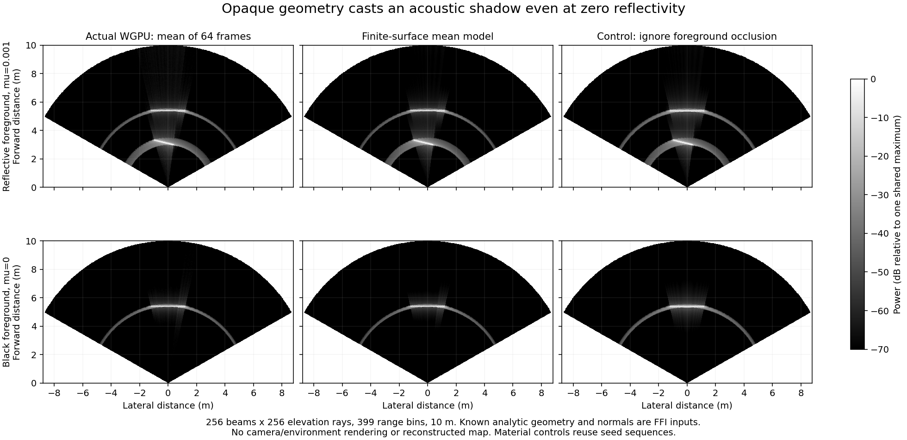

# Finite-surface acoustic power / 유한 표면 음향 전력



The experimental [surface model](../../src/posim_slam/sonar_surface_power.py) predicts ensemble-mean sonar power from finite opaque triangles, calibrated spherical rays and a fixed pose. Its output is an observation prediction. Geometry is supplied by the caller; it does not discover a scene or qualify a map.

Nearest intersections determine visibility before reflectivity is applied. A zero-reflectivity foreground still hides a rear surface. Per-ray power includes incidence squared, inverse-cube range attenuation, absorption, angular beam mixing and the periodic Hamming range response. Summing intercepted rays accounts for finite area and aperture clipping without replacing a per-ray exponent. Post-DFT frequency spacing is included in the power units.

The API supplies a reflectivity adjoint and a triangle-vertex adjoint for range, attenuation and normal changes. The vertex derivative applies within the current visibility/interpolation branch. It excludes silhouette and visibility-cut derivatives. Candidate geometry steps require fresh intersections and an actual objective check. Pose covariance, multiple paths, GPU rasterization and the plugin's local normal-estimation differences remain outside this conditional model.

The model requires NumPy. A BVH bounds geometry to 65,536 nondegenerate triangles and each query to 262,144 rays. Profile limits are 512 azimuth samples, 512 elevation samples and 1,024 native range bins; the response table is capped at 8,388,608 values. The 256×256-ray, 399-bin grouped profile stores 2.73 MB of response matrices. This counts stored arrays, not peak process memory.

## Actual backend control

[Recorded results](../data/sonar-surface-backend.json) use the matching WGPU C ABI, supplied analytic normals and known geometry. Each material case averages 64 frames. Material cases reuse seeds and are paired controls.

| Foreground | Measured/predicted total power | Mean-image relative L2 | Ignoring occlusion L2 |
|---|---:|---:|---:|
| Reflectivity 0.001 | 0.98551 | 0.07317 | 0.22493 |
| Reflectivity 0 | 1.00034 | 0.05512 | 1.03657 |

These are stochastic means, not a hardware calibration. The figure uses one shared intensity scale and shows no camera/environment rendering. With the `diagnostics` extra and a matching source-version library:

```sh
python tools/probe_sonar_surface_backend.py \
  --library /path/to/libmultibeam_sonar.dylib --output /tmp/surface-backend
```

## Conditional plane fixture

The [numeric fixture](../data/sonar-surface-fixture-inputs.npz) contains eight fixed poses and native-backend means of 32 frames per view. Seed/frame sequences are disjoint between views. Six views train; two are held out. Foreground YZ support and background geometry are known. The fit estimates foreground plane offset/slopes and two reflectivities. It uses no reference plane parameters.

```sh
python tools/fit_sonar_surface_fixture.py \
  --inputs docs/data/sonar-surface-fixture-inputs.npz --output /tmp/surface-fit
```

Both commands require new output paths. [Fit results](../data/sonar-surface-fit.json) give held-out power L2 0.08643, versus 0.08418 with reference geometry. [Separate fixture evaluation](../data/sonar-surface-fixture-reference.json) measures 3.18 mm maximum foreground-corner error. This is a known-support, averaged, fixed-pose calibration problem. It does not establish per-ping performance, unknown object support, navigation or real-map accuracy.

On the [actual deeper survey](sonar-forward-model.md), treating all 317 estimated cells as opaque cubes and refitting reflectivity gives held-out L2 0.77399, versus the directionless control's 0.76525. Geometry is frozen; 44 cells have no visible training rays. All geometry remains in that control, including zero fitted reflectivity. Adding occlusion to a frozen, unqualified shape does not fix it. Unknown geometry, visibility changes, speckle and joint pose uncertainty remain required for the operational mapper.

The physical rendering and optimization ingredients are established methods. [Westman et al.](https://www.cs.cmu.edu/~kaess/pub/Westman20icra.pdf) describe directionless volumetric albedo; [Qadri et al.](https://www.cs.cmu.edu/~kaess/pub/Qadri23icra.pdf) model surfaces through acoustic rendering. This NumPy implementation imports neither implementation and claims no new research method.

## 한국어

유한한 불투명 삼각형 표면, 구면 광선과 고정 자세로 소나 전력의 평균을 예측합니다. 입력 형상은 호출자가 제공합니다. 반사율을 적용하기 전에 가장 가까운 교차면으로 가림을 정하므로, 반사율이 0인 앞면도 뒷면을 가립니다. 입사각 제곱·거리 감쇠·흡수·빔 혼합·Hamming 거리 응답과 DFT 뒤 주파수 간격을 반영합니다. 면에 실제로 닿는 광선을 더하므로 유한 면적과 시야각 경계를 함께 처리합니다.

반사율 역연산과 삼각형 꼭짓점 미분을 제공합니다. 꼭짓점 미분은 거리·감쇠·법선 변화를 포함하지만 현재 가림 분기 안에서만 유효합니다. 실루엣과 가림 경계 미분은 제외합니다. 형상 후보마다 교차면과 실제 목적함수를 다시 계산해야 합니다. 자세 공분산·다중 경로·GPU 래스터화와 플러그인의 국소 법선 추정 차이는 이 조건부 모델에 포함하지 않습니다.

NumPy만 사용하는 모델은 삼각형 65,536개, 쿼리당 광선 262,144개로 제한합니다. 프로필 상한은 방위각 512개·고도각 512개·거리 빈 1,024개이며 응답 표는 8,388,608개 값까지입니다. 256×256 광선·399빈의 묶음 프로필은 응답 행렬 2.73 MB를 저장합니다. 프로세스 최대 메모리 수치는 아닙니다.

실제 WGPU에 알려진 형상과 해석적 법선을 주고 조건마다 64프레임을 평균합니다. 앞면 반사율 0.001/0의 전체 전력 비는 0.98551/1.00034, 영상 L2는 0.07317/0.05512입니다. 가림을 무시하면 0.22493/1.03657입니다. 두 조건은 같은 시드를 재사용합니다. 그림은 공통 밝기 척도이며 카메라 환경 렌더링이나 실제 장비 보정 결과가 아닙니다.

평면 수치 시험은 정확한 자세 8개에서 각각 32프레임을 평균합니다. 시점마다 시드·프레임 구간을 분리하고 6개로 학습, 2개로 평가합니다. 물체의 YZ 범위와 배경을 미리 주고 앞면 거리·기울기 및 두 반사율만 추정합니다. 정답 평면은 추정 입력에 없습니다. 미사용 영상 L2는 0.08643, 정답 형상 대조군은 0.08418이며 별도 평가의 모서리 최대 오차는 3.18 mm입니다. 단일 핑·미지 형상·항법·실제 지도 성능을 입증하는 시험은 아닙니다. 위 명령은 `diagnostics` 의존성과 새 출력 경로를 사용합니다.

실제 수심 관측의 317개 셀을 불투명 큐브로 고정하고 반사율만 다시 맞추면 미사용 영상 L2는 0.77399로, 기존 0.76525보다 나쁩니다. 44개 셀에는 보이는 학습 광선이 없습니다. 반사율이 0인 셀도 형상에서 제거하지 않습니다. 운영용 복원은 미지 형상·가림 변화·스펙클과 자세 불확실성을 함께 다뤄야 합니다. 표준 물리·최적화 방법을 독립 구현한 모델이며 연구 신규성을 주장하지 않습니다.
