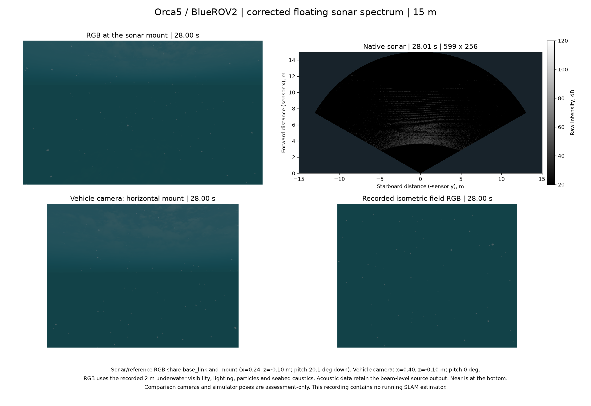

# 부동소수점 음향 스펙트럼과 새 Orca5 기준 기록

[English](README.md)

별도 POSIM 통합 `ffecee9b`에는 main `8c47601`, #6과 #31–36의 현재 커밋이 포함됩니다. 정확한 버전은 [소스 식별 정보](source-identity.json)에 있습니다. PR34 `801f8866`은 각 레이의 복소 진폭을 부동소수점으로 계산하고, 기존 다음 GPU 단계에서 주파수 성분을 합산합니다. 물리식, Philox 난수 계수, 창 함수, 빔 보정, 원래 길이의 변환, FFI와 GPU 네 단계는 유지합니다. 소스 PR은 논의를 위해 열려 있으며 #6이나 원격 main에 병합하지 않았습니다.

진폭 비례 회귀 검사는 이전 실제 커널에서 먼저 실패했습니다. 수정 소스는 Apple M3 Pro/Metal에서 선택 실행 GPU 검사를 포함한 Rust 전체 검사, 독립 DFT 72조건, 창 함수·빈 반사·복구 검사와 현재 커밋의 형식 CI를 통과합니다. 이는 수치 계산과 소스 검증입니다.

동일 입력의 256빔 × 수직 256레이 × 거리 599셀 비교 세 건에서 10–15 m 구간의 모든 셀을 유지했습니다. 부동소수점 기준 계산에 대한 전체 복소 출력 잔차는 최대 1.44e-5, 약한 원거리 성분의 잔차는 최대 0.00318입니다. [대표 프레임 전체](operator-frame20.npz)는 실제 출력의 complex64와 계산 기준의 complex128 정밀도를 보존합니다. [이전 정수 누적 기록](../sonar-range-response-20261030/README.ko.md)은 당시 소스·출력과 함께 유지됩니다.

예열 후 연산·읽기·복사·해제 16회의 로컬 중앙값은 5.95 ms입니다. 같은 고정 입력을 사용한 이전 바이너리의 별도 프로세스 측정은 10.58 ms입니다. 기존 운영 월드는 계속 실행했습니다. 이 값은 센서·렌더링 전체 처리율이 아닙니다. 변경하지 않은 #35 시험의 원본·미리보기 125쌍과 599셀 끝점 검사 18/18을 통과했고, 이전 598셀의 예상 실패 여섯 건도 보존했습니다. 첫 로더 사전 실행 실패는 외장 디스크에 남겨 두었습니다. 성공한 실행은 이미 검증한 Mac 로더·렌더 의존성 구성을 사용하며 설치 SDK를 변경하지 않습니다.

새 Orca5 기록에는 이 소스와 실제 로드한 두 플러그인을 사용했습니다. 소나 92프레임, 차량 RGB 231프레임, IMU 4,618개, 압력 461개, 원본·상태 DVL 각 46개를 기록했습니다. DVL은 모두 네 빔의 바닥 잠금 상태이며 단일 Ping은 실제 모델에서 제외했습니다. 계획상 최소 여유 거리 1.372 m로 임무를 완료했고, 소유한 프로세스 그룹 네 개가 정상 종료됐습니다. 원본 전체, 비교 실험과 실패 기록은 외장 디스크 한 곳에 유지합니다. 이 문서에는 전체 감사 결과와 원본 센서·시점 한 세트를 담습니다.

소나와 비교 RGB는 장착 위치·방향이 같으며, 92쌍 모두 시간차가 10 ms 이내입니다. RGB에는 가시거리 2 m의 수중 조명, 입자와 해저 집광무늬가 적용됩니다. 이 RGB에서는 먼 현장 구조가 구분되지 않으므로 영상만으로 지도 형상을 평가할 수 없습니다. 실제 차량 카메라는 수평, 소나·비교 RGB의 장착 각도는 아래로 20.1°입니다. 소나 그림은 거리를 축으로 사용하며 아래가 가까운 곳입니다. 기록용 앱 런타임은 이전의 깨끗한 고정본에서 검증 대상 소나 버전만 변경했습니다. 추정기는 실행하지 않았고, 기록 중 차량 제어는 시뮬레이션 외부 항법을 사용했습니다. 유용한 소나 지도, 자세·고도 관측 가능성, 실제 DVL 손실 시 효과와 설치형·플랫폼 검증은 남아 있습니다.

NumPy와 POSIM-SLAM 환경에서 `python verify.py`를 실행합니다. 게시 파일 전체 해시, 복소 출력 프레임 전체, 시간 통계, 감사 기록과 보존한 원본 예제를 검증합니다. 센서를 다시 수집하거나 게시하지 않은 원본 전체를 검사하지는 않습니다. `plot_field.py`는 원본 이미지에서 비교 그림을 다시 그립니다. `probe_native.py --binary LIBRARY --output NEW_DIRECTORY --save-full --benchmark 16`은 기록된 두 Mac 바이너리 중 하나로 공개 FFI 비교를 실행하며, 인접한 이전 기록의 고정 지오메트리를 사용합니다. 네이티브 실행에는 기록에 명시한 외부 의존성이 필요합니다. CPU/CUDA와 다른 GPU 플랫폼은 별도 실행 검증이 필요합니다.
