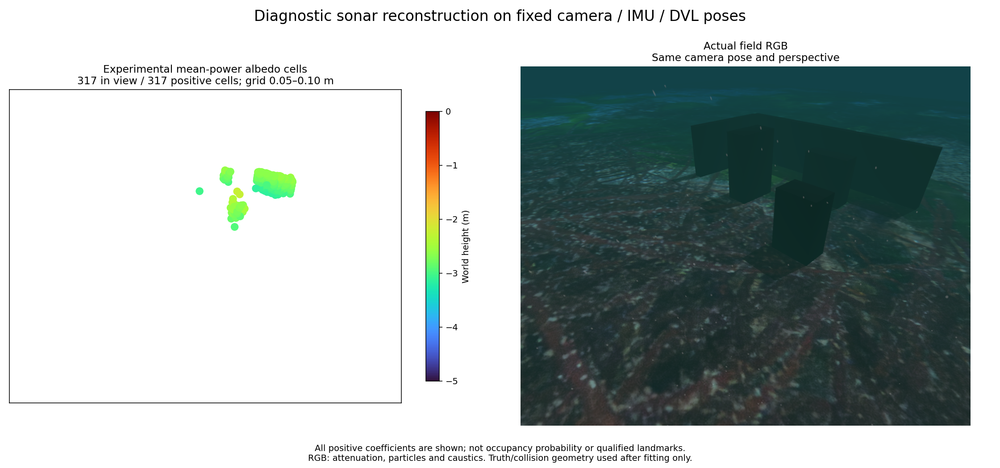
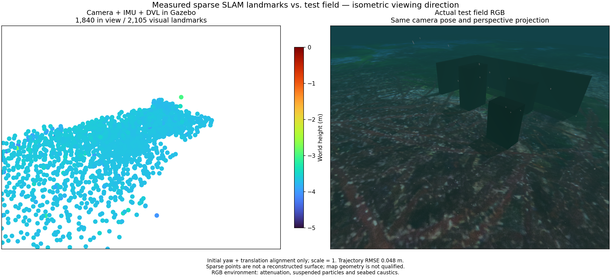

# Sonar source checks and multi-depth observation / 소나 계산과 여러 수심 관측



[Complete sonar candidate PLY](../data/sonar-deeper-survey.ply),
[measured-only input](../data/sonar-deeper-inputs.npz) and
[metrics/provenance](../data/sonar-deeper-summary.json).
Every positive cell is retained; the export declares map/navigation qualification false.

## Continuous range delay

The default volume diagnostic interpolates integer-bin Hamming power. The
optional `fractional-hamming` mode samples the known frequency window's full
periodic power response at eight sub-bins. This samples a known window transform,
not an interpolation of measured complex FFT output. The constructor also
supports four or sixteen sub-bins. Native range values must describe the source's
uniform grid within float32 encoding precision. Forward/adjoint and column-norm
checks use the same operator; the sensitivity calculation stores only the
required diagonal and adjacent products, avoiding a dense sub-bin Gram matrix.

Install `.[diagnostics]`, then run from the repository:

```sh
python tools/sonar_power_volume.py \
  --inputs docs/data/sonar-deeper-inputs.npz \
  --output /tmp/sonar-deeper --range-response fractional-hamming
```

The output path must be new. An explicit DFT checks 260 delays across all four
coarse-bin phases. Maximum grouped-power relative L2 error is 0.08818 for the
integer proxy and 0.00374 for eight sub-bins. The measured maximum native-bin
absolute power error is 0.004457, below the Taylor interpolation bound 0.004546.
These are normalized window-power errors, not map uncertainty or occupancy.
[Full samples](../data/sonar-fractional-response.json) retain every tested phase.

## Actual backend power

The independent [WGPU C-ABI probe](../../tools/probe_sonar_power_backend.py)
requires a library matching the selected POSIM `sonar_wgpu_compute` signature:

```sh
python tools/probe_sonar_power_backend.py \
  --library /path/to/sdk/www-posim/practice/sonar/install/lib/multibeam_sonar/libmultibeam_sonar.dylib \
  --output /tmp/sonar-power.json
```

The probe creates one known return, without Gazebo or a scene. It retains the
actual fixed-point quantization. Expected integrated power includes the backend's
post-DFT amplitude multiplier `bandwidth / native_bins`. Its square changes power
units and is constant for this profile. At 4/5.35/7.17 m, 64-frame mean-power
ratios are 0.9186/0.9188/0.9187. The ideal complex-Gaussian mean's 99% interval is
0.7074–1.3512. Distances reuse the same seeds; they are not independent trials.
Median normalized range-shape L2 errors are 0.00023/0.00034/0.00055.
[Actual library hash and results](../data/sonar-backend-power.json) identify this
SDK measurement; they do not calibrate a real Sonoptix device.

## Observation and geometry

The native 1.2/2.4 m survey keeps the estimator, world and mounts unchanged.
Its 5.5 m out/return route completes six submerged waypoints and surfacing, with
1.174 m minimum planned terrain clearance. Startup, worker recovery, HTTP export
and clean shutdown pass. Fixed navigation uses measured camera/IMU/DVL; pressure
selects immersed sonar samples and sonar does not produce these poses.
There are 300 evaluated states over 59.8 s and 16.995 m travel, with position
RMSE/max 0.04840/0.08857 m and attitude RMSE 1.235°. Initial yaw/translation alone
align the evaluation, with scale one. It is a separate asynchronous recording.

| Record depths, m / response / range proxy | Positive cells | Within 10 cm | Held-out power L2 | Median / p90 / max surface distance, m |
|---|---:|---:|---:|---|
| 0.6–1.2 / integer / per-ray `r^-3` | 2,910 | 1,826 | 0.64985 | 0.06860 / 0.25380 / 0.74590 |
| 0.6–1.2 / fractional / per-ray `r^-3` | 2,854 | 1,801 | 0.65171 | 0.06829 / 0.25380 / 0.74590 |
| 0.6–1.2 / fractional / area `r^-5` | 3,033 | 2,018 | 0.64344 | 0.05893 / 0.20380 / 0.82421 |
| 1.2–2.4 / integer / per-ray `r^-3` | 308 | 280 | 0.76891 | 0.04550 / 0.09811 / 0.15073 |
| 1.2–2.4 / fractional / per-ray `r^-3` | 317 | 288 | 0.76525 | 0.04550 / 0.09811 / 0.15073 |
| 1.2–2.4 / fractional / area `r^-5` | 335 | 290 | 0.76751 | 0.04807 / 0.10752 / 0.15461 |

The illustrated 317 candidates are 5–10 cm cells: 34/19/235 lie within 10 cm of
the three objects as their nearest surface; neither wall nor seabed has such
support. This is partial structure, with no certified feature identity or area
coverage. Range refinement alone does not fix geometry. More depth diversity
improves this sample's geometry while its power residual worsens; residual and
point count cannot be acceptance criteria. Both maps remain unqualified.

The fixed-area control follows projected ray density: a finite 1×0.4 m patch
over 2–8 m gives an effective exponent -4.931 when the per-ray `r^-3` response is
integrated. Surface normals and visibility also affect that measure. Replacing
the exponent alone worsens maximum map error in both records; the default is
unchanged. A surface model must account for incidence, visibility, speckle and
pose uncertainty together. These are established physical/statistical ingredients,
not a claimed research contribution.

An application-side oracle seals the old field before loading true geometry.
On the same fixed estimated poses, a known-scene mean with source normals gives
held-out L2 0.46786, versus 0.69752 with unit incidence. With true poses these are
0.42870/0.59458. Each uses one training-only scalar gain. Ideal intersections
exclude GPU rasterization, waves and vehicle geometry; some rays point upward.
This diagnostic identifies missing observation physics, not an operational map input.

## Visual control



[Complete visual PLY](../data/visual-deeper-survey.ply) retains 2,105 points:
1,987 within 10 cm, median/p90 0.02534/0.07896 m, maximum 1.34884 m. Object
counts within 10 cm are 11/4/3, with zero for both walls. This map also remains
unqualified. Both comparisons use the same actual camera pose/perspective,
Turbo -5..0 m and 64 pt² markers. RGB includes attenuation, particles and
seabed caustics. Truth is used after fitting only; no point is trimmed by it.

## 한국어

선택형 `fractional-hamming`은 알려진 주파수 창의 전체 주기 전력 응답을 거리 칸마다
8번 샘플링합니다. 생성자는 4·16배도 지원합니다. 측정한 복소 FFT 결과를 보간하는
방법과 구분합니다. 원본 거리는 float32 인코딩 정밀도 안에서 균일한 거리 격자와
맞아야 합니다. 정방향·역투영·열 정규화 시험을 통과하며 민감도 계산은 필요한 대각·
이웃 항만 저장합니다. 위 명령은 기존 `.[diagnostics]` 의존성과 새 출력 경로를 씁니다.
기본 정수 거리칸 근사는 유지합니다.

네 거리 묶음 위상의 지연 260개를 직접 DFT와 비교하면 묶은 전력의 최대 상대 L2
오차는 기존 0.08818, 8배 샘플 0.00374입니다. 원본 칸의 최대 절대 전력 오차
0.004457은 보간 상계 0.004546 이내입니다. 지도 불확실성이나 점유 확률이 아닙니다.
WGPU 탐침은 일치하는 C ABI의 라이브러리로 단일 반사점을 계산하며 Gazebo나 장면은
필요하지 않습니다. 실제 양자화와 DFT 뒤 `bandwidth / native_bins` 진폭 배율을
포함합니다. 4/5.35/7.17 m의 64프레임 평균 전력 비는 0.9186/0.9188/0.9187이며
이상적인 복소 가우시안 평균의 99% 구간은 0.7074~1.3512입니다. 거리마다 같은
시드를 재사용합니다. 거리 응답 형태의 중앙 L2 오차는 0.00023/0.00034/0.00055입니다.
실제 장비 보정은 아닙니다.

새 수심 1.2/2.4 m 시험은 추정기·월드·장착 자세를 유지합니다. 5.5 m 왕복 경로에서
수중 웨이포인트 6개와 부상을 완료했고 최소 계획 해저 여유는 1.174 m입니다.
기동·작업자 복구·HTTP 내보내기·정상 종료를 통과했습니다. 항법은 카메라·IMU·DVL을
쓰고, 수압은 잠긴 소나 관측 선택에만 씁니다. 소나는 이 자세를 추정하지 않습니다.
59.8초·16.995 m·300상태에서 위치 RMSE/최대는 0.04840/0.08857 m, 자세 RMSE는
1.235°입니다. 초기 방위·위치만 정렬하고 축척은 1입니다. 별도 비동기 실행입니다.

표는 양의 후보 셀 전체를 평가합니다. 그림의 317셀 중 세 물체에 가까운 셀은
34/19/235개이며 벽·해저는 없습니다. 셀 크기는 5~10 cm이고 표면 10 cm 밖에
29셀이 남습니다. 고유 랜드마크·복원 면적을 입증하지 않으며 지도는 미통과입니다.
이 기록은 형상이 좋아져도 전력 잔차는 더 큽니다. 거리 응답 정밀화만으로 문제가
해결되지는 않습니다. 1×0.4 m 고정 면을 2~8 m에서 검사하면 광선 밀도를 합친 감쇠
지수는 -4.931입니다. 그러나 입사각·가림 없이 지수만 바꾼 면적 대조군은 두 기록
모두 최대 형상 오차가 커져 기본값에 채택하지 않습니다. 입사각·가림·스펙클·자세
불확실성을 함께 다루는 표면 모델이 필요하며 학술적 새로움을 주장하지 않습니다.

정답 형상은 복원 결과를 봉인한 뒤 대조 계산에만 씁니다. 추정 자세를 고정한
알려진 장면의 검증 전력 L2는 법선 포함 0.46786, 입사각 1 가정 0.69752이며,
정답 자세에서는 0.42870/0.59458입니다. 학습 자료에서 정한 배율 하나만 사용합니다.
이상적인 교차 계산은 GPU 래스터·파도·차량 형상을 생략하고 위를 향하는 광선도
있습니다. 이를 운용 지도 입력으로 쓰지 않습니다.

시각 대조군은 2,105점 중 1,987점이 표면 10 cm 안이며 중앙/90백분위/최대 거리는
0.02534/0.07896/1.34884 m입니다. 물체별 근접 점은 11/4/3개, 벽은 없습니다.
시각 지도도 미통과입니다. 그림은 실제 같은 카메라 자세·원근, Turbo -5~0 m,
64 pt² 점을 쓰고 RGB에는 수중 감쇠·입자·해저 집광무늬가 포함됩니다.
정답으로 점을 제거하지 않습니다. 코드·색상표·이미지 고지는 [제3자 문서](../../THIRD_PARTY.md)를 따릅니다.
