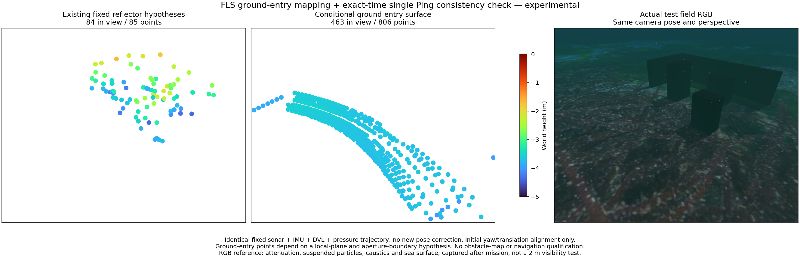
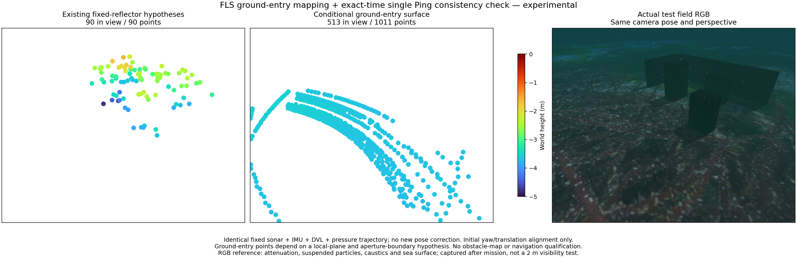
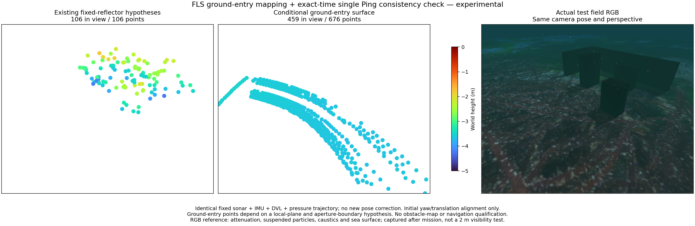
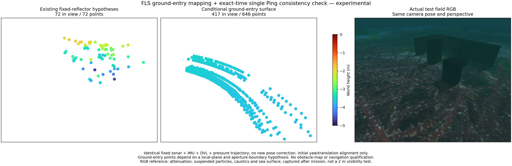
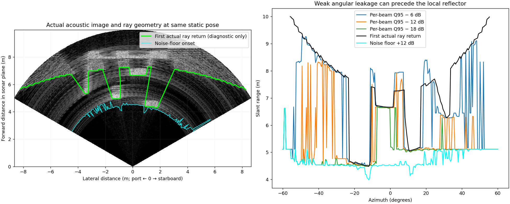

# Ground-entry surfaces / 해저 반사 시작점 표면

[Native protocol and paired replay](sonar-ground-live.md) / [네이티브 전송과 동일 입력 비교](sonar-ground-live.md)

`posim_slam.sonar_ground` is an experimental NumPy mapping frontend. It uses
raw FLS intensity, authored elevation aperture and estimated gravity. It fits
the changing first-return curve as a local surface instead of tracking that
curve as a set of fixed scatterers. No camera, prior terrain or simulator
geometry enters the fit. A separate experimental native transport couples these
raw ranges with poses and unknown planes; recorded accuracy is not qualified.

`posim_slam.sonar_ground`는 NumPy 기반 실험용 지도 추출기입니다. 원본 전방
소나 강도·설정된 수직 개구각·추정 중력 방향을 사용합니다. 관측 위치에 따라
변하는 반사 시작 곡선을 고정 반사점으로 추적하지 않고 국소 표면으로 맞춥니다.
카메라·사전 지형·시뮬레이터 형상은 적합에 입력하지 않습니다.
별도 실험용 네이티브 전송은 원래 거리를 자세·미지 평면과 공동 최적화하지만,
기록 기반 정확도는 아직 검증 기준을 통과하지 못했습니다.

## Observation model / 관측 모델

Median filtering and a 0.15 m sustained return locate intensity transitions.
An onset must exceed near-range median noise by 12 dB and lie within 6 dB of
the beam's own 95th-percentile return level. The latter rejects some angular
leakage from strong reflectors in other beams. It can also censor weak ground
under a stronger object; a surviving transition is not proven to be the physical
first arrival. The thresholds are explicit diagnostic assumptions, not CFAR
calibration or a hardware noise model.

중앙값 필터와 0.15 m 이상 이어지는 반사로 강도 전이를 찾습니다. 근거리
잡음 중앙값보다 12 dB 높고, 해당 빔의 강도 95백분위보다 6 dB 이내여야
합니다. 두 번째 조건은 다른 방위의 강한 반사가 약하게 번진 신호를 일부
제외합니다. 강한 물체 아래의 약한 해저 반사도 놓칠 수 있으므로 통과한 전이가
실제 첫 반사임을 보증하지 않습니다. 수치는 실험 가정이며 CFAR 보정이나
실제 센서 잡음 모델이 아닙니다.

The plane is `n·x = -h` in the sonar frame. At an aperture-boundary ray `u`,
the measured entry range satisfies `u·(n/h) = -1/r`. Deterministic RANSAC seeds
this inverse-range equation; refinement minimizes metric range residuals.
The fitted plane is checked against the analytic first intersection over the
**whole** elevation fan. Gravity and a 30° slope bound must identify the
downward aperture branch. The fit needs at least eight thinned beams, 45° of
angular extent and 60% consensus. Rays are sampled at least 2° apart, with a
3 × 0.03 m range-residual gate. These assumptions are bounded local planarity,
not a known horizontal floor. Surviving measured entries supply points;
no mesh is filled and points are not projected onto the fitted plane.

소나 좌표계 평면은 `n·x = -h`입니다. 개구 경계 광선 `u`와 시작 거리 `r`은
`u·(n/h) = -1/r`를 만족합니다. RANSAC으로 초기화한 뒤 미터 단위 거리 잔차를
줄이고, **전체** 수직 팬의 해석적 첫 교점과 맞는지 확인합니다. 중력과 30° 경사
한계로 하향 개구 경계를 구분할 수 있어야 합니다. 2° 이상 떨어진 빔에서 최소
8개·45° 범위·60% 합의를 요구하며 거리 잔차 한도는 `3 × 0.03 m`입니다.
이는 제한된 국소 평면 가정이며 알려진 수평 해저가 아닙니다. 통과한 관측만
점으로 변환하고 메시를 채우거나 점을 적합 평면으로 옮기지 않습니다.

An optional offline single-Ping check uses only an exact original timestamp,
calibrated mounts/bias and the nearest-ray plane prediction. Its 0.15 m residual
tolerance and 5 m maximum support extrapolation are explicit model bounds, not
measurement covariance or observed shared coverage. Missing/clipped Ping,
unsupported geometry and inconsistent ranges reject the patch. A curved bottom
or intervening object can invalidate the common-plane hypothesis. The check
does not add factors to the native optimizer. No new third-party dependency is
introduced; the Python component remains Apache-2.0.

선택형 오프라인 단일 Ping 검사는 원래 시각이 정확히 일치하는 관측, 보정된
장착·바이어스와 평면의 최소 광선 거리를 사용합니다. 잔차 0.15 m와 지지점에서
최대 5 m 외삽은 명시적 모델 한계이며 측정 공분산이나 관측된 공통 면적이
아닙니다. 누락·잘린 Ping, 성립하지 않는 기하와 불일치는 평면을 제외합니다.
굴곡진 해저나 중간 물체는 공통 평면 가정을 깨뜨릴 수 있습니다. 네이티브
최적화에 새 제약을 추가하지 않으며, 새 의존성 없이 Apache-2.0을 유지합니다.

## Joint range/plane factor / 거리·평면 공동 제약

`sonar_ground_joint.linearize_ground_patch` and native
`makeOwnedGroundGroup` supply raw range rows for poses and one unknown plane.
They reuse the existing rank-aware plane elimination, nonlinear trial and
marginal-prior machinery. The fitted normal and height initialize the plane;
they are not extra measurements. A supplied full covariance retains correlations
between beams and between frames. Each `(timestamp, beam ID)` remains distinct;
changed aperture branches reject the geometry rather than dropping residuals.
The native implementation uses Basalt's fixed-reference, left-rotation convention;
the NumPy reference uses right rotations and is cross-checked after conversion.

`sonar_ground_joint.linearize_ground_patch`와 네이티브 `makeOwnedGroundGroup`은
원래의 거리 관측으로 자세들과 하나의 미지 평면을 함께 제약합니다. 기존의
랭크 기반 평면 제거·비선형 시도·주변화 계산을 재사용합니다. 적합한 법선과
높이는 초기값이며 추가 측정값이 아닙니다. 전체 공분산으로 빔 사이와 프레임
사이의 상관관계를 유지합니다. 원래 시각과 빔 ID를 보존하고, 개구 경계가
달라지는 기하는 잔차를 버리는 대신 거부합니다. Basalt의 고정 기준점·좌측
회전과 NumPy의 우측 회전을 변환한 뒤 두 구현을 대조합니다.

Finite differences, correlated dense elimination and native marginalization
agree. A single view of a free plane adds no pose information. Three views of
one plane constrain only six of their 18 pose coordinates; plane-tangential
translation and rotation about the plane normal remain unobservable. A bounded
synthetic native optimization with an explicit pose prior reduces maximum
relative-height error from 9.09 cm to 4.50 cm. Its finite range noise and pose
prior leave a height/pitch tradeoff; this is not a millimetre-accuracy result.
No IMU observations are included in that isolated solver test.

유한 차분·상관관계를 포함한 전체 행렬 계산·네이티브 주변화가 일치합니다.
미지 평면의 단일 관측은 자세 정보를 추가하지 않습니다. 세 시점에서 같은
평면을 보아도 자세 자유도 18개 중 6개만 구속하며, 평면 방향 이동과 법선
주위 회전은 관측할 수 없습니다. 명시적 자세 사전분포를 둔 작은 합성 시험에서
최대 상대 고도 오차는 9.09 cm에서 4.50 cm로 감소합니다. 유한한 거리 잡음과
자세 사전분포 때문에 고도·피치 간 모호성이 남으며 mm 정확도 결과가 아닙니다.
이 독립 최적화 시험에는 IMU 관측을 넣지 않습니다.

The first eligible three-frame windows from A/B/C/D contain 138/150/136/140 raw
range rows. Native and NumPy reduced information matrices differ by at most
`3.5e-9`; all have pose rank six. These checks use explicit **uncalibrated**
individual/frame-common/time-common noise assumptions of 3/2/1 cm. Same-surface
association is also an assumption. They do not optimize those recorded poses
or improve the fixed-pose map scores below. The experimental native stream has
raw-IMU/DVL/pressure replay and bounded local patch association. Calibrated
acoustic uncertainty, reliable association and recorded accuracy remain required
before enabling this factor in an application mode.

A·B·C·D의 첫 적격 3프레임 구간은 각각 원래 거리 관측 138·150·136·140개입니다.
네이티브와 NumPy의 축소 정보행렬 차이는 최대 `3.5e-9`이고 자세 랭크는 모두
6입니다. 개별·프레임 공통·시간 공통 잡음을 각각 3·2·1 cm로 둔 **미보정 가정**과
동일 표면 가정을 사용합니다. 이 검사는 기록 자세를 최적화하거나 아래 지도
오차를 개선하지 않습니다. 실험용 네이티브 스트림은 원본 IMU·DVL·수압 공동
재생과 제한된 국소 표면 연결을 지원합니다. 앱 모드에는 음향 불확실성 보정·
신뢰할 수 있는 표면 연결·기록 기반 정확도 검증이 필요합니다.

## Recorded results / 기록 결과

[Metrics](sonar-ground-entry.json). C was used for development; A, B and D were
then processed with unchanged settings. All four come from the same simulated
terrain/target family, so they are not independent-world or hardware validation.
Native sonar + IMU + DVL + pressure poses are held fixed. Points keep the first
measurement per 10 cm local voxel. Alignment uses initial yaw/translation only,
scale 1. Distance is to the seabed, not to test obstacles or a coverage measure.

[수치](sonar-ground-entry.json). C에서 개발하고 A·B·D에는 같은 설정을 적용했습니다.
네 기록은 같은 시뮬레이션 지형·물체 계열이므로 다른 환경이나 하드웨어 검증은
아닙니다. 소나·IMU·DVL·수압의 네이티브 추정 자세를 고정하고 10 cm 로컬
복셀마다 첫 관측만 유지합니다. 초기 요각·이동만 정렬하며 축척은 1입니다.
오차는 해저까지의 거리이며 장애물 복원 오차나 면적 커버리지가 아닙니다.

| Record / 기록 | Emitted frames / 채택 프레임 | Points / 점 | Within 10 cm / 10 cm 이내 | Median / 중앙값 | p90 | Maximum / 최대 |
|---|---:|---:|---:|---:|---:|---:|
| A | 20 | 806 | 453 | 3.72 cm | 31.16 cm | 36.24 cm |
| B | 26 | 1,011 | 1,011 | 1.30 cm | 3.36 cm | 6.33 cm |
| C | 18 | 676 | 676 | 1.55 cm | 4.49 cm | 9.05 cm |
| D | 18 | 646 | 646 | 1.44 cm | 3.65 cm | 8.72 cm |

C with only a near-noise threshold emits 2,817 voxel points but has 1.62 m p90
error. Per-beam contrast reduces p90 to 5.06 cm, yet leaves three false patches
and maximum error 1.16 m. The Ping check rejects those patches, as well as some
valid patches and frames lacking an exact-time Ping. Point count alone is not
quality. Fitting/checking takes approximately 19 ms median and 20 ms p95 on this
Mac; this excludes file I/O, surface scoring, plotting and the native estimator.

C에서 근거리 잡음 기준만 사용하면 복셀 점 2,817개지만 p90 오차가 1.62 m입니다.
빔별 대비를 사용하면 p90은 5.06 cm로 줄어도 거짓 평면 세 개와 최대 1.16 m
오차가 남습니다. Ping 검사는 이 평면들과 일부 유효 평면·동일 시각 Ping이 없는
프레임을 제외합니다. 점 개수만으로 품질을 판단할 수 없습니다. 이 Mac에서
적합·검사는 중앙값 약 19 ms, p95 약 20 ms입니다. 파일 읽기·표면 평가·그림·
네이티브 추정기 시간은 제외한 수치입니다.

A still fails: its p90 is 31.16 cm. An **offline oracle-pose diagnostic**, keeping
the identical selected frames, beams and voxel representatives, reduces p90 to
2.44 cm and maximum to 7.36 cm. Truth never enters production estimation or
selection. This identifies pose error as an important remaining contributor;
it does not make the original map pass. Joint uncertain surface/pose estimation,
surface association and observability remain required. Flat planes cannot
resolve tangential translation or rotation about their normal.

A는 p90 31.16 cm로 여전히 실패합니다. 선택 프레임·빔·복셀 대표점을 그대로
유지하고 **오프라인 진단에서만 정답 자세**로 투영하면 p90 2.44 cm, 최대
7.36 cm로 줄어듭니다. 정답은 실제 추정이나 선택에 입력하지 않습니다. 자세
오차가 남은 주요 원인임을 보여주며 원래 지도를 합격시키지 않습니다. 불확실한
표면·자세의 공동 추정, 표면 연결과 관측 가능성 검사가 필요합니다. 평면은
면을 따라 이동하거나 법선 주위로 회전하는 움직임을 구분하지 못합니다.

## Matched views / 같은 시점 비교

Each triplet shows the existing acoustic hypotheses, the new conditional
seabed samples, and actual RGB with the identical isometric camera projection.
Turbo spans −5 to 0 m and marker area is 64 pt². RGB includes attenuation,
particles, caustics and sea surface. It is captured after the mission; 2 m
visibility and application-level live use of this surface method remain untested.

각 그림은 기존 음향 가설·조건부 해저 관측·실제 RGB를 같은 등각 방향 원근
투영으로 비교합니다. Turbo −5~0 m와 점 면적 64 pt²를 사용합니다. RGB에는
감쇠·입자·집광무늬·수면이 있으며 임무 뒤 촬영했습니다. 가시거리 2 m와 이
표면 방법의 앱 실시간 사용은 아직 검증하지 않았습니다.

The sensor diagnostic below compares actual ray geometry with acoustic onsets.
Sampled ray endpoints have surface-distance p90 2.00 cm; weak acoustic onsets
can precede the local geometric return by metres. Geometry is diagnostic only.

아래 센서 진단에서 표본 광선 끝점의 실제 표면 거리 p90은 2.00 cm이지만,
약한 음향 시작 신호는 해당 방위의 기하학적 반사보다 수 m 앞설 수 있습니다.
이 기하 정보는 진단에만 사용합니다.

RANSAC, adaptive contrast, plane geometry and range consistency are established
ingredients. This is not a novelty claim. A research contribution would require
calibrated multi-view surface likelihoods, uncertainty and degeneracy handling,
strong comparisons and independent turbid-water data. See
[terrain and shadow research](sonar-surface-research.md).

RANSAC·적응형 대비·평면 기하·거리 일치는 알려진 기법이며 신규성 주장 대상이
아닙니다. 연구 기여에는 보정된 다중 시점 표면 우도, 불확실성·퇴화 처리,
충분한 비교와 독립적인 탁수 자료가 필요합니다. [관련 연구](sonar-surface-research.md).
