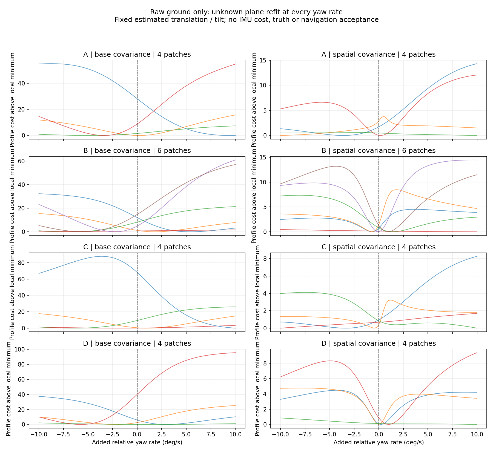

# Ground heading profile / 해저 관측의 방위각 비용

The diagnostic refits an unknown ground plane for each proposed relative yaw
rate. It shows whether raw range observations prefer an added turn before
IMU costs or marginalization are included. Estimated positions and roll/pitch,
selected beams, patch membership and range covariance stay fixed. It does not
supply corrections or readiness decisions to the estimator.

이 진단은 상대 방위각 변화율마다 미지 해저 평면을 다시 맞춥니다. IMU 비용이나
주변화를 포함하기 전에 원본 거리 관측이 추가 회전을 선호하는지 보여 줍니다.
추정 위치와 롤·피치, 선택한 빔, 평면 그룹과 거리 공분산은 고정합니다.
추정기에 보정값이나 준비 완료 판정을 전달하지 않습니다.

[Independent diagnostic code](../../src/posim_slam/ground_heading_profile.py) ·
[regressions](../../tests/test_ground_heading_profile.py) ·
[summary](sonar-ground-heading-profile.json).

[독립 진단 코드](../../src/posim_slam/ground_heading_profile.py) ·
[회귀 검사](../../tests/test_ground_heading_profile.py) ·
[요약 수치](sonar-ground-heading-profile.json).

Each curve is one shared local plane. The horizontal axis is an added yaw rate
from −10 to +10 degrees/s. The vertical axis is half the whitened squared range
error above that curve's lowest sampled, converged local solution. Zero means
the no-ground estimated trajectory. Colours distinguish patches only within
each recording; the two columns use different vertical scales. All four
recordings belong to the same terrain family. No reference pose, mesh or RGB
is read by the diagnostic.

각 곡선은 하나의 공유 국소 평면입니다. 가로축은 −10~+10°/s의 추가 방위각
변화율입니다. 세로축은 백색화한 거리 잔차 제곱합의 절반이며, 수렴한 탐색점 중
가장 작은 값을 뺍니다. 가로축 0은 해저 제약 없는 추정 궤적입니다. 색은 각 기록
안에서 평면을 구분하며 양쪽 열의 세로축 눈금은 다릅니다. 네 기록은 같은 지형
계열입니다. 진단은 정답 자세·지형 메시·RGB를 읽지 않습니다.

## Findings and limits / 결과와 한계

Eighteen patches produce 2,916 converged plane fits across two unchanged noise
models and 81 yaw rates. With the base 3/2/1 cm covariance, several patches
prefer added turns of several degrees/s. With the frozen spatial model
(0.08 m, 2 m), six of eighteen minima lie at the ±10 degrees/s search bounds;
those extrema do not identify a finite optimum. In C, the largest cost decrease
from zero is 68.28 with base covariance and 0.96 with spatial covariance.

평면 18개에 기존 두 오차 모델과 방위각 변화율 81개를 적용해 평면 적합
2,916개가 수렴했습니다. 기본 3·2·1 cm 공분산에서는 여러 평면이 수 °/s의
추가 회전을 선호합니다. 고정한 공간 모델(0.08 m, 2 m)에서는 18개 중 6개의
최솟값이 ±10°/s 탐색 경계에 있습니다. 이 값들은 유한한 최적점을 식별하지
못합니다. C에서 0 대비 가장 큰 비용 감소는 기본 공분산 68.28, 공간 공분산
0.96입니다.

This exposes a route to heading bias in the observation objective itself.
It does not prove the sole cause of recorded drift or exclude optimizer/prior
consistency errors. These conditional costs are not posterior uncertainty,
confidence intervals or a calibrated rejection threshold. Plane association
comes from the existing replay and final estimated poses are used offline.
The plane solver is local; no global optimum is asserted. Estimator settings
and recorded trajectories are unchanged. The mapping failure remains open.

관측 목적함수 자체가 방위각 편향을 유도할 수 있음을 보여 줍니다. 기록된
드리프트의 유일한 원인을 증명하거나 최적화·사전정보의 일관성 오류를 배제하지는
않습니다. 조건부 비용은 사후 불확실성·신뢰구간·보정된 거절 문턱이 아닙니다.
평면 연결은 기존 재생에서 가져오며 최종 추정 자세를 오프라인으로 사용합니다.
평면 최적화는 국소 계산이므로 전역 최적점을 주장하지 않습니다. 추정기 설정과
기록 궤적은 그대로이며 지도 정확도 문제는 미해결입니다.

Synthetic checks preserve the full flat-plane yaw freedom, recover an injected
3 degrees/s turn on a distinct slope, and preserve costs under a common world
yaw/translation. Sixteen selected evaluations match the actual native factor
cost within 8e-13. These checks validate the diagnostic calculation, not terrain
navigation or the sonar frontend. See [recorded mapping results](imu-initial-prior.md).

합성 검사는 수평면의 방위각 자유도를 보존하고, 구분되는 경사면에 넣은
3°/s 회전을 복원하며, 세계 좌표의 공통 회전·이동에도 비용이 같음을 확인합니다.
선택한 계산 16개는 실제 네이티브 제약 비용과 8e-13 이내로 일치합니다.
진단 계산을 검증한 결과이며 지형 항법이나 소나 관측 추출기의 검증은 아닙니다.
[기록 지도 결과](imu-initial-prior.md)를 참고하세요.
