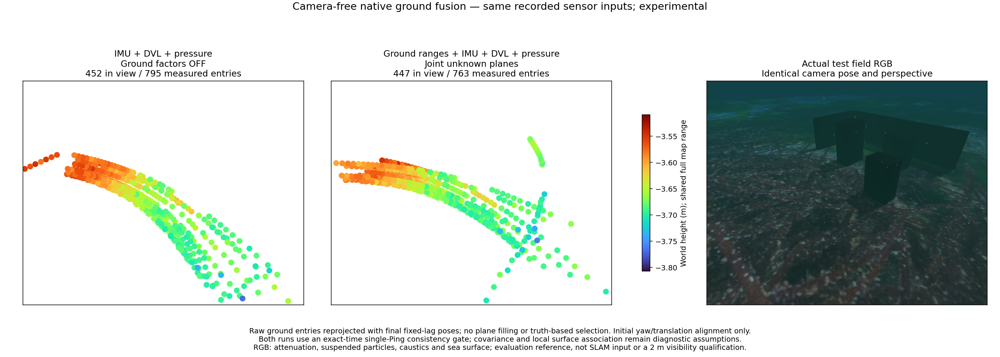
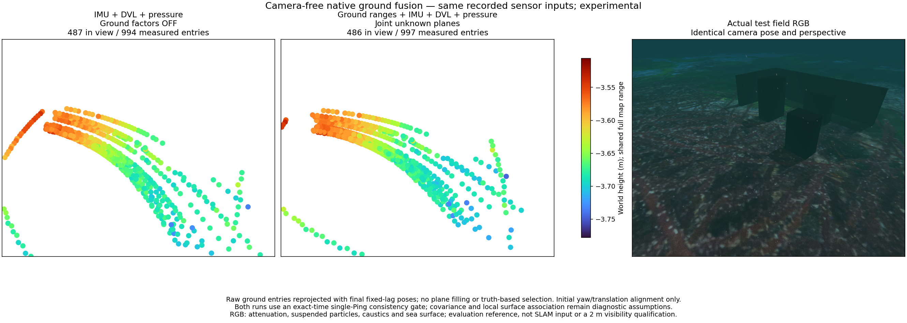
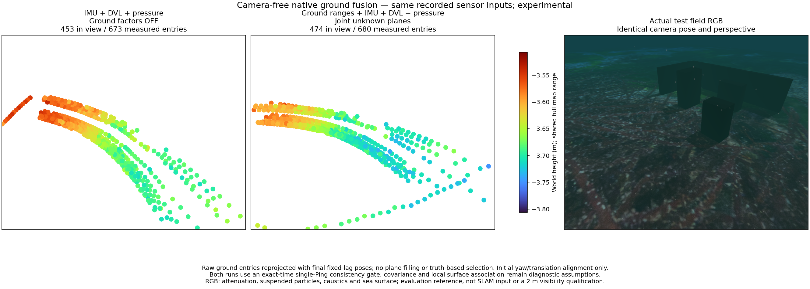
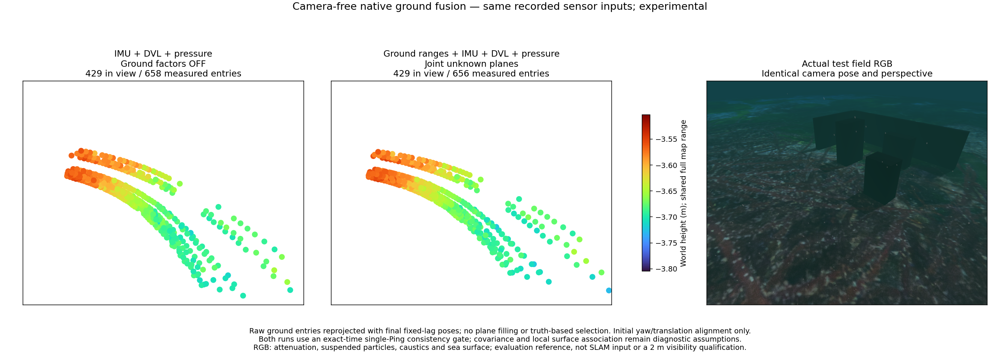

# Native ground fusion / 네이티브 해저 융합

The experimental native worker accepts original-time ground-entry ranges with
IMU, DVL and hydrostatic pressure. It jointly optimizes poses and unknown local
planes. **All four recorded trials worsen position error when ground factors
are added. This mode is not qualified for application use.**

실험용 네이티브 작업자는 원래 시각의 해저 진입 거리, IMU·DVL·정수압을 받아
자세와 미지 국소 평면을 공동 최적화합니다. **네 기록 모두 해저 제약을 추가하면
위치 오차가 커집니다. 앱 사용을 위한 검증 기준을 통과하지 못했습니다.**

Active ground rows use current geometry and the accumulated rotation-coordinate
Jacobians. [Linearization and numerical checks](sonar-ground-linearization.md).

활성 해저 제약은 현재 형상과 누적 회전 좌표의 야코비안을 사용합니다.
[선형화와 수치 검사](sonar-ground-linearization.md).

## Inputs and ownership / 입력과 관측 관리

`LiveClient.ground` negotiates `exact_beam_entries_v1` and submits a bounded
packet of beam IDs, angles and measured ranges. The fitted plane seeds an
unknown variable; it is not an extra measurement. `GroundFactorStore` reuses
the existing optimizer and marginalization. Groups retain at most eight frames
and 512 range rows; at most eight groups are active. Each range belongs to one
group and triggers optimization at its own sensor event, including events without DVL or pressure. Raw point-track factors from the same sonar stream are excluded.

`LiveClient.ground`는 `exact_beam_entries_v1`을 확인하고 빔 ID·각도·원래 거리를
제한된 패킷으로 전송합니다. 적합 평면은 미지수의 초기값이며 추가 관측이
아닙니다. `GroundFactorStore`는 기존 최적화·주변화를 재사용합니다. 그룹당
최대 8프레임·거리 행 512개, 동시 그룹 8개를 유지합니다. 각 거리는 한 그룹에만
속하고 DVL·수압 없이도 해당 센서 이벤트에서 최적화를 시작하며 같은 소나 스트림의 원본 점 추적 제약과 중복 반영하지 않습니다.

Local association requires overlapping measured footprints and consistent range
residuals. The diagnostic profile uses 0.75 m support, 2 s maximum age, 1.25 s
maximum gap and a [conditional predictive innovation test](sonar-ground-association.md)
with tail parameter five. Independent,
frame-common and time-common noise are assumed to be 3/2/1 cm. These are
uncalibrated hypotheses, not established acoustic uncertainty. The optional
exact-time single-Ping check only selects entries; it adds no native range factor.

국소 표면 연결은 관측 영역의 겹침과 거리 잔차 일치를 요구합니다. 진단 설정은
지지 반경 0.75 m, 최대 유지 2초, 최대 간격 1.25초,
[조건부 예측 오차 검사](sonar-ground-association.md)의 꼬리 계수 5를
사용합니다. 독립·프레임 공통·시간 공통 잡음을 3·2·1 cm로 가정합니다. 실제
음향 불확실성을 보정한 값이 아닙니다. 선택형 동일 시각 단일 Ping 검사는
관측 선택에만 쓰며 네이티브 거리 제약을 추가하지 않습니다.

## Matched recorded comparison / 동일 기록 비교

[Metrics](sonar-ground-live.json). Each pair uses identical inputs, native binary,
sensor event times and Ping selection settings, with no camera input. Selection
uses the preceding estimated attitude, not a future or reference pose. The
surface column compares identical raw beam/time entries in both runs. Initial
yaw/translation alignment and physical seabed distances are evaluated only after
estimation; scale is one. All recordings share a simulated terrain family.

[수치](sonar-ground-live.json). 각 쌍은 입력·네이티브 바이너리·센서 이벤트 시각·
Ping 선택 설정이 같고 카메라를 사용하지 않습니다. 관측 선택은 직전 추정
자세를 사용하며 미래 자세나 정답 자세를 쓰지 않습니다. 표면 열은 두 실행의
동일 빔·시각 관측을 비교합니다. 초기 방위각·이동 정렬과 실제 해저 거리는
추정 종료 후 평가하며 축척은 1입니다. 기록들은 같은 시뮬레이션 지형 계열입니다.

Values below are **control / joint ground**. Position error is online RMSE;
surface error is p90 distance to the seabed, not obstacle accuracy or coverage.

아래 값은 **대조군 / 해저 공동 추정** 순서입니다. 위치 오차는 온라인 RMSE,
표면 오차는 해저 거리 p90이며 장애물 정확도나 지도 면적 커버리지가 아닙니다.

| Record / 기록 | Position / 위치 (m) | Surface / 표면 (cm) |
| --- | ---: | ---: |
| A | 0.055 / 1.085 | 2.71 / 9.57 |
| B | 0.019 / 0.356 | 2.33 / 3.94 |
| C | 0.016 / 1.389 | 2.06 / 8.17 |
| D | 0.043 / 0.197 | 2.12 / 3.01 |

The control demonstrates useful conditional seabed samples from IMU/DVL/pressure
poses. It does not demonstrate terrain-aided localization, obstacle mapping or
camera-free navigation without DVL. A low seabed distance alone can hide wrong
horizontal motion on a flat surface. Ground factors need a better validated
surface/echo association and uncertainty model before adoption.

대조군은 IMU·DVL·수압 자세로 조건부 해저 점을 얻을 수 있음을 보여줍니다.
지형 보조 위치 추정·장애물 복원·DVL 없는 카메라 미사용 항법을 검증한 결과는
아닙니다. 평탄한 해저에서는 수평 이동이 틀려도 해저 거리 오차가 작을 수
있습니다. 해저 제약을 채택하려면 표면·반사 연결과 불확실성 모델을 개선하고
검증해야 합니다.

[Stationary acoustic diagnostics](sonar-ground-speckle.md) isolate onset and
plane-normal errors before changing estimator weights.
[정지 음향 진단](sonar-ground-speckle.md)은 추정기 가중치를 바꾸기 전에 반사 시작점과
평면 법선의 오차를 분리합니다.

The [IMU interval correction](imu-interval-noise.md) removes a separate
single-sample covariance failure. In the no-ground C control, online position
RMSE changes from 0.314 m to 0.016 m, and final owned-pose RMSE from 326.53 m
to 0.016 m. This is a common integration correction, not evidence of ground
fusion effectiveness. Synthetic tests and recorded accuracy are separate gates.

[IMU 구간 수정](imu-interval-noise.md)은 별개의 단일 샘플 공분산 오류를
해결합니다. 해저 제약 없는 C 대조군의 온라인 위치 RMSE는 0.314 m에서
0.016 m로, 최종 보유 자세 RMSE는 326.53 m에서 0.016 m로 줄어듭니다.
이는 공통 적분 수정의 결과이며 해저 융합의 효과가 아닙니다. 합성 검사와
기록 기반 정확도는 별도 기준입니다.

## Matched views / 같은 시점 비교

The measured aperture-boundary points use final owned poses, 10 cm voxels,
64 pt² markers and a shared Turbo height range. The RGB reference shares the
camera pose and perspective, with attenuation, particles, caustics and sea
surface. No mesh is filled. RGB is captured after the mission; explicit 2 m
visibility, live application use and independent worlds remain unqualified.

관측한 개구 경계 점은 최종 보유 자세·10 cm 복셀·점 면적 64 pt²·공통 Turbo
높이 범위를 사용합니다. RGB와 카메라 위치·원근이 같으며 감쇠·입자·집광무늬·
수면 효과를 포함합니다. 메시를 채우지 않습니다. RGB는 임무 후 촬영했으며,
명시적인 가시거리 2 m·앱 실시간 사용·독립 환경은 아직 검증하지 않았습니다.

