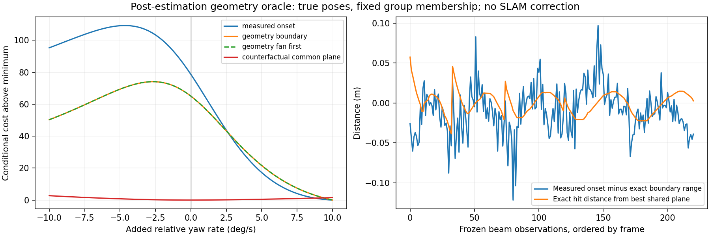

# Moving ground-plane comparison / 이동 중 해저 평면 비교

A camera-free 54 s recorded comparison uses identical IMU, measured DVL and pressure inputs. Adding unknown ground-plane factors increases online position RMSE from 0.05811 m to 0.68783 m. Alignment uses initial yaw and translation only, with scale fixed at one. The control has 1,361 voxel entries, 1,313 within 10 cm of the seabed; fusion has 1,340 entries, 1,258 within 10 cm. These distances exclude obstacle surfaces. The XYZ entries assume aperture-boundary elevation; they are not independent elevation measurements or a qualified 3D map.

Eight native multi-frame groups are evaluated with frozen no-ground translation/tilt and a refitted plane at each trial relative yaw rate. The dominant group prefers the +10 degrees/s search boundary over zero, reducing conditional cost by 69.9924. This excludes IMU/DVL/pressure costs and is not a posterior or proposed correction. Python/native costs agree within 3.5e-13 at the checked zero/best points of that group. The illustrative spatial covariance weakens the preference but is not a calibrated remedy. No production threshold is changed.

Footprint overlap and range innovation alone do not establish a shared physical plane. Terrain curvature, echo onset and aperture assumptions need separate held-out-view tests. Nearby seabed points and low residuals cannot justify a navigation update. RGB shows attenuation, suspended particles, caustics and sea surface; it shares the map camera pose and projection. Both point panels use a common Turbo scale and marker area 64 pt².

## 한국어

카메라를 사용하지 않은 동일한 54초 기록에서 IMU·실측 DVL·수압 입력을 비교했습니다. 미지의 해저 평면 제약을 추가하면 온라인 위치 RMSE가 0.05811 m에서 0.68783 m로 증가합니다. 초기 방위각과 위치만 정렬하고 축척은 1로 유지했습니다. 기준 결과의 1,361점 중 1,313점, 융합 결과의 1,340점 중 1,258점이 해저 10 cm 이내입니다. 장애물 표면은 이 평가에 포함되지 않습니다. 점의 높이는 빔 수직 경계 가정에 따른 값으로, 독립적인 고도 측정이나 검증된 3차원 지도가 아닙니다.

기준 궤적의 위치·기울기를 고정하고 매 회전율에서 평면을 다시 맞춰 8개 관측 묶음을 검사했습니다. 가장 큰 비용 차이를 보인 묶음은 회전을 추가하지 않은 경우보다 탐색 경계인 초당 +10°를 선호하며 조건부 비용이 69.9924 감소했습니다. 다른 센서의 비용이 빠진 진단이므로 사후 불확실성이나 보정 명령으로 사용할 수 없습니다. 해당 묶음의 0 및 최소 비용 지점에서 Python과 네이티브 계산은 3.5e-13 이내로 일치했습니다. 예시 공간 공분산은 편향의 영향을 줄이지만 검증된 해결책은 아닙니다. 제품 임계값은 바꾸지 않았습니다.

반사 지점의 겹침과 거리 잔차만으로 동일한 실제 평면임을 보장할 수 없습니다. 지형 곡률·반사 시작점·빔 경계 가정을 분리해 다른 시점의 관측으로 검증해야 합니다. RGB에는 수중 감쇠·입자·해저 집광무늬·수면이 포함됩니다. 지도와 RGB는 같은 카메라 위치·투영을 사용하며 두 점군의 Turbo 범위와 점 면적 64 pt²도 같습니다.

## Geometry counterfactual / 기하 대조 실험

For the dominant native group, five frames contain 221 frozen observations. A post-estimation oracle uses true poses and the seabed/target collision meshes with 256 vertical rays. All first hits are on the terrain at the selected aperture boundary. Exact geometric ranges still favor the +10 degrees/s search boundary, reducing conditional cost by 65.0549 relative to zero. Replacing the geometry with one common plane gives a minimum at zero. The actual hit points have 0.01435 m RMS departure from their best plane. Thus local nonplanarity is sufficient to cause this group's bias; onset noise and pose error are not required. This does not validate a replacement estimator. No simulator geometry or true pose enters SLAM. The oracle excludes sea surface, vehicle geometry and acoustic amplitude/noise.

가장 큰 편향을 보인 묶음의 5개 프레임·221개 관측을 고정하고, 추정 종료 후 정답 자세와 해저·시험 물체의 충돌 형상을 사용해 수직 빔 256개를 검사했습니다. 모든 최초 교차는 선택한 빔 경계의 해저 지점이었습니다. 정확한 기하 거리를 넣어도 초당 +10° 탐색 경계를 선호하며 0° 대비 조건부 비용이 65.0549 감소했습니다. 반면 공통 평면의 거리로 바꾸면 추가 회전 0°가 최적입니다. 실제 교차점은 가장 잘 맞는 평면에서 RMS 0.01435 m 벗어납니다. 이 묶음에서는 작은 해저 굴곡만으로도 편향이 발생하며, 반사 잡음이나 자세 오차가 필수 원인은 아닙니다. 대체 추정기의 성능은 아직 검증되지 않았습니다. 정답 자세·형상은 SLAM 입력에 사용하지 않으며 이 진단의 기하에는 수면·차량·음향 세기 및 잡음이 포함되지 않습니다.

## Held-out curved-surface prediction / 곡면의 미사용 프레임 예측

A separate diagnostic fits unknown local planes and quadratic height surfaces through first returns over 256 vertical rays, using frozen no-ground estimated poses and measured ranges only. One complete frame is withheld per fit. Planes converge in 34/34 folds and quadratics in 33/34. On 33 paired folds (1,461 ranges), held-out range RMSE is 0.05459 m for planes and 0.10599 m for quadratics. The two-frame group leaves only one training curve; one quadratic prediction errs by 0.654 m RMS and the other fit fails convergence. Several groups improve, but curvature alone is not a validated replacement. The failure remains included in coverage reporting. These are conditional prediction results, not navigation or map acceptance. Two analytic checks pass for unseen-frame prediction of an exact quadratic and explicit rejection of rank-deficient support. Predictive uncertainty and spatial support remain to be validated; no new product mode is enabled.

별도 진단에서 정답 형상 없이 실측 거리와 기준 추정 자세만 사용해 국소 평면·2차 높이 곡면을 맞췄습니다. 수직 빔 256개 중 최초 교차를 예측하며, 매번 프레임 하나를 학습에서 제외했습니다. 평면은 34개 모두, 곡면은 33개에서 수렴했습니다. 공통으로 유효한 33개 실험·1,461개 거리에서 미사용 프레임의 예측 RMSE는 평면 0.05459 m, 곡면 0.10599 m였습니다. 프레임이 두 개인 묶음은 학습에 곡선 하나만 남아 한 곡면 예측에서 0.654 m 오차가 발생했고 다른 실험은 수렴하지 못했습니다. 일부 묶음은 개선되지만 곡률 추가만으로 해결됐다고 할 수 없습니다. 실패를 관측 범위 보고에서 제외하지 않았으며, 이는 항법·지도 성능 인증이 아닙니다. 정확한 곡면의 새 프레임 예측과 계수 추정이 불가능한 관측의 명시적 거부를 확인하는 해석적 검사 두 개가 통과했습니다. 예측 불확실성과 공간적 관측 범위 검증이 남아 있으며 제품 모드는 추가하지 않았습니다.
