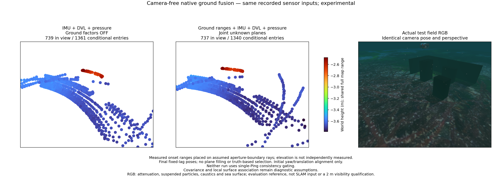
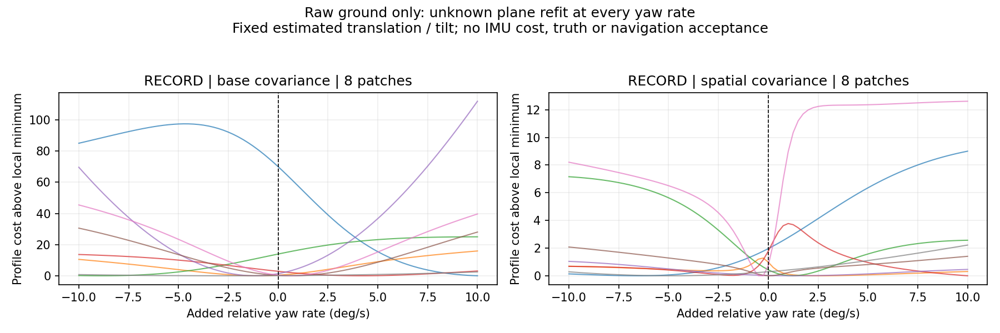

# Moving ground-plane comparison / 이동 중 해저 평면 비교

A camera-free 54 s recorded comparison uses identical IMU, measured DVL and pressure inputs. Adding unknown ground-plane factors increases online position RMSE from 0.05811 m to 0.68783 m. Alignment uses initial yaw and translation only, with scale fixed at one. The control has 1,361 voxel entries, 1,313 within 10 cm of the seabed; fusion has 1,340 entries, 1,258 within 10 cm. These distances exclude obstacle surfaces. The XYZ entries assume aperture-boundary elevation; they are not independent elevation measurements or a qualified 3D map.

Eight native multi-frame groups are evaluated with frozen no-ground translation/tilt and a refitted plane at each trial relative yaw rate. The dominant group prefers the +10 degrees/s search boundary over zero, reducing conditional cost by 69.9924. This excludes IMU/DVL/pressure costs and is not a posterior or proposed correction. Python/native costs agree within 3.5e-13 at the checked zero/best points of that group. The illustrative spatial covariance weakens the preference but is not a calibrated remedy. No production threshold is changed.

Footprint overlap and range innovation alone do not establish a shared physical plane. Terrain curvature, echo onset and aperture assumptions need separate held-out-view tests. Nearby seabed points and low residuals cannot justify a navigation update. RGB shows attenuation, suspended particles, caustics and sea surface; it shares the map camera pose and projection. Both point panels use a common Turbo scale and marker area 64 pt².

## 한국어

카메라를 사용하지 않은 동일한 54초 기록에서 IMU·실측 DVL·수압 입력을 비교했습니다. 미지의 해저 평면 제약을 추가하면 온라인 위치 RMSE가 0.05811 m에서 0.68783 m로 증가합니다. 초기 방위각과 위치만 정렬하고 축척은 1로 유지했습니다. 기준 결과의 1,361점 중 1,313점, 융합 결과의 1,340점 중 1,258점이 해저 10 cm 이내입니다. 장애물 표면은 이 평가에 포함되지 않습니다. 점의 높이는 빔 수직 경계 가정에 따른 값으로, 독립적인 고도 측정이나 검증된 3차원 지도가 아닙니다.

기준 궤적의 위치·기울기를 고정하고 매 회전율에서 평면을 다시 맞춰 8개 관측 묶음을 검사했습니다. 가장 큰 비용 차이를 보인 묶음은 회전을 추가하지 않은 경우보다 탐색 경계인 초당 +10°를 선호하며 조건부 비용이 69.9924 감소했습니다. 다른 센서의 비용이 빠진 진단이므로 사후 불확실성이나 보정 명령으로 사용할 수 없습니다. 해당 묶음의 0 및 최소 비용 지점에서 Python과 네이티브 계산은 3.5e-13 이내로 일치했습니다. 예시 공간 공분산은 편향의 영향을 줄이지만 검증된 해결책은 아닙니다. 제품 임계값은 바꾸지 않았습니다.

반사 지점의 겹침과 거리 잔차만으로 동일한 실제 평면임을 보장할 수 없습니다. 지형 곡률·반사 시작점·빔 경계 가정을 분리해 다른 시점의 관측으로 검증해야 합니다. RGB에는 수중 감쇠·입자·해저 집광무늬·수면이 포함됩니다. 지도와 RGB는 같은 카메라 위치·투영을 사용하며 두 점군의 Turbo 범위와 점 면적 64 pt²도 같습니다.
